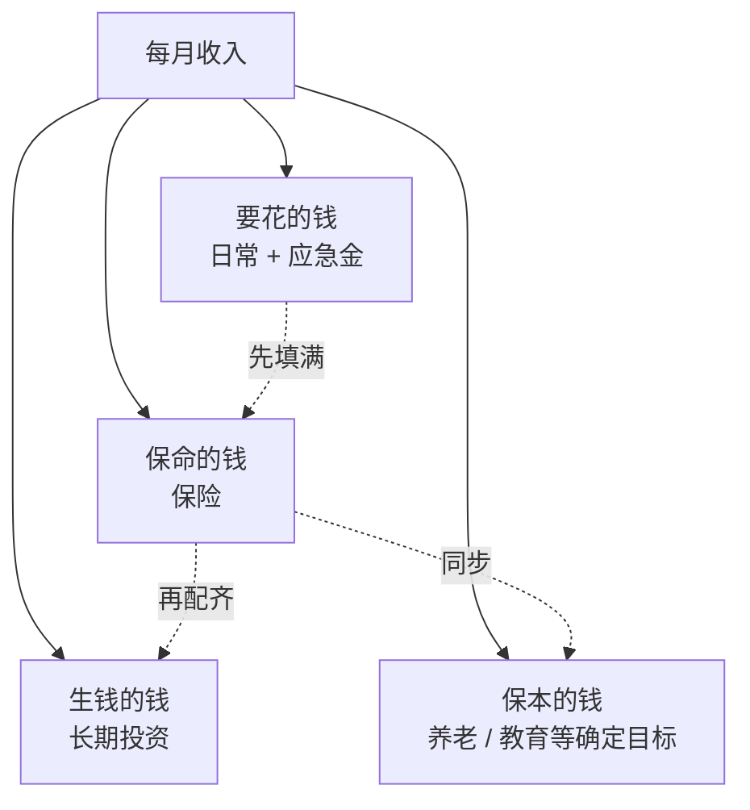
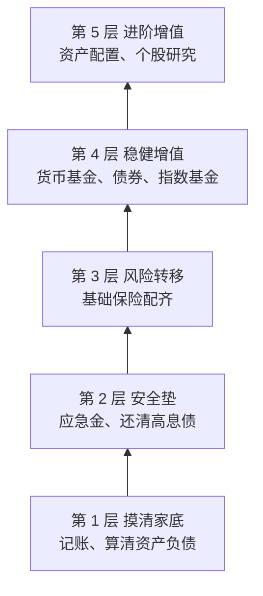
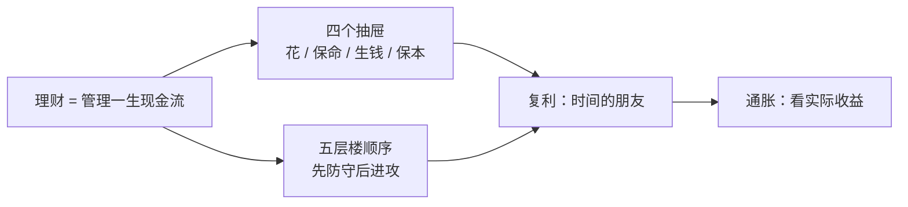

# 第 1 章 理财到底是什么：钱的四个去处、复利与通胀

> **本章导读**
>
> - 建议用时：40 分钟（含动手 10 分钟）
> - 前置知识：无，会加减乘除就行
> - 读完你能回答：
>   1. 理财和「买理财产品」是一回事吗？
>   2. 一个人的钱应该分成哪几份，各管什么？
>   3. 复利为什么被叫做「时间的朋友」？72 法则怎么用？
>   4. 为什么「钱放着不动」其实也在亏？
>   5. 理财应该按什么顺序学、按什么顺序做？

---

## 【积木 1-1】理财不是「买理财产品」

先纠正一个最常见的误会。

很多人一听「理财」，脑子里浮现的是银行柜台上的「某某理财产品，预期年化 X%」，或者手机 App 里的基金排行榜。于是「学理财」就变成了「学怎么挑一个收益高的产品」。

这就好比把「健身」理解成「买一张健身卡」。卡只是工具，真正的健身包括饮食、作息、训练计划、伤病预防。

**理财的真正定义**：

> 管理你一生的现金流，让你在人生每个阶段，都有足够的钱去做想做的事、扛住不想遇到的事。

拆开看，它包括五件事：

| 环节 | 回答的问题 | 本课对应章节 |
|---|---|---|
| 收支管理 | 钱从哪来、到哪去？ | 第 2、3 章 |
| 风险管理 | 出意外时，钱从哪来？ | 第 4、5 章 |
| 投资增值 | 闲钱怎么跑赢通胀？ | 第 6-20 章 |
| 税务规划 | 怎么合法地少交一点？ | 第 15 章 |
| 人生规划 | 买房、养娃、养老各要多少钱？ | 第 21 章 |

你会发现，「投资」只是其中一环，虽然它占了这门课最多的篇幅，但它**不是第一环**。一个月光、负债、没保险的人，投资收益再高，一次意外就能清零。

---

## 【积木 1-2】钱的四个去处

理财圈有一张流传很广的「家庭资产四象限图」，常被冠以「标准普尔」的名字。说实话，这个出处并不可靠，标普公司官方并没有发布过这张图。**但它背后的思路非常好用**，我们只取思路，不迷信比例。

想象你家里有四个抽屉，每一块钱进门，都要先决定放进哪个抽屉：

| 抽屉 | 作用 | 要求 | 常见工具 |
|---|---|---|---|
| **要花的钱** | 日常开销 + 应急 | 随时能取，不能亏 | 活期、货币基金 |
| **保命的钱** | 对冲大病、意外、身故 | 专款专用，以小博大 | 医疗险、重疾险、意外险、寿险 |
| **生钱的钱** | 长期增值，跑赢通胀 | 能承受波动，5 年以上不用 | 股票基金、指数基金 |
| **保本的钱** | 养老、教育等确定目标 | 稳健、确定性高 | 债券、存款、年金 |



**关键不是比例，而是顺序**：先把「要花的钱」和「保命的钱」放好，剩下的才有资格进入「生钱」的抽屉。

### 一个高频误解：「我钱少，不需要分抽屉」

恰恰相反。钱越少，越经不起一次意外。一个月薪 5,000 的人生一场需要自付 3 万的病，和一个月薪 5 万的人遇到同样的事，打击完全不是一个量级。**分抽屉不是有钱人的事，是每个人的事。**

---

## 【积木 1-3】复利：时间才是主角

复利常被说成「爱因斯坦说的世界第八大奇迹」。这句话同样没有可靠出处，大概率是后人附会的。但复利本身的威力，是实打实的数学。

**单利**：只有本金生利息。1 万元，年化 5%，每年拿 500 元利息，30 年后是 1 + 0.05 × 30 = 2.5 万元。

**复利**：利息也生利息。公式只有一行：

```text
终值 = 本金 × (1 + 年化收益率) ^ 年数
```

我们用 1 万元、不同的假设收益率，看看时间的作用（按年复利计算，收益率均为假设值）：

| 假设年化 | 10 年后 | 20 年后 | 30 年后 |
|---|---|---|---|
| 2% | 12,190 | 14,859 | 18,114 |
| 5% | 16,289 | 26,533 | 43,219 |
| 8% | 21,589 | 46,610 | 100,627 |

盯着最后一行看：8% 的情况下，前 10 年只多了 1.2 万，后 10 年（第 20 到 30 年）多了 5.4 万。**复利的曲线前面很平，后面很陡**，所以大多数人在前几年感受不到它，然后就放弃了。

### 72 法则：心算翻倍时间

不用计算器，有个简便算法：

```text
翻倍需要的年数 ≈ 72 ÷ 年化收益率（百分数）
```

| 年化收益率 | 72 法则估算 | 精确值 |
|---|---|---|
| 2% | 36 年 | 35.0 年 |
| 4% | 18 年 | 17.7 年 |
| 6% | 12 年 | 11.9 年 |
| 8% | 9 年 | 9.0 年 |
| 12% | 6 年 | 6.1 年 |

在常见的收益率范围内，误差很小。这个法则反过来也能用：如果有人跟你说「两年翻倍」，那他承诺的年化大约是 36%，这时候你就该警觉了（第 22 章会专门讲防骗）。

### 早 10 年开始，差多少？

假设两个人，每月都投 1,000 元，假设年化 6%，都投到 60 岁：

| | 从 25 岁开始 | 从 35 岁开始 |
|---|---|---|
| 投入本金 | 42 万 | 30 万 |
| 60 岁时资产 | 约 142 万 | 约 69 万 |

本金只差 12 万，结果差了一倍多。**多出来的那 10 年，复利滚的是最后、最陡的那一段。**

这就是为什么我说「理财最重要的不是钱多，而是早开始」。

---

## 【积木 1-4】通胀：钱放着不动，也在变少

二十年前一碗面多少钱？现在多少钱？面没变，是钱「变薄」了。

**通货膨胀**（Inflation，简称通胀）：物价整体持续上涨，等价于同样的钱能买到的东西越来越少。衡量它最常用的指标是 **CPI**（居民消费价格指数），国家统计局每月发布。

我们不去背某一年的 CPI 具体是多少（每年都在变，第 19 章会教你去哪查），只用假设值感受一下：

| 假设年通胀 | 今天的 1 万元，10 年后相当于 | 20 年后 | 30 年后 |
|---|---|---|---|
| 2% | 8,203 | 6,730 | 5,521 |
| 3% | 7,441 | 5,537 | 4,120 |

即使是温和的 2% 通胀，30 年后你的购买力也只剩一半多一点。

### 名义收益 与 实际收益

这引出一个贯穿全课的概念：

```text
实际收益率 ≈ 名义收益率 − 通胀率
```

- 名义收益：账户上显示的数字
- 实际收益：扣掉物价上涨后，你真正多买到的东西

如果你的钱放在一个年化 1.5% 的地方，而通胀是 2%，那么账面在涨，购买力在跌。

### 一个高频误解：「那我把钱全拿去投资，越激进越好」

不对。跑赢通胀是长期目标，不是让每一块钱都去冒险的理由。「要花的钱」和「保命的钱」本来就不是为了跑赢通胀而存在的，它们的任务是**在你需要的时候确定能拿出来**。用短期要用的钱去追高收益，是另一种更快的亏钱方式。

---

## 【积木 1-5】理财的顺序：先防守，再进攻

把前面讲的串起来，理财有一个几乎不会错的顺序，像盖房子：



**下面的楼层没盖好，上面的楼层盖得越高，塌得越狠。**

这也是本课的章节顺序：

- 第 1 层：第 2、3 章
- 第 2 层：第 4 章
- 第 3 层：第 5 章
- 第 4 层：第 6-13 章
- 第 5 层：第 14-20 章

### 「还清高息债」为什么排在投资前面？

信用卡分期、各种消费贷，换算成实际年化利率，常常远高于账面上写的「月费率」（第 4 章会教你怎么换算）。还掉一笔实际年化 15% 的债，等价于获得了一笔**确定的、无风险的** 15% 收益。市面上找不到这么好的投资。

---

## 【积木 1-6】新手最常踩的五个坑

先把坑标出来，后面每一章都会回头看它们：

| 坑 | 表现 | 为什么是坑 | 对应章节 |
|---|---|---|---|
| 只看收益，不看风险 | 「这只基金去年涨了 80%！」 | 去年涨得多，往往意味着波动大，买在高点的人可能先亏一大截 | 第 6、20 章 |
| 用短期的钱做长期投资 | 下个月要交房租的钱拿去买股票 | 被迫在亏损时卖出，把浮亏变成真亏 | 第 4、6 章 |
| 追涨杀跌 | 涨了才敢买，跌了吓得卖 | 系统性地「高买低卖」 | 第 14 章 |
| 不分散 | 全部押在一只基金或一个行业 | 一个判断错误就伤筋动骨 | 第 12 章 |
| 相信稳赚 | 保本高收益、内部消息、带单老师 | 高收益和零风险不可能同时存在，这类承诺基本都是骗局 | 第 22 章 |

---

## 【积木 1-7】小林登场

从这一章开始，我们有一个贯穿全课的虚构学员：**小林**。完整档案见 [cases/xiaolin/README.md](../cases/xiaolin/README.md)。

简单说：28 岁程序员，税后月薪 1.2 万，每月花掉约 1 万但说不清花在哪；有 3 万活期存款，背着 2 万信用卡分期；跟风买了一只「明星基金」被套 30%；没有任何商业保险；目标是「五年后攒首付」。

用本章的眼光看小林，问题一目了然：

- **四个抽屉**：他只有「要花的钱」（还被分期占了一块）和一笔放错位置的「生钱的钱」，「保命的钱」和「保本的钱」是空的。
- **楼层顺序**：他跳过了第 1、2、3 层，直接冲上了第 5 层，买了一只自己都说不清为什么买的基金。
- **复利**：他每月其实有能力结余，但钱没有被有意识地留下来，复利根本没有机会启动。

接下来的每一章，我们都会帮小林修一块问题。

---

## 【积木 1-8】动手：跑一下复利计算器

仓库里的 `tools/compound_interest.py` 只用 Python 标准库，不需要安装任何东西。

**问题一**：如果小林把每月乱花掉的钱里省下 2,000 元，坚持 30 年，假设年化 5%，假设通胀 3%，结果如何？

```bash
python3 tools/compound_interest.py --monthly 2000 --rate 5 --years 30 --inflation 3 --every 10
```

输出：

```text
假设：本金 0 元，每月 2,000 元，年化 5.0%，通胀 3.0%
  年份         累计投入         期末资产         其中收益       折合今天的钱
    10        240,000        310,565         70,565          231,089
    20        480,000        822,067        342,067          455,159
    30        720,000      1,664,517        944,517          685,759
```

怎么读这张表：

- **期末资产**：30 年后账户上约 166 万，其中约 94 万是收益，比投入的本金还多。这就是复利后段的威力。
- **折合今天的钱**：约 69 万。这是把 30 年后的 166 万按每年 3% 通胀折回今天的购买力。
- 你可能注意到 69 万比投入的 72 万还少。别慌，这两个数不能直接比：72 万是在 30 年里**陆续**投进去的，越晚投的钱，折回今天时缩水越少。这张表真正要说明的是：**名义 5% 减去 3% 通胀，实际增长只有约 2%**，所以收益率稍微高一点或低一点，对 30 年后的购买力影响巨大。

**问题二**：72 法则验证一下。

```bash
python3 tools/compound_interest.py --double 6
# 年化 6.0%：72 法则估算 12.0 年，精确值 11.9 年
```

**你自己的作业**：把 `--monthly` 改成你自己每月能省下的钱，`--years` 改成你离 60 岁还有几年，跑一遍。

> 说明：工具里定投和本金都按**月复利**计算，所以一次性投入的结果会比积木 1-3 里按年复利的表格略高一点（例如 1 万元、8%、30 年，按月复利约 10.9 万，按年复利约 10.1 万），这是计息频率不同造成的，不是算错了。

---

## 【本章小结】

三句话：

1. **理财是管理一生的现金流**，投资只是其中一环，而且不是第一环。
2. **钱要分抽屉，事要按顺序**：先摸清家底、建安全垫、配保险，再去投资。
3. **复利靠时间，通胀在偷钱**：早开始比钱多更重要，跑赢通胀是长期资产的任务，不是每一块钱的任务。



### 自测题

1. 有人说「我在学理财，正在研究哪只基金收益最高」，按本章的定义，他漏掉了哪些环节？（积木 1-1）
2. 四个抽屉分别是什么？下个月要交的房租应该放在哪个抽屉？（积木 1-2）
3. 年化 4% 大约多少年翻倍？如果有人承诺「三年翻倍」，对应的年化大约是多少？（积木 1-3）
4. 为什么复利的效果在前几年很难感受到？这对你坚持投资有什么启示？（积木 1-3）
5. 某存款年化 1.5%，假设通胀 2%，实际收益率大约是多少？这笔钱是在变多还是变少？（积木 1-4）
6. 为什么「还清信用卡分期」应该排在「开始投资」前面？（积木 1-5）
7. 小林跳过了理财楼层中的哪几层？（积木 1-7）
8. 用计算器算一下：你每月能省下的钱，按假设年化 4%、到 60 岁，名义上能积累多少？（积木 1-8）

---

## 【下一章预告】

第 2 章我们帮小林干第一件正事：**给自己做两张报表**。

- **资产负债表**：你到底有多少「净资产」？那只被套的基金、那笔信用卡分期该怎么算？
- **现金流量表**：每月 1.2 万进来、1 万出去，那 1 万都去哪了？

你会发现，一个做数据分析的人，用分析公司的方法分析自己，会有意想不到的收获。

*学完本章，回到对话里说一句「继续」，我就开讲第 2 章。*
