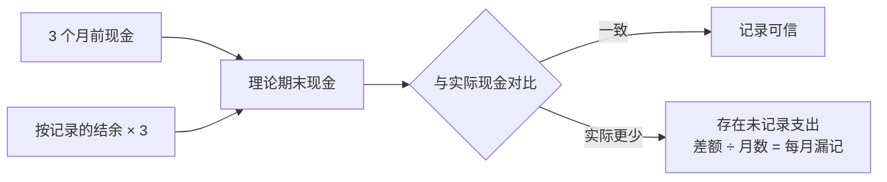
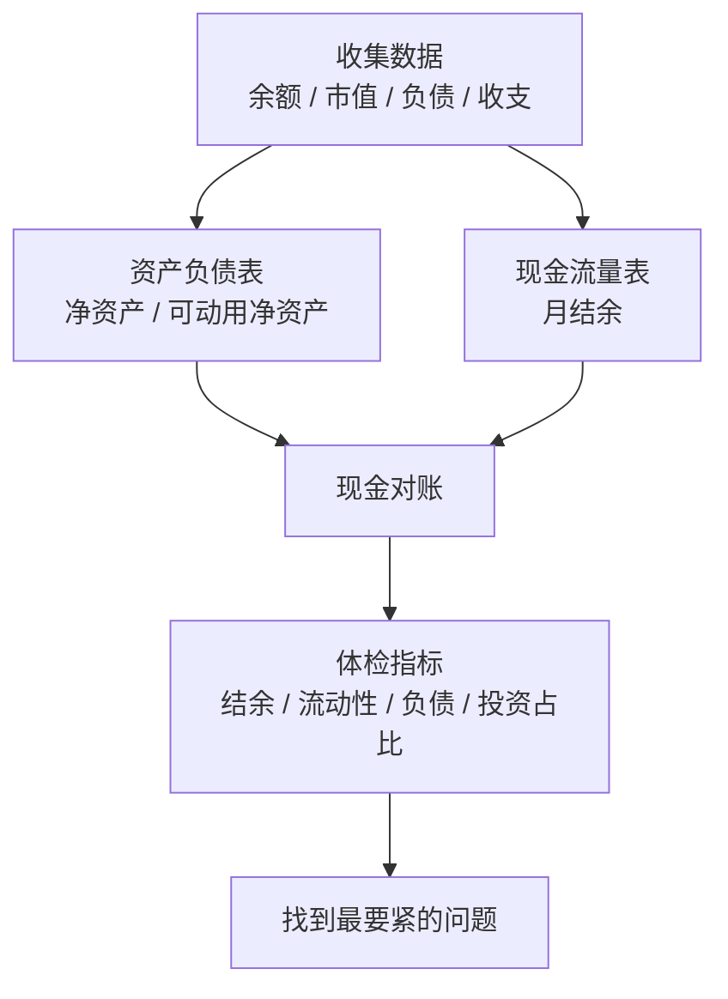

# 第 2 章 给自己做一张财务报表：资产负债表与现金流量表

> **本章导读**
>
> - 建议用时：50 分钟（含动手 20 分钟）
> - 前置知识：第 1 章（四个抽屉、先防守后进攻）
> - 读完你能回答：
>   1. 个人的「资产负债表」和「现金流量表」分别回答什么问题？
>   2. 基金没卖、手机刚买，在报表上该记多少钱？
>   3. 为什么两张表必须能「对上账」？对不上说明什么？
>   4. 用哪几个指标给自己的财务做体检？参考值是多少？

---

## 【积木 2-1】像分析一家公司一样分析自己

你做数据分析，一定熟悉这个区分：**存量**和**流量**。

- 存量是某个时点的快照：今天库存有多少件、账户余额是多少。
- 流量是一段时间的累计：这个月卖了多少件、这个月进出了多少钱。

上市公司每季度要公布三张报表，第 17 章我们会细读。个人只需要其中两张，正好一张管存量、一张管流量：

| 报表 | 类型 | 回答的问题 | 类比 |
|---|---|---|---|
| 资产负债表 | 存量，某一天的照片 | 此刻我有什么、欠什么、净值多少？ | 体检报告 |
| 现金流量表 | 流量，一个月的录像 | 钱从哪来、到哪去、剩下多少？ | 运动手环的每日记录 |

第 1 章说理财的第一层是「摸清家底」，指的就是这两张表。没有它们，后面所有的决定（留多少应急金、每月投多少、多久能攒够首付）都是拍脑袋。

---

## 【积木 2-2】资产负债表：此刻的一张照片

核心等式只有一行：

```text
净资产 = 资产 − 负债
```

难点不在公式，在于**分类**。我们把资产分成四类，这四类和第 1 章的「四个抽屉」是对应的：

| 资产类别 | 特点 | 例子 |
|---|---|---|
| 流动资产 | 随时能取、几乎不亏 | 活期、货币基金、微信零钱 |
| 投资资产 | 会涨跌，追求增值 | 基金、股票、债券、定期理财 |
| 受限资产 | 是你的，但不能随便取 | 住房公积金、个人养老金账户 |
| 自用资产 | 自己在用，会贬值或难变现 | 手机、电脑、车、自住房 |

负债按「今天一次性还清要多少钱」记，常见的有：信用卡本期未还账单、分期剩余待还、消费贷、车贷、房贷、借亲友的钱。


左右两边永远相等：你拥有的每一样东西，要么是借钱买的（负债），要么是你自己的（净资产）。

---

## 【积木 2-3】五条记账原则：别让报表骗你

报表最怕的不是算错，而是**自己哄自己**。下面五条原则专门防这个：

| 原则 | 意思 | 反例 |
|---|---|---|
| 按市价，不按买价 | 资产记「今天卖掉能拿到多少」 | 两万买的电脑记两万 |
| 负债记全额 | 分期记剩余全部待还，不只记本月 | 「我每月才还 1,800」 |
| 刷卡也是负债 | 信用卡已消费未还款的部分要记 | 「还没到还款日，不算」 |
| 不记没到手的钱 | 年终奖、别人口头答应还的钱都不算 | 「年底有奖金，先记上」 |
| 受限、自用单独标 | 它们算资产，但救不了急 | 把公积金当应急金 |

### 一个高频误解：「基金没卖，就不算亏」

资产负债表记的是**今天的市值**。基金从 15,000 跌到 10,500，你此刻拥有的就是 10,500，这 4,500 已经从你的净资产里少掉了。

「不卖就不亏」把两件事混在了一起：

- **亏没亏**：看报表，已经亏了。
- **要不要卖**：是另一个决定，取决于这笔钱什么时候用、这只基金还值不值得持有。第 14 章讲「沉没成本」时会专门讨论。

承认浮亏，才能做出正确的下一步决定。

### 一个高频误解：「买的东西都是资产」

手机、电脑从买下那一刻起就在贬值。小林 24,000 买的设备，现在二手价约 6,000。在报表上，**用分期买消费品，等于当场增加了一大笔负债，换来一件快速缩水的资产**，净资产立刻下降。

《穷爸爸富爸爸》对资产的定义更激进：能往你口袋里放钱的才是资产，往外掏钱的都是负债。这个说法不符合会计口径，但提醒很有用：**自用资产越多，不代表你越富。**

---

## 【积木 2-4】现金流量表：一个月的录像

个人现金流量表比公司简单得多，三行就够：

```text
月结余 = 月收入 − 生活支出 − 还债支出
```

| 项目 | 内容 | 注意 |
|---|---|---|
| 收入 | 税后工资、副业、利息分红 | 用税后、到手的数字 |
| 生活支出 | 房租、餐饮、交通、购物、社交 | 第 3 章会细分「固定」和「可变」 |
| 还债支出 | 分期、贷款每月还款 | 单独列出，还清后这一行会消失 |
| 结余 | 剩下能存、能投的钱 | 理财的「燃料」 |

为什么把还债单独列？因为它和生活支出性质不同：生活支出每个月都会有，还债支出有终点。还清那天，结余会自动多出一块，提前知道这一点，才能提前规划这笔钱去哪。

### 一个高频误解：「结余就是月底卡里剩下的钱」

不是。卡里余额会被很多东西干扰：信用卡还款日不在月底、上个月的钱这个月才扣、年终奖一次性入账。**结余要按「这个月的收入减这个月的支出」来算**，而不是看月底余额。

---

## 【积木 2-5】两张表必须对得上账

做数据的人都知道，两个口径的数据必须能互相校验。两张报表之间也有一条勾稽关系：

```text
期末净资产 − 期初净资产 = 期间结余 + 投资涨跌 − 自用资产贬值
```

完整核对比较麻烦，日常用一个简化版就够了：**只对现金**。

```text
期初现金 + 期间结余 = 期末现金（理论值）
```

如果理论值和实际值对不上，差额就是「你以为没花、其实花了」的钱。



这个方法特别适合「感觉每月该有结余，但钱就是没攒下来」的人，也就是小林。

---

## 【积木 2-6】五个体检指标

有了两张表，就能算比率。下面是国内理财规划教材和媒体里最常用的几个，**参考值是经验值，不同来源略有出入**（比如流动性比率，有的写 3 倍，有的写 3 到 6 倍），用来发现问题，不是考试及格线。

| 指标 | 公式 | 常见参考值 | 回答的问题 |
|---|---|---|---|
| 结余比率 | 月结余 ÷ 月税后收入 | 30% 以上 | 攒钱能力强不强？ |
| 流动性比率 | 流动资产 ÷ 月支出 | 3 到 6 个月 | 断了收入能撑多久？ |
| 资产负债率 | 总负债 ÷ 总资产 | 低于 50% | 欠债多不多？ |
| 负债收入比率 | 月还债 ÷ 月税后收入 | 低于 35% 到 40% | 每月还款压力大不大？ |
| 投资与净资产比率 | 投资资产 ÷ 净资产 | 长期目标 50% 左右 | 钱有没有在「生钱」？ |

两个使用提醒：

1. **不要只看一个指标**。资产负债率很低，可能只是因为公积金很多，而公积金救不了急。所以本课的工具会同时算「账面」和「可动用」两种口径。
2. **投资与净资产比率对新手偏低是正常的**。刚工作的人净资产小，先把前四个指标做健康，这个比率会随时间自然上来。

参考来源：中国新闻网《盘点：家庭理财 8 个关键比率》（2010-12-14）、搜狗百科「家庭财务指标」词条等，属非一手来源，各家数值不完全一致。

---

## 【积木 2-7】小林的第一份体检报告

小林的数据在 `cases/xiaolin/ch02-statements.json`。他翻了三个月的银行流水，凭记忆估了每月支出，然后跑工具：

```bash
python3 tools/personal_statements.py cases/xiaolin/ch02-statements.json
```

资产负债表部分：

```text
  资产合计                      71,500
  负债合计                      23,000
  账面净资产 = 资产 - 负债         48,500
  可动用净资产（剔除受限、自用）   17,500
```

账面上有 4.85 万，可是去掉公积金和二手设备，真正能动用的只有 1.75 万。

现金流量表显示每月应该结余 2,000。但对账一做，问题出来了：

```text
== 三、现金对账（两张表互相验证） ==
  3 个月前现金                 33,000
  + 按记录的结余 2,000 x 3 个月 =     6,000
  = 理论上现在应有             39,000
  实际现在只有                 30,000
  对不上的钱                    9,000   即每月约 3,000 没有记录
  修正后月支出                 13,000
  修正后月结余                 -1,000
```

**小林以为自己每月存 2,000，实际上每月倒贴 1,000。** 那 3,000 去哪了？国庆旅行、朋友婚礼的份子钱、几次冲动下单……这些不是每月都有的大额支出，凭记忆估算时全被漏掉了。

体检结果：

```text
  结余比率              -8.3%   [关注]
  流动性比率            2.3 个月   [关注]
  资产负债率（账面）         32.2%   [达标]
  资产负债率（可动用）        56.8%   [关注]
  负债收入比率            15.0%   [达标]
  投资与净资产比率          21.6%   [关注]
```

怎么读：

- **最严重的是结余为负**。其他问题都可以慢慢修，这个不修，30,000 活期会被一点点吃光。
- **账面负债率 32% 看起来健康，可动用口径是 57%**。这正是积木 2-6 提醒的：公积金把资产「撑大」了。
- **负债收入比 15% 不高**，说明分期本身不是压力来源，问题出在支出失控。
- **流动性只有 2.3 个月**，如果失业，撑不过一个季度。第 4 章会处理。

---

## 【积木 2-8】动手：做你自己的两张表

第一步，生成模板：

```bash
python3 tools/personal_statements.py --template > my-statements.json
```

第二步，打开 `my-statements.json` 填数字。几个实操建议：

- **资产**：打开所有银行 App、支付宝、微信、券商、基金 App，逐个记下今天的余额和市值。公积金在当地公积金 App 或「手机公积金」小程序查。
- **负债**：信用卡 App 里看「本期未还」和「分期剩余待还」两个数。
- **支出**：先凭感觉估一遍，等第 3 章开始记账后再替换成真实数据。
- **对账**：在 `reconcile.cash_start` 填三个月前的现金余额（翻银行流水能查到）。

第三步，运行：

```bash
python3 tools/personal_statements.py my-statements.json
```

> 提醒：`my-statements.json` 是你的真实财务数据，不要提交到公开仓库。可以在本地 `.gitignore` 里加一行 `my-*.json`。

**多久做一次？** 资产负债表每季度一次，固定在同一天（比如季末最后一天）；现金流量表每月一次。坚持一年，你会得到 4 张照片和 12 段录像，自己的财务趋势一目了然。

---

## 【本章小结】

三句话：

1. **资产负债表管存量，现金流量表管流量**，一张是照片，一张是录像。
2. **按市价记资产、按全额记负债**，受限和自用资产单独标出来，别让报表哄你。
3. **两张表要能对上账**，对不上的差额就是你看不见的支出；体检指标要多个一起看。



### 自测题

1. 「上个月我花了 8,000 元」和「我卡里有 3 万」，哪个是存量、哪个是流量？（积木 2-1）
2. 公积金余额 5 万，算不算资产？能不能算进应急金？（积木 2-2、2-3）
3. 18,000 元买的电脑，现在二手能卖 5,000，报表上记多少？（积木 2-3）
4. 一只基金买入 2 万、现在市值 1.6 万、还没卖，你的净资产减少了吗？（积木 2-3）
5. 为什么还债支出要和生活支出分开列？（积木 2-4）
6. 3 个月前现金 2 万，你记录的月结余 3,000，现在现金 2.5 万，每月大约漏记多少？（积木 2-5）
7. 一个人账面资产负债率 30%，是不是就说明他负债很健康？（积木 2-6）
8. 小林的体检报告里，为什么说最要紧的是结余为负，而不是负债？（积木 2-7）

---

## 【下一章预告】

小林每月有 3,000 元「消失」了，凭记忆永远找不回来。第 3 章我们教他**记账与预算**：

- 怎么记账才能坚持下去，而不是三天打鱼？
- 固定支出和可变支出，哪个更值得砍？
- 「先存再花」为什么比「花剩再存」有效？
- 50/30/20 这类预算法则，适不适合你？

*学完本章，回到对话里说一句「继续」，我就开讲第 3 章。*
