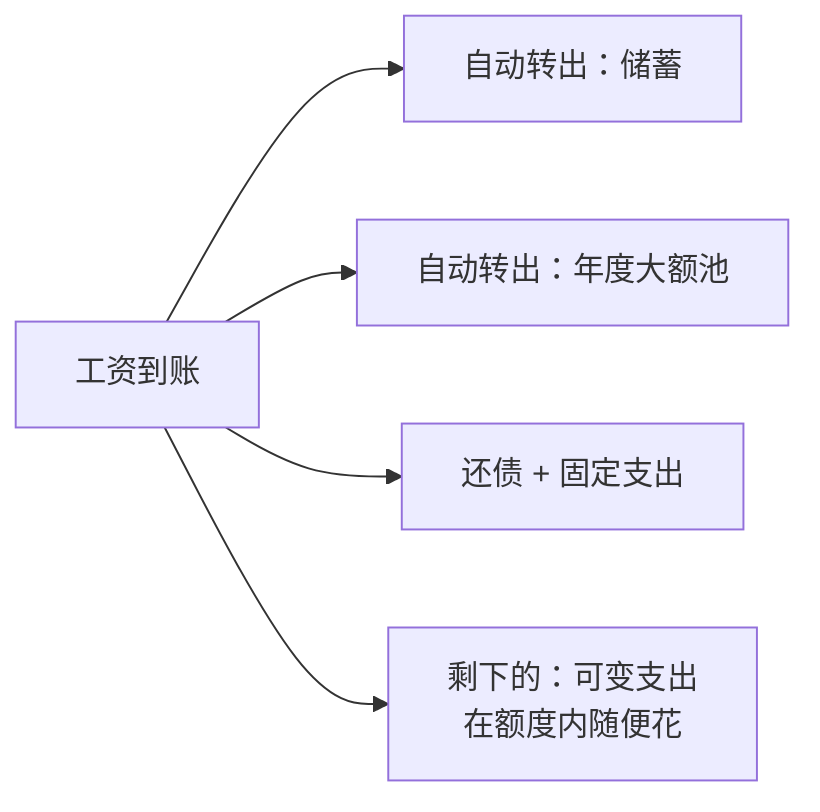
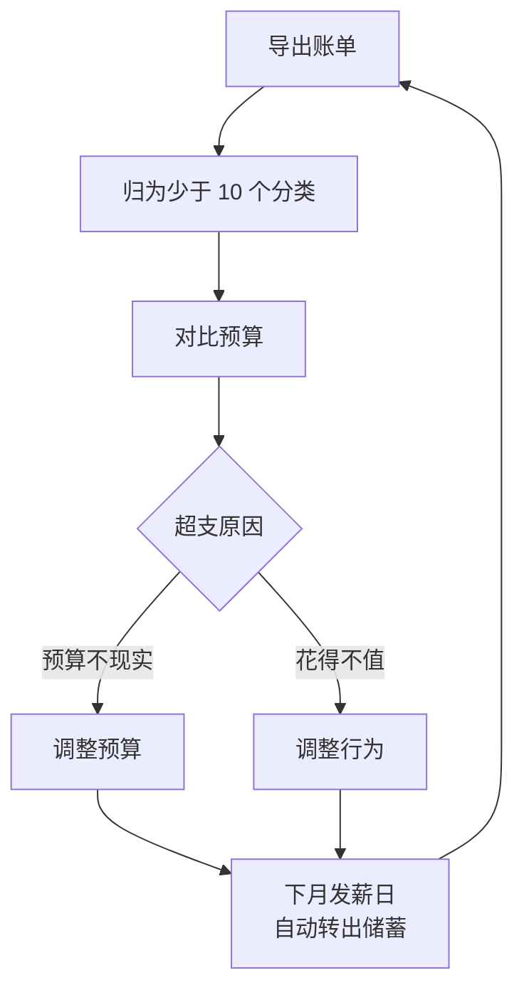

# 第 3 章 记账与预算：让每一块钱都有去处

> **本章导读**
>
> - 建议用时：45 分钟（含动手 15 分钟）
> - 前置知识：第 2 章（现金流量表、现金对账）
> - 读完你能回答：
>   1. 为什么大多数人记账坚持不过一个月？怎么记才能坚持？
>   2. 固定支出、可变支出、不定期大额支出，分别怎么管？
>   3. 「先存再花」为什么比「花剩再存」有效？
>   4. 50/30/20 法则是什么？适不适合你？

---

## 【积木 3-1】记账的目的不是记录，是决策

第 2 章的现金对账告诉小林：每月有约 3,000 元「消失」了。凭记忆找不回来，只能靠记账。

但大多数人记账的结局是：热情一周，坚持一个月，然后再也不打开那个 App。原因通常是把记账当成了目的。

**记账只是采集数据，真正的产出是决策**。对做数据分析的你来说，这个道理很熟悉：埋点不是目的，看板也不是，根据数据改产品才是。

记账有三个层次，大多数人停在第一层：

| 层次 | 做什么 | 回答的问题 |
|---|---|---|
| 1. 流水 | 记下每一笔 | 我花了什么？ |
| 2. 分类 | 按类别汇总 | 钱主要花在哪？ |
| 3. 预算 | 事前定额度，事后对比 | 哪里超了？下个月怎么调？ |

只有走到第三层，记账才开始产生价值。

---

## 【积木 3-2】最小可行记账：怎么记才能坚持

坚持不下去，多半是记得太细、太累。几条实用原则：

| 原则 | 做法 |
|---|---|
| 工具不重要 | 记账 App、表格、甚至备忘录都行，挑一个你每天会打开的 |
| 分类少于 10 个 | 分得越细越难坚持。本课小林只用 9 个分类 |
| 能导出就别手记 | 微信、支付宝和多数银行 App 都能下载或导出账单（入口随版本变化，在账单页面里找），每周导出一次，批量归类 |
| 每周 10 分钟 | 固定一个时间（如周日晚上）集中整理，比每笔都记更容易坚持 |
| 允许粗略 | 外卖可以一周汇总成一笔，不必精确到每一单 |

### 一个高频误解：「记账就是为了省钱」

记账不是为了让你什么都不敢买，而是让你**看清楚**钱花到了哪里，然后决定哪些花得值、哪些不值。一个人每月花 1,000 元健身、觉得很值，没有问题；问题是那些花了、过后想不起来、也说不出值不值的钱。

---

## 【积木 3-3】三类支出：固定、可变、不定期大额

小林的预算之所以总是失效，是因为他只想到了「每月都有」的支出。支出其实有三类：

| 类型 | 特点 | 例子 | 管理方法 |
|---|---|---|---|
| 固定支出 | 每月金额基本不变 | 房租、话费、会员、分期 | 每年审视一次，砍一次就长期生效 |
| 可变支出 | 每月都有，金额浮动 | 餐饮、交通、购物、娱乐 | 设月度额度，每周检查 |
| 不定期大额 | 不是每月都有，但每年一定有 | 旅行、人情份子、换手机、保险年费、节日 | 按年估算，除以 12，每月提前存 |

**第三类是月光的头号原因**。它们不是意外，每年都会发生，只是不在每个月发生，所以凭记忆估支出时总被漏掉。小林那消失的 3,000 元，大部分就在这一类里。

### 年度大额池：把「意外」变成「计划」

做法很简单：

1. 列出一年里所有的不定期大额支出，估一个总数。比如旅行 6,000、人情 3,600，合计 9,600。
2. 除以 12，每月 800 元，单独存起来（可以用一个单独的银行卡或货币基金账户）。
3. 真要花的时候，从这个池子里出，不影响当月的日常预算。

### 固定支出：砍一刀，长期见效

可变支出要每个月跟自己较劲，固定支出只要砍一次。小林的「通讯会员」每月 300 元，包含两个视频会员、一个音乐会员和一个网盘，他一年也没用几次其中一个。取消一个，每月省 100，一年 1,200，不需要任何意志力。

---

## 【积木 3-4】先存再花：把储蓄变成一笔固定支出

大多数人的顺序是：

```text
收入 − 支出 = 储蓄（花剩下的才存）
```

结果通常是没剩下。换个顺序：

```text
收入 − 储蓄 = 可以花的钱（先存，剩下的随便花）
```

这叫 **Pay yourself first**（先付钱给自己）。它有效的原因是：人会自动按手里的钱来调整消费，账户里钱少了，自然就花得少了。

实操：**发薪日当天，设置自动转账**，把储蓄额和年度大额池的钱转到另外的账户。不依赖意志力，是这个方法唯一的关键。



---

## 【积木 3-5】三种预算方法

### 方法一：50/30/20 法则

出自美国参议员 Elizabeth Warren 与女儿 Amelia Warren Tyagi 合著的《All Your Worth》（2005 年）：

| 比例 | 用途 | 包括 |
|---|---|---|
| 50% | 需要（Needs） | 房租、基本餐饮、交通、通讯、每月最低还款 |
| 30% | 想要（Wants） | 购物、娱乐、旅行、下馆子 |
| 20% | 储蓄与额外还债 | 存款、投资、提前还款 |

它的优点是简单，只需要三个数字。缺点是在房租高的城市，「需要」很容易超过 50%。**把它当起点，不是标准答案**。

### 方法二：信封法

每个分类分配一个「信封」，信封里的钱花完了，这个分类这个月就不能再花。以前用现金，现在可以用 App 里的分类额度来模拟。适合可变支出失控的人。

### 方法三：零基预算

每月开始前，把每一块收入都分配到某个用途上，直到「收入 − 所有分配 = 0」。储蓄也是一个用途。最精细，也最累，适合愿意花时间的人。

| 方法 | 难度 | 适合 |
|---|---|---|
| 50/30/20 | 低 | 刚开始，想要一个大致框架 |
| 信封法 | 中 | 可变支出总超支 |
| 零基预算 | 高 | 想精确控制每一块钱 |

可以组合：用 50/30/20 定大框架，可变支出用信封法控额度。小林就是这么做的。

---

## 【积木 3-6】小林的第一个月真实账单

小林把 10 月的微信、支付宝、银行流水导出来，归成 9 个分类，共 17 笔（外卖、午餐按周汇总），存在 `cases/xiaolin/ch03-transactions.csv`。同时按本章的方法做了一份新预算 `cases/xiaolin/ch03-budget.json`。对比一下：

```bash
python3 tools/budget.py cases/xiaolin/ch03-budget.json cases/xiaolin/ch03-transactions.csv
```

```text
月税后收入 12,000，流水 17 笔，实际总支出 13,000

分类        类型          预算      实际      差额  状态
房租        需要       3,000   3,000       0  正常
通讯会员      需要         200     300    -100  超支
餐饮        需要       2,200   2,900    -700  超支
交通        需要         400     400       0  正常
分期还款      还债       1,800   1,800       0  正常
购物        想要         600   1,400    -800  超支
社交娱乐      想要         700   1,000    -300  超支
人情        想要         300   1,000    -700  超支
旅行        想要         500   1,200    -700  超支
储蓄        储蓄       2,300  -1,000  -3,300  未达标

50/30/20 检查（目标：需要 50% / 想要 30% / 储蓄 20%）
  预算：需要 63.3%  想要 17.5%  储蓄 19.2%
  实际：需要 70.0%  想要 38.3%  储蓄 -8.3%

「想要」类最大的 5 笔支出（最值得复盘）：
  2026-10-01  旅行         1,200  国庆短途游（车票 + 两晚住宿）
  2026-10-17  人情         1,000  大学同学婚礼份子钱
  2026-10-12  购物           680  直播间冲动下单：机械键盘
  2026-10-18  社交娱乐         450  周末聚餐 + KTV
  2026-10-21  购物           420  换季衣服
```

真实总支出 13,000，和第 2 章现金对账推算的一模一样。**消失的 3,000 元找到了**：

| 来源 | 第 2 章估计 | 10 月实际 | 差额 |
|---|---|---|---|
| 旅行 | 0 | 1,200 | 1,200 |
| 人情 | 0 | 1,000 | 1,000 |
| 餐饮 | 2,500 | 2,900 | 400 |
| 购物 | 1,000 | 1,400 | 400 |
| 合计 | | | 3,000 |

有三分之二是不定期大额支出（旅行和人情），剩下三分之一是可变支出低估。

---

## 【积木 3-7】小林的新预算：怎么定出来的

新预算每月储蓄 2,300 元（结余比率约 19%），具体调整：

| 调整 | 方法 | 每月影响 |
|---|---|---|
| 取消一个视频会员 | 固定支出砍一刀 | 省 100 |
| 外卖从每周 4 次降到 2 次 | 可变支出设额度 | 餐饮 2,900 降到 2,200 |
| 购物 + 社交娱乐设信封 | 信封法 | 2,400 降到 1,300 |
| 旅行 + 人情建年度大额池 | 每月存 800 | 年度共 9,600，不再挤占当月 |
| 发薪日自动转出储蓄 2,300 | 先存再花 | 储蓄从 -1,000 变成 2,300 |

### 为什么「需要」占了 63%，超过 50%？

因为房租 3,000 加分期 1,800，两项已经占收入的 40%。这在一线和新一线城市很常见，不说明预算做错了。关键在于：

- **分期大约 11 个月后还清**，到时每月多出 1,800，储蓄能升到 4,100，结余比率约 34%，达到第 2 章说的 30% 参考线。
- 那时 50/30/20 的比例自然就接近了。

### 一个高频误解：「定了预算就必须严格执行，超了就是失败」

第一个月超支几乎是必然的，因为预算本身就是估出来的。**预算的价值在于每月对比、每月修正**：超支的类别，要么是预算定得不现实（调预算），要么是花得不值（调行为）。三个月后，预算会越来越准。

---

## 【积木 3-8】动手：你的第一份预算

1. 导出你上个月的微信、支付宝、银行账单，按不超过 10 个分类汇总成 CSV（格式参考 `cases/xiaolin/ch03-transactions.csv`）。
2. 复制 `cases/xiaolin/ch03-budget.json`，按本章方法改成你的预算。每个分类标上「需要 / 想要 / 还债 / 储蓄」。
3. 运行：

```bash
python3 tools/budget.py my-budget.json my-transactions.csv
```

4. 看三件事：哪些类别超支？50/30/20 偏在哪？最大的几笔「想要」支出值不值？
5. 在发薪日设置一笔自动转账，金额就是你预算里的储蓄额。

> 提醒：文件名用 `my-` 开头，仓库的 `.gitignore` 已经忽略 `my-*.json`。CSV 也建议这样命名，并在 `.gitignore` 里补一行 `my-*.csv`（本章已加上）。

---

## 【本章小结】

三句话：

1. **记账只是采集数据，预算对比才产生决策**；分类要少，能导出就别手记，每周集中整理。
2. **不定期大额支出是月光的头号原因**，按年估算、按月提前存，把「意外」变成「计划」。
3. **先存再花，用自动转账代替意志力**；50/30/20 只是起点，预算要每月修正。



### 自测题

1. 记账的三个层次是什么？为什么只记流水没有用？（积木 3-1）
2. 你会用什么方法让自己坚持记账？至少说三条。（积木 3-2）
3. 每年春节回家的路费和红包，属于哪一类支出？应该怎么管？（积木 3-3）
4. 为什么说砍固定支出比砍可变支出更省力？（积木 3-3）
5. 「先存再花」最关键的执行手段是什么？（积木 3-4）
6. 50/30/20 分别指什么？房租高的人用它会遇到什么问题？（积木 3-5）
7. 小林消失的 3,000 元，主要来自哪两类支出？（积木 3-6）
8. 预算第一个月就超支了，应该怎么处理？（积木 3-7）

---

## 【下一章预告】

小林现在每月能存 2,300 元了。但他手里的 3 万活期只够撑 2.3 个月，还背着 2 万信用卡分期。第 4 章讲**安全垫**：

- 应急金到底留多少？放在哪？
- 信用卡分期「月费率 0.6%」，实际年化是多少？为什么远比看上去高？
- 先还债还是先存应急金？
- 个人征信是什么，哪些行为会影响它？

*学完本章，回到对话里说一句「继续」，我就开讲第 4 章。*
