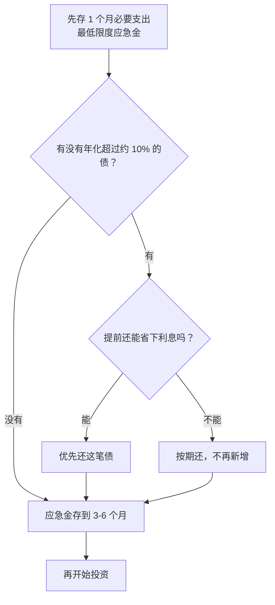

# 第 4 章 安全垫：应急金、负债管理与个人信用

> **本章导读**
>
> - 建议用时：45 分钟（含动手 10 分钟）
> - 前置知识：第 2 章（流动性比率）、第 3 章（需要与想要）
> - 读完你能回答：
>   1. 应急金该留多少？按什么支出算？放在哪？
>   2. 分期「每期 0.6%」，真实年化是多少？为什么？
>   3. 先还债还是先存应急金？多笔债先还哪笔？
>   4. 个人征信记录了什么？哪些行为会伤害它？

---

## 【积木 4-1】安全垫的作用：不让一次意外变成一连串灾难

想象一下小林突然失业。没有安全垫的剧本通常是这样的：


意外本身往往不致命，致命的是**被迫用最贵的方式去应对**。安全垫由三块组成：应急金（第 4 章）、可控的负债（第 4 章）、保险（第 5 章）。这一章先讲前两块。

---

## 【积木 4-2】应急金：留多少、按什么算

常见的建议是 **3 到 6 个月的支出**。第 2 章的流动性比率也是这个口径。但「支出」按哪个数算，很多人没想清楚。

**应急金按「必要支出」算，不按「全部支出」算。** 真遇到失业，你会自然砍掉购物、旅行、娱乐，但房租、吃饭、交通、还款砍不掉。也就是第 3 章预算里标为「需要」和「还债」的部分。

小林的必要支出：房租 3,000 + 通讯 200 + 餐饮 2,200 + 交通 400 + 分期 1,800 = **7,600 元/月**。

```bash
python3 tools/debt_apr.py emergency --essential 7600 --cash 30000 --saving 2300
```

```text
每月必要支出 7,600，现有流动资金 30,000，每月可存 2,300
  当前可撑 3.9 个月
  3 个月目标 22,800，缺口 0，按每月存 2,300 约需 0.0 个月
  6 个月目标 45,600，缺口 15,600，按每月存 2,300 约需 6.8 个月
```

第 2 章说他只能撑 2.3 个月，是按全部支出 13,000 算的；按必要支出算是 3.9 个月。两个数都对，口径不同：前者回答「保持现在的生活能撑多久」，后者回答「勒紧裤腰带能撑多久」。**定应急金目标用后者，检查生活方式是否可持续用前者。**

### 3 个月还是 6 个月？

| 情况 | 建议 |
|---|---|
| 收入稳定、单身、无人需要供养 | 3 个月左右 |
| 收入波动大（销售、自由职业）、行业裁员多 | 6 个月以上 |
| 有房贷、有孩子、家里只有一份收入 | 6 个月以上 |
| 健康状况一般、保险还没配齐 | 往多了留 |

小林是程序员，单身，但行业有裁员风险，保险还没配。目标定在 6 个月，约 4.6 万。

### 应急金放在哪？

三个要求：**随时能取、本金基本不亏、有一点收益更好**。常见选择是活期存款和货币基金，第 7 章会细讲它们的区别。**不能放的地方**：股票、股票基金（需要用钱时可能正在亏）、定期存款（提前取会损失利息）、借给朋友的钱。

### 一个高频误解：「我有信用卡额度，就不需要应急金」

信用卡额度是银行的钱，不是你的。真出事时，银行可能因为你收入中断而降额；就算没降额，用它应急也是在借高息债，正好走上积木 4-1 那条链条。**额度不是安全垫，是安全垫失效后的最后一根绳子。**

---

## 【积木 4-3】分期的真实年化：每期 0.6% 不是年化 7.2%

信用卡分期、很多消费分期都是这样收费的：**每期手续费 = 初始本金 × 每期费率**。12,000 元分 12 期，每期费率 0.6%，每期手续费 72 元，12 期共 864 元。

看起来：864 ÷ 12,000 = 7.2%，比很多贷款都便宜？

问题在于，**你每个月都在还本金，欠银行的钱越来越少，但手续费一分没少**。第 12 个月你只欠 1,000 元，仍然要付 72 元手续费，相当于这一个月的月利率 7.2%。

用内部收益率（IRR）算真实成本：

```bash
python3 tools/debt_apr.py apr --principal 12000 --periods 12 --fee 0.6
```

```text
本金 12,000，12 期，每期手续费率 0.6%
  每期还款 1,072.00（本金 1,000.00 + 手续费 72.00）
  手续费合计 864.00
  表面费率 每期费率 x 12 = 7.20%
  名义年化（IRR x 12）= 13.03%
  实际年化（复利）     = 13.84%
  速算 每期费率 x 24n/(n+1) = 13.29%
```

**真实年化约 13%，接近表面费率的两倍。** 分 24 期更贵一点，名义年化约 13.3%。

速算公式：`真实年化 ≈ 每期费率 × 24n ÷ (n + 1)`，n 是期数。期数较多时可以简单记成「每期费率 × 24」。

2021 年起，央行要求贷款产品向借款人明示年化利率（中国人民银行公告〔2021〕第 3 号）。所以现在办分期时，页面上一般能找到「年化利率」一栏，**看那个数，别看每期费率**。

### 一个高频误解：「提前还清分期就能省下手续费」

不一定。很多银行的信用卡分期，提前还款时**剩余各期的手续费仍要一次性收取**，或者收一部分违约金。各家银行规则不同，提前还款前一定要先查清楚。如果剩余手续费照收，提前还款就省不了钱，反而把应急金掏空了。

---

## 【积木 4-4】先还债还是先存应急金？

一个实用的决策顺序：



几个要点：

1. **最低限度的应急金先存上**，否则还债期间一出意外，又得借新债。
2. **高息债优先还**。还掉一笔年化 13% 的债，等于拿到一笔确定的 13% 收益（第 1 章讲过）。
3. **能不能省利息要先算**。见积木 4-3 的提前还款规则。
4. **房贷、公积金贷款这类低息长期债**，一般不需要急着提前还，第 21 章再讨论。

### 多笔债务先还哪笔？

| 方法 | 做法 | 优点 | 缺点 |
|---|---|---|---|
| 雪崩法 | 先还利率最高的 | 总利息最少，数学上最优 | 如果最贵的那笔金额大，很久都看不到「还清一笔」 |
| 雪球法 | 先还金额最小的 | 很快还清一笔，有成就感，容易坚持 | 总利息多一些 |

能坚持就用雪崩法；担心自己坚持不下去，用雪球法也完全可以。**最差的方法是没有方法。**

---

## 【积木 4-5】个人征信：你的金融信用档案

**个人信用报告**由中国人民银行征信中心记录，银行、持牌金融机构审批贷款和信用卡时会查看。可以通过征信中心官网或部分商业银行 App 查询本人的信用报告。

它主要记录：

| 内容 | 举例 |
|---|---|
| 信贷记录 | 贷款、信用卡的额度、余额、每月是否按时还款 |
| 查询记录 | 哪些机构因为什么原因查过你的报告 |
| 公共信息 | 欠税、民事判决、强制执行等 |

### 哪些行为会伤害征信？

1. **逾期**：最直接的伤害。按《征信业管理条例》，不良信息自不良行为或事件终止之日起保存 5 年，也就是说，**还清之后还要再等 5 年**才会消失。
2. **短期内频繁申请贷款或信用卡**：每次申请，机构查询你的报告都会留下「贷款审批」「信用卡审批」查询记录。短时间内很多，会被认为急需用钱。很多网贷页面上的「测一测额度」，也可能会查询征信。
3. **替别人担保**：对方不还，你要承担责任，也会体现在你的报告上。

### 一个高频误解：「还最低还款额就算逾期」

不算逾期，不会上征信不良记录。但信用卡的免息期会失效，未还部分通常从消费记账日起按日计息，利率由各银行确定，折算成年化往往很高。**最低还款是救急手段，不能长期使用。**

### 保护征信的三个习惯

- 所有信用卡设置**全额自动还款**，绑定一张常有余额的卡。
- 不用的信用卡不必急着注销，但每年检查一次有没有年费、有没有忘记的欠款。
- 每年查一次自己的信用报告，看有没有不认识的贷款或查询记录。

---

## 【积木 4-6】小林的安全垫计划

小林的现状：活期 30,000，必要支出 7,600/月，信用卡分期剩余待还 20,000、约 11 期，每月可存 2,300。

他先查了发卡银行的规则：分期提前还款时，剩余手续费仍要一次性收取。所以提前还款**省不了钱**。于是决定：

| 决定 | 原因 |
|---|---|
| 分期按期还，不提前还 | 提前还省不了手续费，还会把应急金掏空 |
| 不再办任何新分期 | 真实年化约 13%，买消费品不值得 |
| 30,000 活期留作应急金 | 按必要支出已能撑 3.9 个月，达到 3 个月底线 |
| 每月 2,300 继续存入应急金 | 约 6.8 个月后达到 6 个月目标 4.6 万 |
| 信用卡改为全额自动还款 | 避免忘记还款导致逾期 |
| 被套的基金暂时不动 | 留到第 10、14 章再分析该不该卖 |

**分期还清后**（约 11 个月后），必要支出降到 5,800 元，每月可存的钱从 2,300 涨到 4,100。到那时安全垫建好，才轮到第 6 章以后的投资。

---

## 【积木 4-7】动手

1. 从第 3 章的预算里，把「需要」和「还债」加起来，得到你的必要支出。
2. 测算应急金：

```bash
python3 tools/debt_apr.py emergency --essential 你的必要支出 --cash 你的流动资金 --saving 每月可存
```

3. 打开信用卡 App，查看每一笔分期：每期费率、剩余期数、提前还款规则，用下面的命令算真实年化：

```bash
python3 tools/debt_apr.py apr --principal 分期本金 --periods 期数 --fee 每期费率
```

4. 查一次自己的个人信用报告。

---

## 【本章小结】

三句话：

1. **应急金按必要支出留 3 到 6 个月**，放在随时能取、不会亏的地方；信用卡额度不是应急金。
2. **分期的真实年化约是表面费率的两倍**，看年化利率，别看每期费率；提前还款前先查规则。
3. **先存最低限度应急金，再处理高息债，再补满应急金，最后才投资**；按时还款、少申请、不担保，保护好征信。


### 自测题

1. 为什么应急金按必要支出算，而不是按全部支出算？（积木 4-2）
2. 小林第 2 章流动性 2.3 个月，第 4 章说 3.9 个月，哪个对？（积木 4-2）
3. 为什么信用卡额度不能当应急金？（积木 4-2）
4. 6,000 元分 6 期，每期费率 0.75%，用速算公式估算真实年化。（积木 4-3）
5. 为什么分期的真实年化会比「每期费率 × 12」高那么多？（积木 4-3）
6. 雪崩法和雪球法的区别是什么？（积木 4-4）
7. 逾期还清后，不良记录会立刻消失吗？（积木 4-5）
8. 小林为什么不提前还清分期？（积木 4-6）

---

## 【下一章预告】

应急金能应对失业，但应对不了一场需要几十万的大病。第 5 章讲**保险**：

- 社保已经有医保了，为什么还需要商业保险？
- 医疗险、重疾险、意外险、寿险，分别管什么？
- 年轻人应该先买哪个？保费占收入多少合适？
- 为什么「返还型」「理财型」保险通常不是新手的首选？

*学完本章，回到对话里说一句「继续」，我就开讲第 5 章。*
