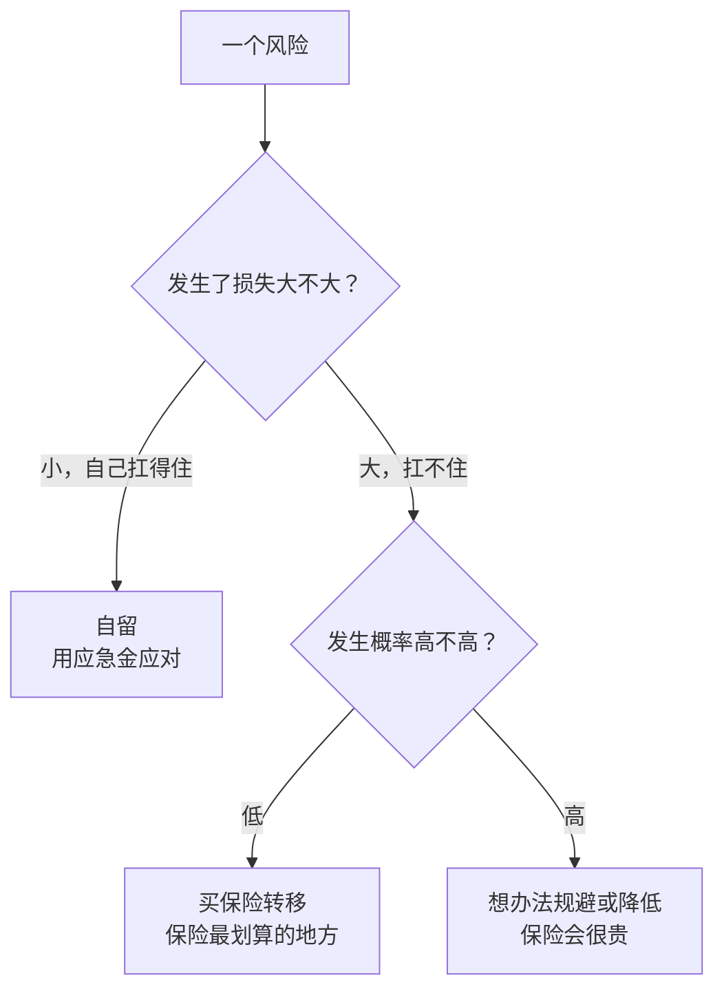
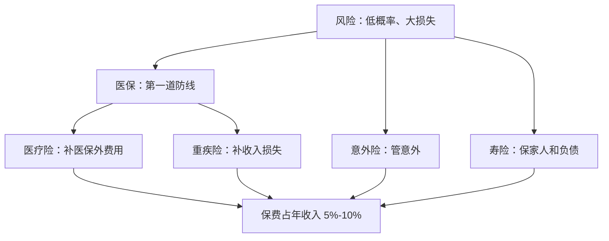

# 第 5 章 保险：用小钱转移大风险

> **本章导读**
>
> - 建议用时：45 分钟（含动手 10 分钟）
> - 前置知识：第 1 章（保命的钱）、第 4 章（应急金）
> - 读完你能回答：
>   1. 保险到底在解决什么问题？什么风险值得买保险？
>   2. 有了医保，为什么还需要商业保险？
>   3. 医疗险、重疾险、意外险、寿险，各管什么？先买哪个？
>   4. 为什么返还型、理财型保险通常不是新手的首选？
>   5. 投保时哪些细节最容易导致拒赔？

---

## 【积木 5-1】保险的本质：花一笔确定的小钱，换掉一个不确定的大损失

第 4 章的应急金能扛住几个月没收入，但扛不住一场要花几十万的大病。这种风险靠自己存钱是存不过来的，只能**转移**出去。

保险的原理很朴素：一大群人每人交一点钱汇成一个池子，谁出了事，就从池子里拿钱。你付出的是确定的保费，换来的是「万一出事，不会被一次打垮」。

什么风险值得买保险？用一张图判断：



**保险最适合「概率低、损失大」的风险**：重病、残疾、身故、大额意外。反过来，手机碎屏、感冒发烧这类损失小的事，用应急金就够了，买保险反而不划算。

### 一个高频误解：「买了保险没出事，钱就白花了」

不是白花。你买到的是「这一年里，万一出事也不会垮」的确定性。就像家里装了防盗门，一年没有小偷上门，你不会觉得防盗门白装了。

---

## 【积木 5-2】社保医保管什么，管不了什么

小林只有公司缴纳的社保。社保里的**基本医疗保险**（简称医保）非常重要，它是第一道防线，也是很多商业保险理赔的前提。但它有三条边界：

| 边界 | 含义 | 后果 |
|---|---|---|
| 起付线 | 一年内医疗费用低于这个数，医保不报 | 小病基本自己出 |
| 报销比例 | 起付线以上也只报一部分，剩下自付 | 大病自付部分可能很多 |
| 封顶线 + 目录 | 报销有年度上限；不在医保目录里的药品、耗材、项目不报 | 进口药、部分靶向药、特需病房等可能全自费 |

具体数字**各地不同、每年会调**，去当地医保局官网或「国家医保服务平台」App 查你所在城市的规则。

还有一项医保管不了的：**收入损失**。生一场大病，治疗加康复可能一两年不能正常工作，房租、分期照样要付。医保只管医药费，不管你没了收入怎么办。

所以商业保险要补的是两个缺口：**医保报不了的医疗费**和**生病期间的收入损失**。

### 关于惠民保

很多城市有政府指导、保险公司承办的「城市定制型商业医疗险」，俗称**惠民保**。特点是便宜、通常不限职业年龄、部分产品允许带病投保（但既往症赔付比例往往较低）。缺点是免赔额通常较高、保障范围因城市而异。可以作为补充，不能完全替代百万医疗险。具体以你所在城市的产品条款为准。

---

## 【积木 5-3】四大险种：各管一摊

| 险种 | 解决什么 | 怎么赔 | 年轻人的优先级 |
|---|---|---|---|
| 医疗险 | 医保报不了的住院医疗费 | 报销型：花多少报多少，不超过实际费用 | 最高 |
| 意外险 | 意外导致的身故、伤残、医疗 | 身故伤残按比例给付；意外医疗报销 | 高 |
| 重疾险 | 确诊重病后的收入损失和康复费用 | 给付型：确诊符合条件就一次性给保额 | 高 |
| 寿险 | 身故后家人的生活、未还的债 | 身故给付保额 | 有人靠你养或有大额负债时才高 |

### 医疗险：报销「花掉的钱」

常见的是**百万医疗险**：保额通常几百万，有一个年度免赔额（常见 1 万元左右），超过部分在医保报销后按比例报销。保费相对低，因为免赔额挡掉了大量小额理赔。

关注三点：**免赔额**多少、**续保条件**（是否保证续保、保证几年）、是否覆盖**医保外**的药品和项目。

### 重疾险：补偿「失去的收入」

重疾险是**给付型**：确诊合同约定的疾病并符合定义，就一次性赔付保额，钱怎么用你说了算。

疾病定义有行业统一规范。中国保险行业协会与中国医师协会 2020 年 11 月 5 日发布的《重大疾病保险的疾病定义使用规范（2020 年修订版）》规定了 **28 种重度疾病和 3 种轻度疾病**（恶性肿瘤、急性心肌梗死、脑中风后遗症三种核心疾病分为重度和轻度两级），**规范内 3 种轻度疾病的赔付比例上限为保额的 30%**。例如 TNM 分期为 I 期的甲状腺癌按轻度赔付。各产品可以在规范之外增加病种。来源：中国保险行业协会官网答记者问（2020-11-05）。

### 一个高频误解：「有了医疗险，就不需要重疾险」

两者解决的是不同问题。医疗险报销**医院里花的钱**，出院之后的康复、营养、护理以及没法上班损失的收入，医疗险都不管。重疾险给的是一笔**可以自由支配的钱**，用来补这些缺口。

### 意外险

便宜、几乎不挑健康状况，但只保**意外**（外来的、突发的、非本意的、非疾病的）。猝死通常不算意外，除非条款特别约定。买的时候看清是否含**意外医疗**、有没有职业限制。

### 寿险

**定期寿险**：保到某个年龄（如 60 岁），期间身故赔付，保费低，适合「上有老下有小、还背着房贷」的人。
**终身寿险**：保终身，一定会赔，所以保费高得多，更多用于财富传承，不是新手的保障工具。

---

## 【积木 5-4】买保险的顺序和预算

几条原则：

1. **先给家庭经济支柱买，再给孩子和老人买**。家里最怕的是挣钱的人倒下。很多家庭只给孩子买、大人裸奔，顺序反了。
2. **先保障，后理财**。先把医疗、意外、重疾、寿险这些保障型配齐，再考虑储蓄型。
3. **先保额，后保期**。预算有限时，宁可先买定期（保到 60 或 70 岁）、把保额买够，也不要为了「保终身」把保额买得很低。保额不够，出事时只能解决一小部分问题。
4. **保费别太多**。常见经验是年保费占年收入的 5% 到 10%（也有人说「双十原则」：保额为年收入 10 倍、保费不超过年收入 10%，出处不可考，只能当粗略参考）。保费太高会挤压第 3 章的储蓄和第 4 章的应急金。


---

## 【积木 5-5】为什么返还型、理财型保险通常不适合新手

市场上很多产品主打「有病赔钱，没病返本」「保障加理财两不误」。它们的问题在于：

- **同样的保障，保费贵得多**。多出来的那部分，本质上是你存在保险公司的钱，到期再还给你。
- **这笔钱的收益率通常不高**。按第 1 章的思路，把多出的保费换成你自己做的长期投资，几十年后的差距可能很大。几十年后拿回的「本金」，还要扣掉通胀（第 1 章积木 1-4）。
- **流动性差**。中途退保往往只能拿回「现金价值」，前几年可能远低于已交保费。

所以对预算有限的年轻人，更常见的思路是「**买消费型保障，把省下的保费自己存或投**」。这不是说储蓄型保险一无是处：对于自律性差、需要强制储蓄、或有特定传承需求的人，它有它的用处。关键是**先搞清楚你买的是保障还是储蓄**，别把两者混在一起，以为买了很多保障。

---

## 【积木 5-6】投保避坑：最容易拒赔的地方

| 环节 | 坑 | 怎么做 |
|---|---|---|
| 健康告知 | 有病史、体检异常没如实告知 | 问什么答什么，如实告知。《保险法》第十六条规定了投保人的如实告知义务，故意或重大过失未告知，保险公司可能解除合同、不赔 |
| 等待期 | 投保后一段时间内出险不赔或只退保费 | 医疗险、重疾险常有 30 到 180 天等待期，越早买越好，别等身体出问题再买 |
| 免赔额 | 以为花了就能报 | 看清免赔额多少、是每年还是每次 |
| 续保 | 以为一年期产品永远能续 | 看是否「保证续保」、保证几年；不保证续保的产品，生病后可能续不了 |
| 职业 | 高风险职业不在承保范围 | 看清职业类别限制 |
| 受益人 | 寿险受益人写「法定」 | 按自己的意愿指定受益人，避免纠纷 |

### 一个高频误解：「过了两年，保险公司就必须赔」

《保险法》第十六条确实规定：保险人的合同解除权自知道有解除事由之日起超过三十日不行使而消灭，自合同成立之日起**超过二年的，保险人不得解除合同**，发生保险事故的应当承担赔偿或给付责任。这常被称为「不可抗辩条款」。但它**不是带病投保、隐瞒病史的护身符**：涉及故意欺诈等情形的实务争议很多，而且等你真需要理赔时，打官司的成本和不确定性都很高。**如实告知永远是最省事的做法。**

---

## 【积木 5-7】小林的保险方案

小林：28 岁，单身，父母有退休金、不需要他供养，负债 2 万（分期），流动资产 3 万，税后年收入约 14.4 万。

```bash
python3 tools/insurance_needs.py --income 144000 --debt 20000 --liquid 30000 --recovery-years 3
```

```text
税后年收入 144,000
  重疾险建议保额  432,000  （年收入 x 3 年康复期）
  寿险建议保额    0  （负债可被现有资产覆盖，且没有人靠你的收入生活，暂不急需）
  医疗险          百万医疗险，保额通常数百万，覆盖住院大额自费
  意外险          保额可参考 年收入 x 3 到 5，并含意外医疗
  年保费预算      7,200 到 14,400  （年收入 5% 到 10%）
```

他的方案：

| 险种 | 决定 | 原因 |
|---|---|---|
| 医疗险 | 买一份百万医疗险，优先选保证续保期长的 | 补医保的大额缺口，最便宜也最急 |
| 意外险 | 买一份含意外医疗的综合意外险 | 便宜，补意外伤残 |
| 重疾险 | 买定期重疾，保额约 40 万到 50 万 | 补约 3 年收入损失；预算有限，先保额后保期 |
| 寿险 | 暂不买 | 没有人靠他的收入生活，负债能被资产覆盖 |
| 惠民保 | 所在城市有就加一份 | 低成本补充 |
| 返还型保险 | 不买 | 保费高，不符合「先保障」 |

**实际保费要以投保时具体产品的报价为准**，本课不推荐具体产品。小林的原则是总保费控制在年收入 5% 到 10% 之内，买完后在第 3 章的预算里加一行「保险」，按年度大额池的方式每月存 1/12。

### 什么时候要重新评估？

结婚、生孩子、买房背房贷、换工作（公司福利变化）、父母需要赡养时。比如工具的第二组测算：同样收入，如果背了 100 万房贷、有一个孩子还需供养 15 年、每年支出 6 万，寿险需求就变成约 185 万。**保险方案跟着人生阶段变**，第 21 章还会回到这里。

---

## 【积木 5-8】动手

1. 查一下你的社保：当地医保的起付线、报销比例、封顶线；你公司有没有补充医疗保险。
2. 跑一遍需求测算：

```bash
python3 tools/insurance_needs.py --income 你的税后年收入 --debt 负债 --liquid 流动资产 \
  --dependents-spend 被供养人年支出 --dependents-years 供养年数 --recovery-years 3
```

3. 把已有保单都翻出来，列一张表：险种、保额、保到几岁、年保费、受益人。很多人会发现自己买了不少，却没有一份真正覆盖大病。
4. 如果要投保，逐条读健康告知，如实回答。

---

## 【本章小结】

三句话：

1. **保险用确定的小钱换掉不确定的大损失**，最适合概率低、损失大的风险；医保是第一道防线，但管不了目录外费用和收入损失。
2. **四大险种各管一摊**：医疗险报销医疗费，重疾险补收入损失，意外险管意外，寿险保家人；年轻单身先配医疗、意外、重疾。
3. **先大人后孩子、先保障后理财、先保额后保期**；如实告知，看清等待期、免赔额和续保条件。



### 自测题

1. 手机碎屏险和重疾险，哪个更符合「保险最划算的地方」？为什么？（积木 5-1）
2. 医保的三条边界是什么？（积木 5-2）
3. 医疗险和重疾险分别是报销型还是给付型？有了医疗险为什么还需要重疾险？（积木 5-3）
4. 按 2020 年版重疾规范，I 期甲状腺癌怎么赔？规范内轻度疾病赔付比例上限是多少？（积木 5-3）
5. 一个家庭预算有限，应该先给孩子买还是先给父母中挣钱多的人买？（积木 5-4）
6. 为什么说「先保额，后保期」？（积木 5-4）
7. 返还型保险的主要问题是什么？（积木 5-5）
8. 投保两年后，隐瞒病史就一定能赔吗？（积木 5-6）

---

## 【下一章预告】

到这里，第一阶段「守住钱」就讲完了：小林有了报表、预算、应急金和保险。从第 6 章开始，进入第二阶段「认识工具」。第一课不讲具体产品，而是讲一个所有产品都逃不开的规律：**风险、收益、流动性的不可能三角**。

- 为什么不存在「高收益、低风险、随时取」的产品？
- 风险到底怎么衡量？波动和亏损是一回事吗？
- 你的钱什么时候要用，为什么决定了它能承受多大的风险？

*学完本章，回到对话里说一句「继续」，我就开讲第 6 章。*
