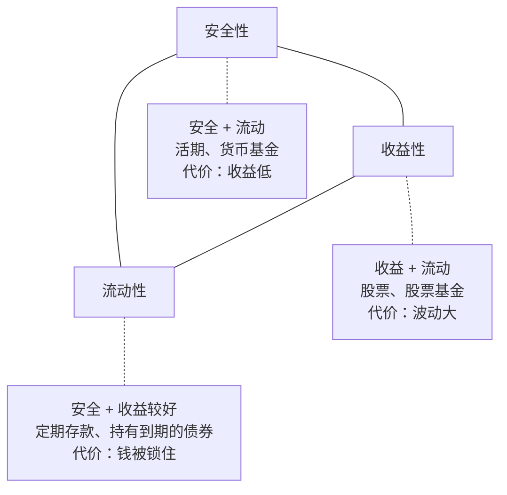
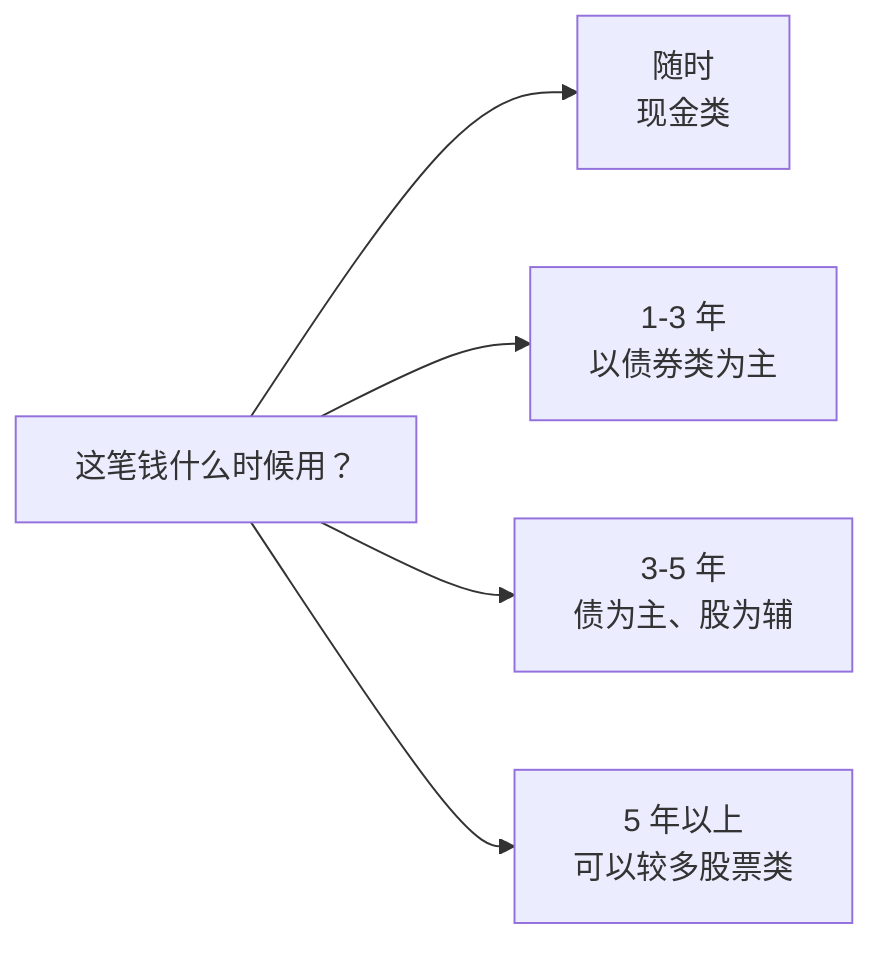
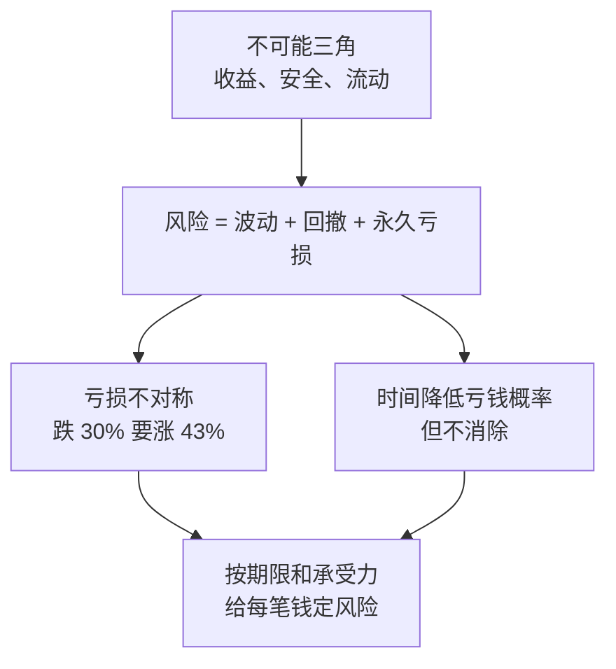

# 第 6 章 风险、收益、流动性：理财的不可能三角

> **本章导读**
>
> - 建议用时：45 分钟（含动手 10 分钟）
> - 前置知识：第 1 章（复利、实际收益）、第 4 章（应急金放哪）
> - 读完你能回答：
>   1. 为什么不存在「高收益、低风险、随时取」的产品？
>   2. 风险到底是什么？波动、回撤、亏损有什么区别？
>   3. 为什么亏 30% 要涨 43% 才能回本？
>   4. 持有时间长，风险就消失了吗？
>   5. 怎么给每一笔钱选择合适的风险水平？

---

## 【积木 6-1】不可能三角：三个愿望只能挑两个

任何一个理财工具，都可以从三个维度打分：

| 维度 | 问的是 | 高分的样子 |
|---|---|---|
| 收益性 | 长期能赚多少？ | 长期回报高 |
| 安全性 | 会不会亏、亏多少？ | 几乎不亏 |
| 流动性 | 要用钱时能不能马上取出、不打折？ | 随时取、不损失 |

**不可能三角**说的是：一个工具不可能三项都拿满分，最多同时占两项。



为什么会这样？可以从「谁愿意给你钱」来理解：

- 你想要**高收益**，就得有人付这笔钱。别人凭什么多付？因为你承担了他不想承担的东西：要么是**风险**（企业可能经营失败），要么是**时间**（钱被锁住很久不能用）。
- 如果一个产品既不让你承担风险，又不锁住你的钱，还给你高收益，那多出来的钱从哪来？

所以，**看到号称三项全满的产品，第一反应应该是：它把风险藏在了哪里？** 第 22 章讲防骗时，这是第一条判断标准。

### 一个高频误解：「银行卖的就不会亏」

银行柜台和 App 里卖的产品，既有银行自己的存款，也有银行代销的理财、基金、保险。2018 年资管新规（《关于规范金融机构资产管理业务的指导意见》）发布后，资管产品打破刚性兑付，银行理财不再承诺保本，按净值波动，可能亏损。**看产品属于什么，不看在哪买的。** 产品说明书上的风险等级（通常是 R1 到 R5 或类似分级）比「银行」两个字更重要。

---

## 【积木 6-2】风险到底是什么：波动、回撤、亏损

日常说的「风险」，其实混着三个不同的东西：

| 概念 | 含义 | 例子 |
|---|---|---|
| 波动 | 价格上下起伏的剧烈程度 | 一只基金一年里在 -15% 到 +20% 之间来回 |
| 回撤 | 从最高点跌下来的幅度 | 从 1.5 元跌到 1.05 元，回撤 30% |
| 永久亏损 | 钱真的回不来了 | 公司破产、骗局、在低点被迫卖出 |

**波动不等于亏损**。一个长期向上但波动大的资产，只要你拿得住、不用在低点卖，波动本身不会让你亏钱。真正让人亏钱的，往往是：

1. **买到了本身就会永久亏损的东西**（基本面变坏、骗局）；
2. **在波动的低点，被迫或忍不住卖出**，把浮亏变成实亏。

第 2 种比第 1 种常见得多。它通常发生在两种情况下：要用钱了（流动性问题），或者扛不住了（心理问题，第 14 章细讲）。

### 衡量风险的两个常用数字

- **年化波动率**：收益率的标准差，衡量「平时晃得多厉害」。做数据分析的你应该很熟悉，就是收益序列的标准差再年化。
- **最大回撤**：历史上从最高点到之后最低点的最大跌幅，衡量「最坏的时候有多疼」。

买任何会波动的产品之前，先去看它的历史最大回撤，然后问自己：**如果我的钱真的跌了这么多，我能不能睡得着？会不会卖？** 第 20 章会教你怎么自己算这两个数。

---

## 【积木 6-3】亏损的不对称：跌 30% 要涨 43% 才能回本

```bash
python3 tools/risk_sim.py recover
```

```text
    亏损      回本需要涨
   10%       11.1%
   20%       25.0%
   30%       42.9%
   40%       66.7%
   50%      100.0%
   70%      233.3%
```

原因很简单：跌是从大数往下跌，涨是从小数往上涨。100 跌 30% 是 70，70 要涨回 100，需要涨 30 ÷ 70 ≈ 42.9%。

这张表告诉我们两件事：

1. **控制回撤比追求高收益更重要**。跌得越深，回本越难，所需的时间也越长。
2. **「等它涨回来」不是计划**。跌 50% 需要翻倍才能回本，这可能要很多年，也可能永远不会发生（如果它本身就是个坏资产）。

### 小林的那只基金

小林买入 15,000 元，现在约 10,500 元，亏了 30%。按上表，它需要涨约 43% 才能回本。这不是说它一定涨不回来，也不是说现在就该卖。该不该卖，取决于两个问题，我们在第 10 章和第 14 章回答：

- 这只基金本身还值不值得持有？（看它是什么、为什么跌）
- 如果今天手里是 10,500 元现金，你还会买它吗？（排除「回本心理」的干扰）

---

## 【积木 6-4】时间与风险：持有越久越安全，但不是零风险

常听到一句话：「长期持有股票就不会亏。」我们用模拟来检验一下。

下面是三类资产的**假设参数**（只表示量级，不代表任何产品）：偏现金类年化收益 2%、波动 0.5%；偏债券类 4%、4%；偏股票类 8%、20%。每种情形模拟 2 万次：

```bash
python3 tools/risk_sim.py horizon
```

```text
偏债券类：假设年化收益 4.0%、年化波动 4.0%（模拟 20000 次）
    持有年数     到期亏钱概率   最差 5% 情形的期末值     期间平均最大回撤
         1          16.1%                 0.97 倍             0.3%
         3           4.3%                 1.00 倍             1.0%
         5           1.4%                 1.05 倍             1.6%
        10           0.1%                 1.20 倍             2.6%
        20           0.0%                 1.62 倍             3.9%

偏股票类：假设年化收益 8.0%、年化波动 20.0%（模拟 20000 次）
    持有年数     到期亏钱概率   最差 5% 情形的期末值     期间平均最大回撤
         1          35.4%                 0.75 倍             4.8%
         3          27.7%                 0.66 倍            12.8%
         5          23.8%                 0.64 倍            19.0%
        10          16.8%                 0.63 倍            29.1%
        20           9.2%                 0.75 倍            39.9%
```

（偏现金类各持有期亏钱概率均为 0，略。）

怎么读这张表：

1. **持有越久，到期亏钱的概率越低**。偏股票类从持有 1 年的约 35% 降到 20 年的约 9%。这是「长期投资」有道理的地方。
2. **但概率没有降到零，最坏的情形也没有消失**。即使持有 10 年，最差的 5% 情形下期末仍只有本金的约 0.63 倍。
3. **持有越久，途中经历的回撤越大**。20 年里平均会经历约 40% 的最大回撤。时间降低了「到期亏钱」的概率，却增加了「中途见到大跌」的机会。你得扛过这些大跌，才能拿到长期结果。

### 一个必须说明的局限

这个模拟假设每年收益服从正态分布、各年互相独立，并且只按年末看回撤。真实市场有**连续多年下跌、极端暴跌（厚尾）**，年内回撤也比年末数字更深。所以**真实世界的坏情况可能比模拟更坏**。模拟是用来建立直觉的，不是用来预测的。

### 一个高频误解：「长期持有就一定能赚钱」

更准确的说法是：**对于长期向上的优质资产，持有越久，亏钱的概率越低**。两个前提缺一不可：资产本身要长期向上（一只基本面持续恶化的股票，拿越久亏越多），你要真的拿得住（中途在大跌里卖掉，长期就不存在了）。

---

## 【积木 6-5】按「钱什么时候要用」来决定风险

把积木 6-4 的结论翻译成行动：**一笔钱能承受多大风险，首先取决于它什么时候要用**。

| 资金用途 | 什么时候用 | 适合的风险水平 | 第 1 章的抽屉 |
|---|---|---|---|
| 日常开销、应急金 | 随时 | 几乎不能有波动 | 要花的钱 |
| 1 到 3 年内的目标（旅行、换车） | 短期 | 低波动 | 保本的钱 |
| 3 到 5 年的目标（首付） | 中期 | 中低波动，可少量配股票类 | 保本的钱 + 少量生钱的钱 |
| 5 年以上不用的钱（养老、长期增值） | 长期 | 可承受较大波动 | 生钱的钱 |



这就是第 4 章说「应急金不能放股票」的原因：你无法控制失业发生在市场的高点还是低点。

### 第二个维度：你自己能扛多少

钱的期限决定了你「能承受」多少风险，你的性格决定了你「愿意承受」多少。两者取较低的那个。

一个简单的自测：**想象你投入 10 万，一年后变成 7 万，你会怎么做？**

| 反应 | 说明 |
|---|---|
| 睡不着，想全部卖掉 | 股票类占比要低，先从低波动产品开始 |
| 难受，但能忍着不动 | 可以配一部分股票类 |
| 觉得便宜了，想再买一点 | 风险承受力较高，但也要防止过度自信 |

**最常见的错误，是在牛市里高估自己的承受力。** 涨的时候人人都觉得自己能扛 30% 的回撤，真跌到 30% 时才知道不行。所以新手宁可先保守一点，用小钱实际经历一次下跌，再决定要不要加。

---

## 【积木 6-6】小林的钱分到哪个格子

按本章的方法，小林给每笔钱贴上「期限」标签：

| 钱 | 金额 | 什么时候用 | 风险水平 |
|---|---|---|---|
| 应急金 | 3 万，目标 4.6 万 | 随时 | 现金类，第 7 章选工具 |
| 年度大额池 | 每月 800 | 1 年内 | 现金类 |
| 首付储蓄 | 应急金存满后开始 | 约 5 年 | 债为主、股为辅，第 8、12 章细化 |
| 被套的基金 | 10,500 | 没想好 | 先搞清楚它是什么，第 10 章 |

小林发现，他以前的问题不是「选错了产品」，而是**从没想过每笔钱的期限**：把可能几年内要用的钱，放进了一个一年就可能跌 30% 的产品里。

他还做了承受力自测：想到 10 万变 7 万，他的答案是「睡不着」。这说明即使是 5 年以上的长期钱，他一开始也不适合配太高的股票类比例。第 12 章做资产配置时会用到这个结论。

---

## 【积木 6-7】动手

1. 列出你所有的钱，每一笔标上「什么时候要用」，对照积木 6-5 的表，看有没有放错格子的。
2. 打开你持有的每一个产品，找到它的**风险等级**和**历史最大回撤**（基金 App 的详情页通常能找到）。
3. 用自己的假设参数跑一次模拟，比如：

```bash
python3 tools/risk_sim.py horizon --mu 6 --sigma 15
```

4. 做积木 6-5 的「10 万变 7 万」自测，把答案写下来，第 12 章会用到。

---

## 【本章小结】

三句话：

1. **收益、安全、流动性三者最多占两样**；看到三样全占的产品，先问风险藏在哪。
2. **波动不等于亏损**，真正让人亏钱的多是在低点被迫或忍不住卖出；跌得越深越难回本，控制回撤很重要。
3. **钱的期限决定能承受多少风险，性格决定愿意承受多少**，两者取较低者；长期持有降低亏钱概率，但不会降到零。



### 自测题

1. 不可能三角是哪三个维度？活期存款占了哪两个？（积木 6-1）
2. 「在银行买的理财一定保本」，这句话对吗？为什么？（积木 6-1）
3. 波动、回撤、永久亏损有什么区别？哪一种最常让普通人亏钱？（积木 6-2）
4. 一笔投资亏了 40%，要涨多少才能回本？（积木 6-3）
5. 根据模拟，持有偏股票类资产 10 年，亏钱概率是零吗？持有越久，途中的回撤会怎样？（积木 6-4）
6. 这个模拟有哪些局限？（积木 6-4）
7. 3 年后要用的首付款，适合全部买股票基金吗？为什么？（积木 6-5）
8. 小林以前的根本问题是什么？（积木 6-6）

---

## 【下一章预告】

小林的应急金和年度大额池都要放在「现金类」里。但现金类也有很多选择，收益、到账速度、风险各不相同。第 7 章讲**现金管理**：

- 活期、定期、大额存单有什么区别？存款保险保多少？
- 货币基金是什么？为什么它不是「保本」的，却又非常稳？
- 国债逆回购是什么，什么时候用？
- 应急金怎么在这些工具里分层摆放？

*学完本章，回到对话里说一句「继续」，我就开讲第 7 章。*
