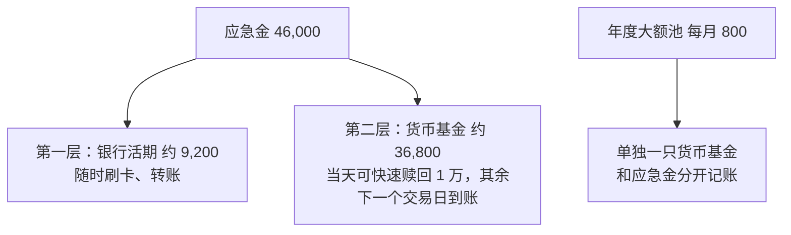
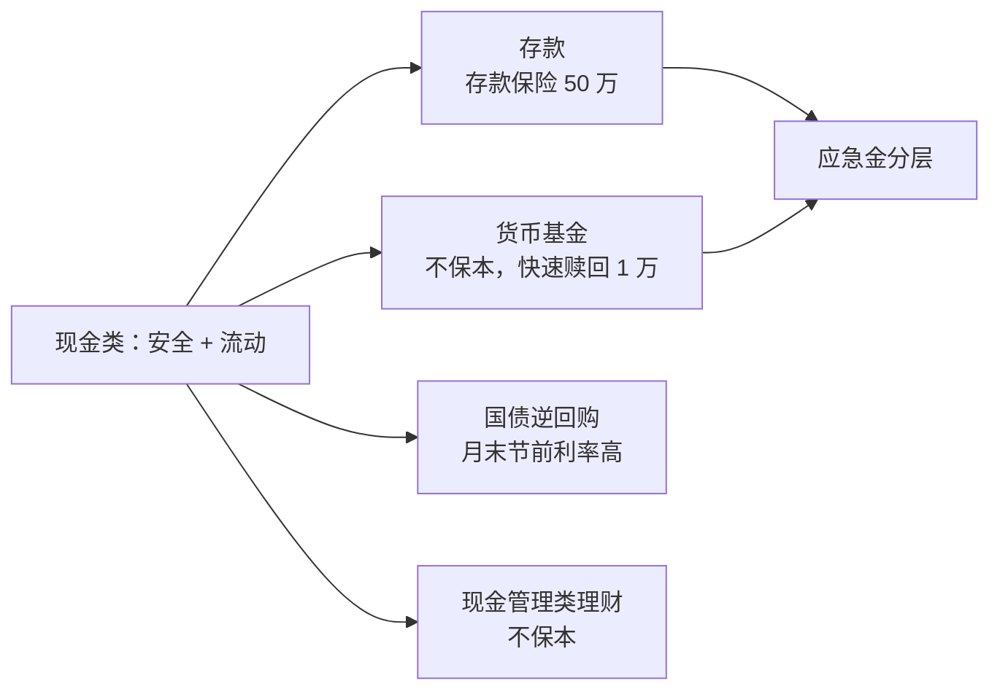

# 第 7 章 现金管理：存款、货币基金、国债逆回购

> **本章导读**
>
> - 建议用时：40 分钟（含动手 10 分钟）
> - 前置知识：第 4 章（应急金）、第 6 章（不可能三角）
> - 读完你能回答：
>   1. 活期、定期、大额存单有什么区别？存款保险保多少？
>   2. 货币基金是什么？为什么它不保本，却又非常稳？
>   3. 「T+0 快速赎回」为什么每天只能取 1 万？
>   4. 国债逆回购是什么，什么时候值得用？
>   5. 应急金该怎么在这些工具里摆放？

---

## 【积木 7-1】现金类工具：不可能三角里的「安全 + 流动」

第 6 章说过，任何工具最多占三角中的两个角。现金类工具占的是**安全**和**流动**，代价是**收益低**。

所以选现金工具时，不要指望它让你变富。它的任务只有一个：**需要钱的时候，钱一分不少地在那里**。在这个前提下，再去比较一点收益差别。

本章讲四类工具：

| 工具 | 本质 | 谁在保障 |
|---|---|---|
| 银行存款 | 你借钱给银行 | 银行信用 + 存款保险 |
| 货币基金 | 你买了一只投资短期债券、存单的基金 | 资产本身的低风险，不保本 |
| 国债逆回购 | 你通过交易所把钱短期借出去，对方用国债作抵押 | 交易所制度 + 国债抵押 |
| 银行现金管理类理财 | 类似货币基金的银行理财 | 资产本身的低风险，不保本 |

---

## 【积木 7-2】银行存款：活期、定期、大额存单

| 类型 | 特点 | 适合 |
|---|---|---|
| 活期 | 随时存取，利率最低 | 日常支付、应急金的第一层 |
| 整存整取定期 | 约定期限，到期取本息；**提前支取通常按活期计息** | 确定一段时间内不用的钱 |
| 大额存单 | 起存金额高（常见 20 万元起），利率比同期限定期略高；部分可转让 | 金额大、期限确定的钱 |
| 通知存款、协定存款等 | 介于活期和定期之间 | 有特定需求时再了解 |

### 现在的利率大概在什么水平？

存款利率由各银行自己挂牌，会跟着市场利率调整，**这几年在持续下调**。以下数字只用来感受量级，**存钱前请以银行 App 当天的挂牌利率为准**：

| 产品（国有大行） | 年利率 | 来源与时点 |
|---|---|---|
| 活期 | 0.05% | 广州新闻网 2026-07-14 报道，非一手来源，需核实 |
| 1 年期定期 | 0.95% | 同上 |
| 3 年期定期 | 1.25% | 同上 |
| 3 年期个人大额存单 | 1.55%（起存 20 万） | 工商银行个人网上银行产品页，2026-10-22 检索 |

小林把 46,000 元（应急金目标）放在不同地方一年，利息差多少？

```bash
python3 tools/cash_tools.py compare --amount 46000 --rates 活期=0.05 货币基金=1.0 一年定期=0.95 三年定期=1.25
```

```text
本金 46,000 元，存放 1 年的利息（按你输入的年化利率）
  活期         年化  0.05%   利息约       23 元
  货币基金       年化  1.00%   利息约      460 元
  一年定期       年化  0.95%   利息约      437 元
  三年定期       年化  1.25%   利息约      575 元
```

（货币基金的 1.0% 是假设值，下一节讲它的真实收益怎么看。）

两个观察：

1. **活期几乎没有利息**，4.6 万一年 23 元。大笔钱长期放活期，是最常见的「躺着亏」（第 1 章的通胀）。
2. **定期比货币基金多不了多少，有时还更少**。在这种利率环境下，为一点点利息把应急金锁进定期，不划算。

### 定期提前支取：利息几乎归零

```bash
python3 tools/cash_tools.py early --amount 14000 --rate 0.95 --demand 0.05 --months 10 --term 12
```

```text
本金 14,000，12 个月定期，年化 0.95%
  存满到期的利息           133.00 元
  第 10 个月提前支取（按活期 0.05%）利息     5.83 元
  如果放活期 10 个月，利息也是 5.83 元：提前支取等于白存定期
```

所以**定期只适合「确定不会提前用」的钱**。具体的提前支取规则以银行为准，有的产品允许部分提前支取。

### 存款保险：50 万元以内全额偿付

《存款保险条例》（国务院令第 660 号，2015 年 5 月 1 日起施行）第五条规定：存款保险实行限额偿付，最高偿付限额为人民币 50 万元；**同一存款人在同一家投保机构**所有被保险存款账户的本金和利息合并计算，在 50 万元以内的全额偿付。来源：中国政府网。

三个要点：

- 按**每家银行**分别计算，不是全部银行合计 50 万。存款多的人可以分散在几家银行。
- 保的是**存款**。银行代销的基金、理财、保险，**不在存款保险范围内**。
- 超过 50 万的部分，不是一定拿不回，而是要从银行清算财产中受偿。

### 一个高频误解：「那家小银行利率高，反正有存款保险」

50 万以内确实受保护。但要注意两件事：一是确认你买的是**存款**，而不是挂着银行名头的理财或其他产品；二是**明显高于市场水平的「高息存款」**要警惕。2026 年 7 月，四大行就曾联合发布风险提示，称「存 100 万解锁 5.25% 利息」属于冒用银行名义的虚假宣传（广州新闻网 2026-07-14 报道）。第 22 章会专门讲这类骗局。

---

## 【积木 7-3】货币基金：不保本，但非常稳

余额宝、零钱通、银行 App 里的各种「宝」，背后大多是**货币市场基金**（简称货币基金、货基）。

它投资的是期限很短、信用很高的东西：银行存款、同业存单、短期国债、央行票据等。监管对它的投资期限、信用等级、集中度都有严格限制，所以它的波动极小。

### 怎么看它的收益？

货币基金每天公布两个数：

| 指标 | 含义 |
|---|---|
| 万份收益 | 持有 1 万份，昨天赚了多少钱 |
| 七日年化收益率 | 用最近 7 天的收益折算成的年化收益 |

七日年化是**过去 7 天的情况，不是承诺**，每天都在变。举两个例子感受量级（新浪财经基金页面数据，非一手来源）：工银货币 A 的七日年化在 2026-05-22 为 0.927%，上银慧财宝货币 A 在 2026-05-10 为 1.124%。也就是说，**这一时期货币基金收益大致在 1% 上下**，和一年期定期差不多。

### 为什么说它不保本？

基金合同和公告里都有一句：「购买货币市场基金并不等于将资金作为存款存放在银行或者存款类金融机构，不保证基金一定盈利，也不保证最低收益。」它**不受存款保险保护**。历史上，在极端情况下个别货币基金也出现过单日收益为负。

但它的风险量级和股票基金完全不同：**正常情况下几乎每天都是小幅正收益**。所以它很适合放应急金，前提是你知道它不是存款。

### T+0 快速赎回：每天 1 万的上限

很多平台的货币基金可以「秒到账」，这叫 **T+0 快速赎回**。它不是你把基金卖掉的正常流程，而是**销售平台或基金公司先垫钱给你**，再慢慢走正常的赎回流程。

垫钱有风险，所以监管设了上限。按证监会 2018 年发布的《关于进一步规范货币市场基金互联网销售、赎回相关服务的指导意见》（证监会公告〔2018〕10 号），**单个投资者在单个销售渠道持有的单只货币基金，单日快速赎回上限为 1 万元**。来源：工银瑞信基金、上银基金 2018 年 6 月的相关公告。

超过 1 万怎么办？走**普通赎回**，一般下一个交易日到账（周末和节假日顺延）。

**这对应急金的含义**：如果你的应急金全在一只货币基金里，真遇到急事，当天最多只能拿出 1 万。所以应急金需要分层。

---

## 【积木 7-4】国债逆回购：月末、节前的小工具

名字听起来复杂，原理很简单：**你通过证券交易所，把钱短期借给需要资金的机构，对方拿国债作抵押**。到期后本金和利息自动回到你的证券账户。

| 特点 | 说明 |
|---|---|
| 安全性高 | 由交易所制度保障，有国债作抵押 |
| 期限短 | 常见 1 天、2 天、3 天、7 天、14 天、28 天等 |
| 利率波动大 | 跟资金市场松紧有关，**月末、季末、年末、长假前**常常明显升高，平时可能和货币基金差不多 |
| 门槛 | 需要开证券账户；起投金额、手续费以交易所和券商规则为准 |
| 操作 | 在券商 App 的「国债逆回购」专区选择期限，按「卖出」（借出资金）操作 |

一个常被提到的细节：**利息按实际占用天数计算**。比如节前最后一个交易日买入 1 天期，资金要到节后才能用，但计息天数会覆盖假期。具体计息天数在下单界面会显示。

### 一个高频误解：「逆回购利率有时 5%，比货基好多了」

那是某一天、某几天的年化利率，**只在很短的时间里有效**。一年里大多数时候它和货币基金差不多。而且它需要证券账户、需要在交易时间操作，资金量小的话多出来的利息只有几块钱。**对新手来说，它是锦上添花，不是必需品。** 等你第 9 章开了证券账户，可以小额试试。

---

## 【积木 7-5】银行现金管理类理财

银行 App 里还有一类产品，名字常带「天天」「日日」「现金」，比如「某某天天鑫」。它们大多是银行理财子公司发行的**现金管理类理财产品**，投资方向和货币基金类似，风险等级通常是最低的一档（如 PR1 或 R1）。

和货币基金的主要区别：

| | 货币基金 | 现金管理类理财 |
|---|---|---|
| 发行方 | 基金公司 | 银行理财子公司 |
| 监管 | 证监会 | 金融监管总局（原银保监会）、央行 |
| 收益 | 差不多 | 差不多，有时略高 |
| 是否保本 | 不保本 | 不保本 |

**两者都不是存款**。第 6 章说过，2018 年资管新规之后，银行理财不再承诺保本。

---

## 【积木 7-6】小林的现金分层

小林的应急金目标是 4.6 万（第 4 章），另外每月往年度大额池存 800 元（第 3 章）。按本章的知识，他这样摆放：



```bash
python3 tools/cash_tools.py ladder --amount 46000 --layers 银行活期=0.2 货币基金=0.8
```

```text
应急金 46,000 元分层：
  银行活期         20%      9,200 元
  货币基金         80%     36,800 元
```

他的考虑：

- **第一层**约 1 个月的必要支出，放活期，零门槛、零延迟。
- **第二层**放货币基金，利息比活期高很多；当天能快速赎回 1 万，其余第二个交易日到账，配合第一层足够应付大多数急事。
- **不用定期**：当前利率下定期比货币基金多不了多少，提前支取还会让利息归零。
- **年度大额池单独放**，避免和应急金混在一起，被不知不觉花掉。
- **国债逆回购暂时不用**：还没开证券账户，钱也不多。

### 一个高频误解：「把钱分散在好几只货币基金里，每只都能快速赎回 1 万」

规则上确实是按**单只基金、单个渠道**计算的，所以分散在几只货币基金里，能提高当天能取出的总额。但这会让账户变复杂。对大多数人来说，「活期 + 一只货币基金」两层已经够用，没必要为此开一堆账户。

---

## 【积木 7-7】动手

1. 打开你的银行 App，查当天的活期、一年定期、三年定期挂牌利率。
2. 打开你常用的「宝」类产品，看它背后是哪只货币基金，查它的七日年化和万份收益。
3. 用你查到的真实利率跑一次比较：

```bash
python3 tools/cash_tools.py compare --amount 你的应急金 --rates 活期=x 货币基金=y 一年定期=z
```

4. 把你的应急金按两层摆好，并确认第二层的快速赎回额度和普通赎回到账时间。

---

## 【本章小结】

三句话：

1. **现金工具的任务是「需要时钱在那里」**，在安全和流动的前提下再比收益；存款 50 万以内受存款保险保护，按每家银行分别计算。
2. **货币基金不是存款、不保本，但正常情况下非常稳**；七日年化不是承诺，快速赎回每天只能取 1 万。
3. **应急金分层摆放**：活期放约 1 个月，其余放货币基金；当前利率下定期优势不大，逆回购是锦上添花。



### 自测题

1. 现金类工具在不可能三角中占哪两个角？代价是什么？（积木 7-1）
2. 一年定期存了 8 个月要提前取出，利息大概怎么算？（积木 7-2）
3. 你在 A 银行存 40 万、B 银行存 30 万，A 银行出了问题，存款保险保多少？（积木 7-2）
4. 在银行 App 里买的基金，受存款保险保护吗？（积木 7-2）
5. 七日年化收益率是什么意思？它是不是承诺收益？（积木 7-3）
6. 为什么 T+0 快速赎回有 1 万元上限？这对应急金有什么影响？（积木 7-3）
7. 国债逆回购的利率什么时候常常比较高？为什么说它对新手不是必需品？（积木 7-4）
8. 小林为什么不把应急金放定期？（积木 7-6）

---

## 【下一章预告】

小林的首付储蓄大约 5 年后要用，第 6 章说它适合「债为主」。可是债券基金也会跌，有时一个月能跌好几个点，这是怎么回事？第 8 章讲**债券与固收**：

- 债券是什么？票面利率、到期收益率有什么区别？
- 为什么**利率上升，债券价格反而下跌**？
- 久期是什么，怎么用它估计债券基金能跌多少？
- 信用风险是什么，为什么「高收益债」不等于好债？

*学完本章，回到对话里说一句「继续」，我就开讲第 8 章。*
