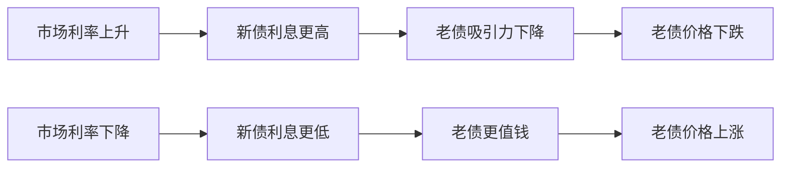
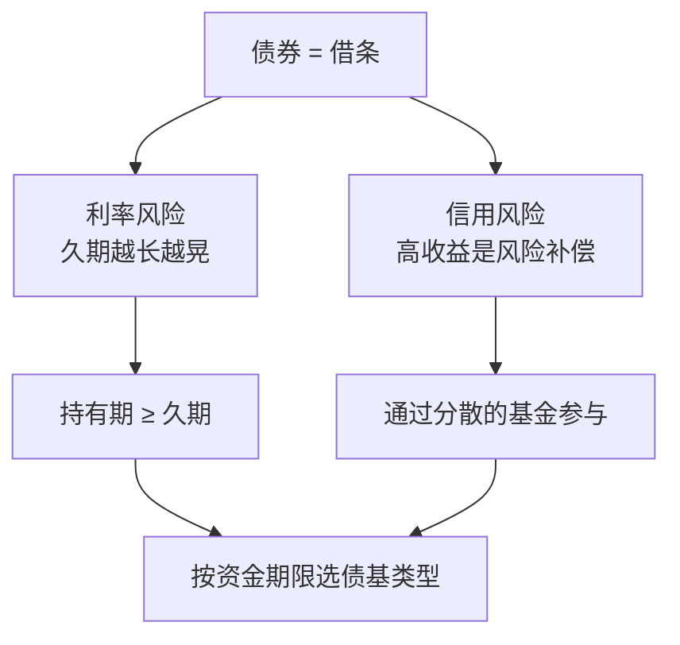

# 第 8 章 债券与固收：利率、久期与信用

> **本章导读**
>
> - 建议用时：50 分钟（含动手 10 分钟）
> - 前置知识：第 1 章（复利、折现的直觉）、第 6 章（不可能三角、回撤）
> - 读完你能回答：
>   1. 债券是什么？票面利率和到期收益率有什么区别？
>   2. 为什么利率上升，债券价格反而下跌？
>   3. 久期是什么？怎么用它估算债券基金可能跌多少？
>   4. 信用风险是什么？为什么「收益率高的债」不一定是好债？
>   5. 纯债基金、一级债基、二级债基有什么区别？3 到 5 年后要用的钱该选哪种？

---

## 【积木 8-1】债券就是一张「借条」

你把钱借给国家、地方政府或企业，对方给你一张标准化的借条，写清楚三件事：

| 要素 | 含义 | 例子 |
|---|---|---|
| 面值 | 到期还你多少本金 | 100 元 |
| 票面利率 | 每年按面值付多少利息 | 2.5%，每年付 2.5 元 |
| 到期日 | 哪天还本 | 10 年后 |

谁借钱，决定了这张借条有多可靠：

| 发行人 | 常见名称 | 信用 |
|---|---|---|
| 中央政府 | 国债 | 最高 |
| 政策性银行 | 政策性金融债（国开债等） | 很高 |
| 地方政府 | 地方政府债 | 高 |
| 企业、金融机构 | 公司债、企业债、金融债、短融、中票等 | 差别很大，看具体发行人 |

和存款最大的不同：**债券可以在市场上买卖**。你不必持有到期，可以在中途按当时的市场价格卖给别人。这就带来了一个存款没有的东西：**价格波动**。

---

## 【积木 8-2】票面利率 与 到期收益率

这是新手最容易混的两个数。

- **票面利率**：写在借条上，从发行那天起就固定不变，决定每年付多少利息。
- **到期收益率**（YTM，Yield to Maturity）：如果你**今天按市场价买入并持有到期**，每年实际能获得的收益率。它随价格每天在变。

两者什么时候不一样？当债券的价格不等于面值时：

```bash
python3 tools/bond_calc.py price --coupon 2.5 --years 10 --ytm 3.0
```

```text
面值 100，票面利率 2.5%，剩余 10 年，市场收益率 3.0%
  价格           95.73
  麦考利久期     8.94 年
  修正久期       8.68  （利率每变动 1 个百分点，价格约反向变动 8.68%）
```

一张票面利率 2.5% 的老债，如果现在市场上同类新债的收益率是 3%，谁还愿意按 100 元买它？只有价格降到约 95.73 元，买家每年拿 2.5 元利息、到期再赚回约 4.27 元差价，综合下来才相当于 3% 的收益率。

**新闻里说的「10 年期国债收益率」，指的就是到期收益率**，它是整个金融市场的「基准利率」之一，第 19 章讲宏观时会反复用到。最新数值可以在中国债券信息网（中债）或财经网站查到。

---

## 【积木 8-3】利率与价格反向：跷跷板

刚才的例子已经说明了一个最重要的规律：



**利率和债券价格是一块跷跷板**：利率涨，价格跌；利率跌，价格涨。

用工具看一只 10 年期、票面 2.5% 的债券，在市场收益率变动时价格怎么变：

```bash
python3 tools/bond_calc.py shock --coupon 2.5 --years 10 --ytm 2.5 --shifts -1 -0.5 0.5 1 2
```

```text
票面 2.5%，剩余 10 年，当前收益率 2.5%，价格 100.00，修正久期 8.75
      利率变动      新价格     精确涨跌     久期估算
     -1.00%    109.22     +9.22%     +8.75%
     -0.50%    104.49     +4.49%     +4.38%
     +0.50%     95.73     -4.27%     -4.38%
     +1.00%     91.68     -8.32%     -8.75%
     +2.00%     84.17    -15.83%    -17.50%
```

市场利率上升 1 个百分点，这只「很安全」的债券价格跌了约 8.3%。这就是为什么债券基金也会跌，而且有时跌得不少。**国债没有违约风险，但有利率风险**，这两个是完全不同的东西。

---

## 【积木 8-4】久期：一个数字说清利率风险

上面的表里有个「修正久期 8.75」，它就是衡量利率风险的核心指标。

**久期**（Duration）有两层意思：

1. **麦考利久期**：把所有现金流按到账时间加权平均，大约是「你平均要等多少年才能收回钱」。单位是年。
2. **修正久期**：利率每变动 1 个百分点，价格大约反向变动多少百分比。

日常用的是第二个，记一个公式就够：

```text
价格变动 ≈ − 修正久期 × 利率变动
```

修正久期 8.75，利率上升 1 个百分点，价格约跌 8.75%（精确值 8.32%）。利率变动越大，估算误差越大，这叫**凸性**：表里利率上升 2 个百分点时，估算跌 17.5%，实际只跌 15.8%。日常估算够用，知道这件事就行。

### 期限越长，久期越大，越「晃」

```bash
python3 tools/bond_calc.py compare --coupon 2.5 --ytm 2.5 --years 1 3 5 10 30
```

```text
票面 2.5%、收益率 2.5% 时，不同剩余期限的利率敏感度
    剩余年限     修正久期    利率上升 1 个百分点
         1       0.98            -0.97%
         3       2.86            -2.80%
         5       4.65            -4.52%
        10       8.75            -8.32%
        30      20.93           -18.39%
```

30 年期的国债，利率上升 1 个百分点能跌 18%，波动接近股票。**「国债」不等于「低波动」，要看期限。**

### 久期与持有期：为什么长期持有能扛住利率上升

利率上升短期让价格下跌，但也让你**之后收到的利息可以按更高的利率再投资**。如果你的持有时间大致等于久期，这两种效应会大致抵消。这就是债券投资里的一个经验：

> **让持有期限 ≥ 久期，利率波动对你的最终结果影响就小得多。**

反过来，如果你一年后就要用钱，却买了久期 8 年的债券基金，一旦利率上升，你很可能要在下跌时卖出。

### 一个高频误解：「债券基金很安全，不会亏」

债券基金的回撤主要来自两个地方：**利率上升**（久期越长跌越多）和**信用事件**（下一节）。另外还有一种情况：短时间内大量投资者集中赎回，基金被迫卖债，进一步压低价格。例如 2022 年 11 月，债市快速调整，叠加银行理财和债券基金的集中赎回，形成过一轮「下跌、赎回、再下跌」的负反馈，不少产品短期回撤明显。**债券基金波动小，但不是不会亏。**

---

## 【积木 8-5】信用风险：收益率高，往往是因为风险高

国债的风险主要是利率；企业债还多一层：**对方可能还不上**，这叫信用风险或违约风险。

市场用**信用利差**来定价这个风险：同样期限，企业债的收益率比国债高出的部分。利差越大，说明市场认为这家企业越可能出问题。

### 高收益的真实期望

假设一只债收益率 6%，看起来比国债高很多。但如果每年有 3% 的概率违约，违约后只能收回 40%：

```bash
python3 tools/bond_calc.py credit --ytm 6 --pd 3 --recovery 40
```

```text
收益率 6.0%，假设年违约概率 3.0%，违约后回收 40.0%
  一年期粗略期望收益 ≈ 6.0 - 3.0 x 0.60 = 4.20%
  但若真违约：这笔钱当年约亏 60%（不是平均的小损失，而是集中的大损失）
```

（违约概率和回收率均为假设值。）

两个结论：

1. **扣掉违约损失后，期望收益要低得多**。市场给的高收益，大部分是对风险的补偿，不是白送的。
2. **信用风险的损失是「集中」的**：平时一直拿着高利息，某一天突然亏掉一大半。所以普通人如果要碰信用债，**一定要通过分散得很好的基金**，而不是自己买单只企业债。

### 信用评级

评级机构会给发行人和债券打分，常见是 AAA、AA+、AA 等。评级是参考，但**不是保证**。2020 年 11 月，评级为 AAA 的河南永城煤电控股集团发行的债券出现违约，曾引发市场震动。评级会滞后，发行人的经营状况会变。

---

## 【积木 8-6】普通人怎么买债：债券基金分类

个人直接买债券门槛较高、品种有限，大多数人通过**债券基金**参与。按规定，80% 以上基金资产投资于债券的才叫债券基金（《公开募集证券投资基金运作管理办法》），剩余部分的投向决定了它的风格：

| 类型 | 投资范围 | 波动 | 适合 |
|---|---|---|---|
| 短债基金 | 主要投资剩余期限较短的债券 | 很小 | 1 到 2 年内可能用的钱 |
| 中长期纯债基金 | 只投债券，久期较长 | 中等，受利率影响大 | 3 年以上不用、能接受几个点回撤的钱 |
| 一级债基 | 债券为主，可投可转债等，不直接买股票 | 中等 | 稍微进取一点 |
| 二级债基 | 债券为主，可投不超过 20% 的股票 | 明显更大 | 想用少量股票增强收益，接受更大回撤 |
| 可转债基金 | 主要投资可转债 | 很大，接近偏股 | 不适合当「稳健的钱」 |

挑债券基金时，**看三件事**（第 10 章讲基金时会细化）：

1. **它属于哪一类**：基金名称不一定准确，看招募说明书里的投资范围。
2. **久期大概多少**：定期报告里通常会披露组合久期或剩余期限分布。
3. **历史最大回撤**：用第 6 章的方法问自己：这个跌幅我能接受吗？

---

## 【积木 8-7】小林的首付储蓄怎么放

小林的首付储蓄大约 5 年后要用（第 6 章），等应急金存满后开始每月投入。按本章的知识：

| 考虑 | 结论 |
|---|---|
| 持有期约 5 年，后期越来越短 | 久期不要超过剩余持有年限；越接近买房，越要往短债、货币基金挪 |
| 承受力低（第 6 章自测） | 以纯债类为主，暂不配二级债基和可转债基金 |
| 信用风险 | 只通过分散的基金参与，不买单只企业债，不追高收益 |
| 利率风险 | 接受短期几个点的波动；不在下跌时卖出，因为持有期大于久期 |

他的初步方案：首付储蓄**以短债基金和中短久期纯债基金为主**；最后 1 到 2 年，逐步把这部分钱转到货币基金和存款里，确保交首付那天，价格波动不会打乱计划。第 12 章做资产配置时，会再决定要不要加一小部分股票类。


---

## 【积木 8-8】动手

1. 用工具算一下：一只剩余 5 年、票面 2%、收益率 2% 的债券，利率上升 0.5 个百分点会跌多少？

```bash
python3 tools/bond_calc.py shock --coupon 2 --years 5 --ytm 2 --shifts 0.5
```

2. 打开你持有的或关注的一只债券基金，找到：基金类型、股票仓位上限、组合久期（或剩余期限分布）、历史最大回撤。
3. 查一下今天的 10 年期国债收益率（中国债券信息网或财经网站），把数值和日期记下来。第 19 章会用到。

---

## 【本章小结】

三句话：

1. **债券是标准化的借条，可以中途买卖**；票面利率固定不变，到期收益率随价格每天变化。
2. **利率与债券价格反向**，久期衡量这种敏感度：价格变动 ≈ − 修正久期 × 利率变动；期限越长越晃，持有期不短于久期就能扛住利率波动。
3. **收益率高往往意味着信用风险高**，违约损失集中而巨大；普通人通过分散的债券基金参与，并按资金期限选择短债、纯债或含股票的债基。



### 自测题

1. 一张债券票面利率 3%，现在价格 105 元，它的到期收益率比 3% 高还是低？（积木 8-2）
2. 为什么市场利率上升，已发行债券的价格会下跌？（积木 8-3）
3. 一只债券基金的久期为 4，利率上升 0.5 个百分点，大约跌多少？（积木 8-4）
4. 30 年期国债没有违约风险，它是不是低波动资产？（积木 8-4）
5. 为什么说「持有期 ≥ 久期」能降低利率波动对结果的影响？（积木 8-4）
6. 一只债收益率 8%，你应该先问什么问题？（积木 8-5）
7. AAA 评级的债券一定不会违约吗？（积木 8-5）
8. 纯债基金和二级债基的主要区别是什么？小林为什么暂时不配二级债基？（积木 8-6、8-7）

---

## 【下一章预告】

债券是「借钱给别人」，股票则是「成为公司的主人之一」。第 9 章讲**股票是什么**：

- 股票的本质是什么？股价长期由什么决定？
- 交易所、主板、创业板、科创板、北交所有什么区别？
- A 股的交易规则：T+1、涨跌停、交易时间、费用
- 怎么开证券账户？新手开户后最该先做什么、最不该做什么？

*学完本章，回到对话里说一句「继续」，我就开讲第 9 章。*
