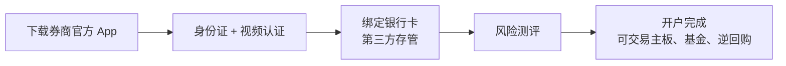
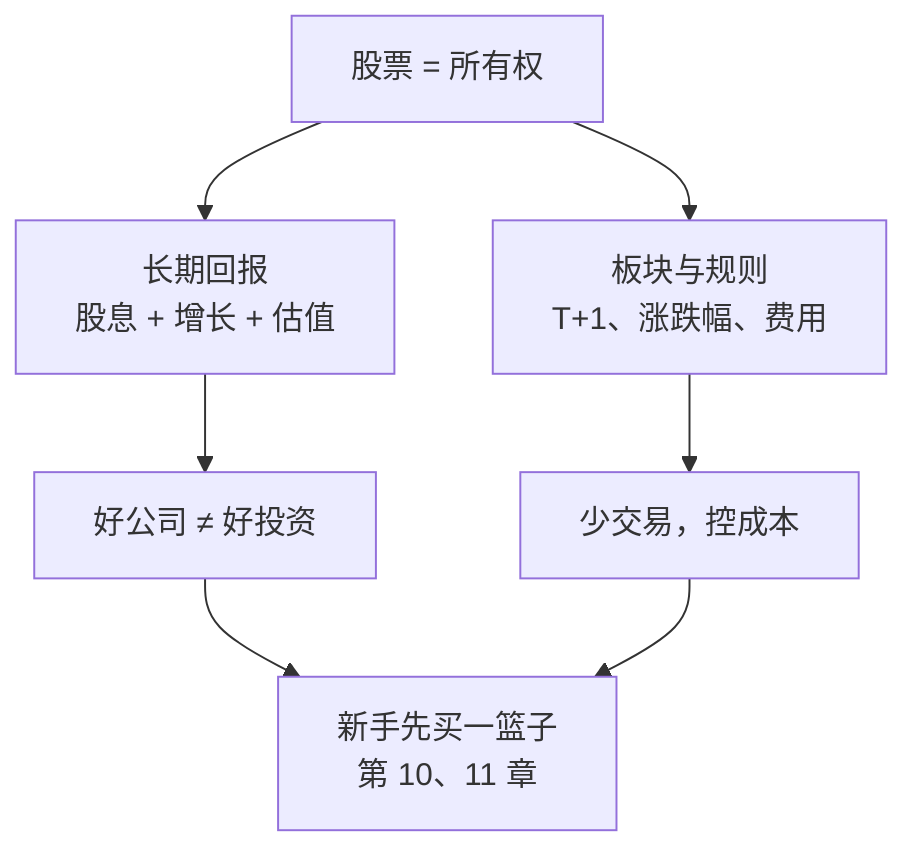

# 第 9 章 股票是什么：股权、交易所与 A 股规则

> **本章导读**
>
> - 建议用时：50 分钟（含动手 10 分钟）
> - 前置知识：第 6 章（风险与回撤）、第 8 章（债券是借条）
> - 读完你能回答：
>   1. 股票的本质是什么？长期来看，股价由什么决定？
>   2. 为什么「好公司」不一定是「好投资」？
>   3. 主板、创业板、科创板、北交所有什么区别？
>   4. A 股的交易规则：T+1、涨跌停、交易时间、费用分别是什么？
>   5. 开了证券账户之后，新手最该先做什么、最不该做什么？

---

## 【积木 9-1】股票是公司的一小块所有权

第 8 章说，债券是一张借条：你借钱给别人，对方承诺按时还本付息。

**股票完全不同：你不是债主，你是股东**。买入一家公司的股票，你就拥有了这家公司的一小部分，享有两项核心权利：

| 权利 | 含义 |
|---|---|
| 剩余收益权 | 公司赚的钱，在付完成本、利息、税之后，剩下的归股东。可以分红给你，也可以留在公司继续扩张 |
| 投票权 | 参与股东大会，对重大事项表决 |

和债券对比一下：

| | 债券 | 股票 |
|---|---|---|
| 身份 | 债主 | 所有者之一 |
| 回报 | 约定好的利息，有上限 | 公司赚得越多你分得越多，没有上限 |
| 公司破产时 | 优先受偿 | 排在最后，往往血本无归 |
| 到期 | 有到期日 | 没有到期日，只要公司存在就一直有效 |

所以股票的长期回报更高、波动也更大，正好是第 6 章「风险越高，长期回报要求越高」的体现。

---

## 【积木 9-2】股价长期由什么决定

短期看，股价由买卖力量决定，情绪、消息、资金都能让它大涨大跌。但长期看，有一个很朴素的拆解：

```text
股票长期年化回报 ≈ 股息率 + 每股盈利增长率 + 估值变化
```

- **股息率**：公司每年分给你的钱占股价的比例。
- **盈利增长**：公司赚的钱每年增长多少。
- **估值变化**：市场愿意为每 1 元盈利付多少钱，常用**市盈率**（PE = 股价 ÷ 每股盈利）衡量，第 18 章细讲。

用工具看一个例子：一家公司股息率 2.5%，每股盈利每年稳定增长 5%，持有 10 年（均为假设值）。

```bash
python3 tools/stock_cost.py decompose --dividend 2.5 --growth 5 --pe-start 15 --pe-end 15 --years 10
```

```text
  年化总回报 ≈ 股息 2.5% + 盈利增长 5.0% + 估值变化 +0.00%（含交叉项）≈ 7.50%
```

同样的公司、同样的经营，但如果你买入时市盈率是 30 倍，10 年后回落到 15 倍：

```bash
python3 tools/stock_cost.py decompose --dividend 2.5 --growth 5 --pe-start 30 --pe-end 15 --years 10
```

```text
  估值变化每年贡献 -6.70%
  年化总回报 ≈ 股息 2.5% + 盈利增长 5.0% + 估值变化 -6.70%（含交叉项）≈ 0.47%
```

**公司 10 年来一直在稳定赚钱、稳定增长，你却几乎没赚到钱**。原因只有一个：买得太贵了。

### 一个高频误解：「好公司就是好投资」

好公司是「这家企业经营得好」，好投资是「以合理的价格买到了它」。两件事都要成立。热门的好公司常常被抢得很贵，这时它仍然是好公司，但不一定是好投资。小林那只被套的「明星基金」，很可能就买在了大家都觉得它好、价格最贵的时候。第 10 章我们去看看。

---

## 【积木 9-3】交易所与板块

A 股的股票在三家交易所上市：上海证券交易所（上交所）、深圳证券交易所（深交所）、北京证券交易所（北交所）。不同板块定位不同、规则不同：

| 板块 | 交易所 | 定位 | 普通股票涨跌幅限制 | 个人开通权限的常见要求 |
|---|---|---|---|---|
| 主板 | 上交所、深交所 | 大型成熟企业 | ±10% | 开户即可交易 |
| 创业板 | 深交所 | 成长型创新创业企业 | ±20% | 前 20 个交易日日均资产 10 万元 + 2 年交易经验 |
| 科创板 | 上交所 | 硬科技企业 | ±20% | 日均资产 50 万元 + 2 年交易经验 |
| 北交所 | 北交所 | 创新型中小企业 | ±30% | 日均资产 50 万元 + 2 年交易经验 |

权限要求来自券商公开说明（2026 年检索，非一手来源），具体以交易所和券商当期规则为准。

**风险警示股票**（名称前带 ST 或 *ST，表示公司财务或经营出现异常，可能退市）：2026 年 7 月 6 日起，沪深交易所将**主板** ST、*ST 股票的涨跌幅限制由 5% 调整为 10%，与主板其他股票一致；创业板、科创板风险警示股票仍为 20%，北交所为 30%。来源：沪深北交易所 2026 年 4 月 24 日发布的修订后交易规则，据央视网 2026-07-06 报道。

**新手的结论很简单**：股票的波动在不同板块差别很大，涨跌幅限制越宽的板块，单日波动可能越大；带 ST 的股票，新手不要碰。

---

## 【积木 9-4】A 股交易规则：新手必须知道的几条

| 规则 | 内容 |
|---|---|
| 交易时间 | 交易日 9:15-9:25 开盘集合竞价，9:30-11:30、13:00-14:57 连续竞价，14:57-15:00 收盘集合竞价 |
| 盘后固定价格交易 | 2026 年 7 月 6 日起扩展至沪深全部 A 股和 ETF：15:05-15:30 以当日收盘价成交，委托不可撤销 |
| T+1 | 当天买入的股票，下一个交易日才能卖出；当天卖出得到的钱可以马上买别的，但要下一个交易日才能转回银行卡 |
| 交易单位 | 买入以 100 股（1 手）为单位；卖出时不足 100 股的零股要一次性卖出 |
| 涨跌幅限制 | 见积木 9-3；注册制下的新股上市初期（通常为前 5 个交易日）不设涨跌幅限制 |
| 申报价格范围 | 连续竞价阶段，买卖申报价格不能偏离基准价太多（俗称「价格笼子」），超出范围的申报无效，具体比例以交易所规则为准 |

来源：沪深交易所交易规则及 2026 年修订内容（央视网、人民财经网 2026 年 7 月报道）；以交易所当期规则为准。

### 一个高频误解：「涨停了就说明是好股票」

涨跌停只是交易所设定的单日价格波动上限。连续涨停往往是情绪和资金推动的结果，追进去的人常常买在最高处。**涨跌停是「刹车」，不是「信号」。**

---

## 【积木 9-5】交易成本：每一次买卖都在付钱

| 费用 | 标准 | 谁付 |
|---|---|---|
| 印花税 | 成交金额的 0.05% | 仅卖出方 |
| 过户费 | 成交金额的 0.001% | 买卖双方 |
| 佣金 | 不超过成交金额的 0.3%，由你和券商约定；常见单笔最低 5 元 | 买卖双方 |

来源：东北证券、中信证券的证券交易收费公示表（2026-10-22 检索）。

用工具算一笔 1 万元的买卖，佣金按 0.025% 假设：

```bash
python3 tools/stock_cost.py cost --amount 10000 --commission 0.025
```

```text
成交金额 10,000，佣金费率 0.025%（最低 5 元）
  买入成本 5.10  卖出成本 10.10（含印花税 5.00）
  一买一卖合计 15.20，占成交额 0.152%
```

金额小的时候，「最低 5 元」会让成本比例明显升高。2,000 元一买一卖要 11.04 元，占 0.552%。

单次看起来不多，真正的问题是**频率**：

```bash
python3 tools/stock_cost.py drag --commission 0.025 --turnover 1 4 12 50
```

```text
佣金 0.025%（按大额成交、不触发 5 元最低计），一买一卖成本约 0.102%
     年换手次数     每年成本     10 年累计拖累
         1.0      0.10%           1.0%
         4.0      0.41%           4.0%
        12.0      1.22%          11.6%
        50.0      5.10%          40.8%
```

每年把仓位换 50 次（大约每周一次），光交易成本 10 年就会吃掉约 40%。**交易越频繁，你越是在为券商和税收打工。** 这还没算最大的隐性成本：频繁交易时的判断失误（第 14 章）。

---

## 【积木 9-6】开户：流程与第一件事

开证券账户本身没有资金门槛，年满 18 周岁、持本人身份证和一张银行卡（一般要求 I 类账户），通过券商官方 App 就能线上办理，大致流程：



几个要点：

- **只用券商官方渠道**，不要通过陌生人发来的链接下载 App。第 22 章会讲冒充券商的诈骗。
- **你的资金在银行**。券商账户里的资金实行第三方存管，由银行托管，券商不能挪用。
- **风险测评如实填写**。它决定了你能买哪些风险等级的产品，故意填高等于拆掉自己的保护。
- **佣金可以问一问**。佣金由你和券商协商，不同渠道差别不小，开户前后都可以咨询。

### 开户后最该做的事 和 最不该做的事

| 最该做 | 最不该做 |
|---|---|
| 熟悉界面：行情、委托、撤单、持仓、资金转账 | 第一天就满仓买入某只股票 |
| 小额试一次国债逆回购（第 7 章），走通资金流程 | 加入「荐股群」、跟「老师」操作 |
| 搜索并收藏几个宽基指数，只看不买（第 11 章会用） | 开通融资融券、期权等杠杆工具 |
| 写下自己的规则：每月最多投多少、为什么买 | 用应急金或短期要用的钱买股票 |

---

## 【积木 9-7】为什么新手不建议从个股开始

股票是长期回报最高的资产类别之一，但**直接买个股**对新手来说门槛很高：

1. **需要懂公司**：要看懂财报、判断估值（第 17、18 章），否则就是在猜。
2. **单只股票的风险集中**：一家公司可能因为一次经营失误、一次财务造假、一次行业变化就跌掉大半，甚至退市。2026 年年内已有 160 余家公司触发风险警示（央广网 2026-08-19 报道），常态化退市在加速。
3. **心理压力更大**：单只股票的波动比一篮子股票大得多，更容易追涨杀跌。

所以本课的路线是：**先通过基金持有一篮子股票（第 10、11 章），等第 17、18 章学会看公司，再决定要不要碰个股**。

---

## 【积木 9-8】小林开了证券账户

小林这周用券商官方 App 开了户，风险测评如实填写，结果为稳健型。他按积木 9-6 的「最该做」清单：

| 做了什么 | 收获 |
|---|---|
| 熟悉了委托、撤单、转账 | 知道了 T+1 和资金下一个交易日才能回到银行卡 |
| 月末用 1,000 元试了一次 1 天期国债逆回购 | 走通了资金流程，理解了第 7 章讲的计息天数 |
| 收藏了沪深 300、中证 500 等几个宽基指数 | 第 11 章会用到 |
| 没有买任何个股 | 安全垫还没完全建好（应急金未存满） |

他还算了一笔账：以前他在基金 App 上「看到涨了就加、跌了就卖」，一年操作了二十多次。按积木 9-5 的方法，光是频繁买卖带来的成本就不少，**还没算每次都买在高点、卖在低点的损失**。

---

## 【本章小结】

三句话：

1. **股票是公司的一小块所有权**，长期回报 ≈ 股息 + 盈利增长 + 估值变化；买得太贵，好公司也赚不到钱。
2. **A 股规则要记住**：T+1、按手买入、不同板块涨跌幅不同（主板 10%、创业板和科创板 20%、北交所 30%），2026 年 7 月起主板 ST 也是 10%；卖出缴 0.05% 印花税。
3. **交易越频繁成本越高**；开户后先熟悉流程、小额试水，新手先通过基金持有一篮子股票，不要从个股开始。



### 自测题

1. 债主和股东在公司破产时，谁先拿钱？（积木 9-1）
2. 股票长期回报可以拆成哪三部分？（积木 9-2）
3. 一家公司盈利 10 年一直增长，为什么买它的人可能几乎没赚钱？（积木 9-2）
4. 主板、创业板、科创板、北交所的普通股票涨跌幅限制分别是多少？2026 年 7 月起主板 ST 股票的涨跌幅变成多少？（积木 9-3）
5. 周一买入的股票，最早什么时候能卖？周一卖出得到的钱，什么时候能转到银行卡？（积木 9-4）
6. 印花税谁交、交多少？为什么小额交易的成本比例更高？（积木 9-5）
7. 每年换手 12 次，按本章假设，10 年交易成本大约拖累多少？（积木 9-5）
8. 为什么本课不建议新手从个股开始？（积木 9-7）

---

## 【下一章预告】

终于要面对小林那只被套 30% 的「明星基金」了。第 10 章讲**基金全景**：

- 基金是什么？基金公司、基金经理、托管银行各自的角色是什么？
- 主动基金、指数基金、ETF、FOF 有什么区别？
- 一只基金该看哪些信息？费用有哪些，为什么它们那么重要？
- 小林的基金到底是什么、为什么跌、该不该卖？

*学完本章，回到对话里说一句「继续」，我就开讲第 10 章。*
