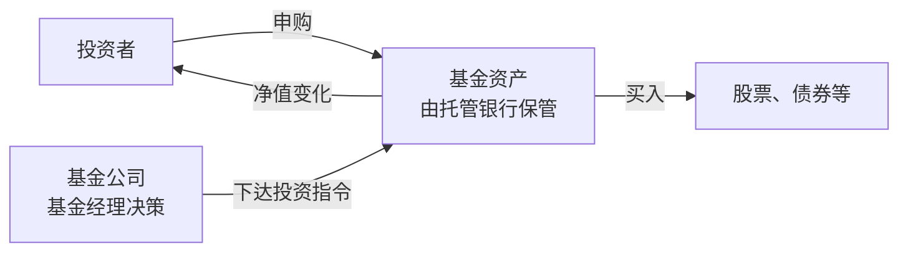
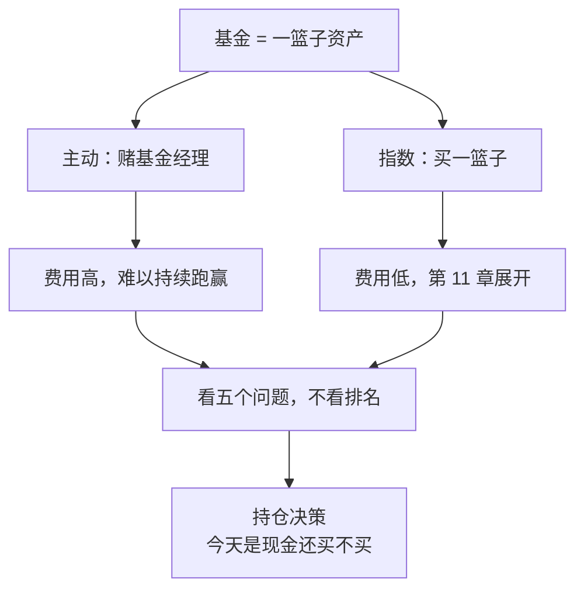

# 第 10 章 基金全景：主动基金、指数基金、ETF、FOF

> **本章导读**
>
> - 建议用时：50 分钟（含动手 15 分钟）
> - 前置知识：第 6 章（回撤）、第 8 章（债券基金分类）、第 9 章（股票与交易成本）
> - 读完你能回答：
>   1. 基金是什么？基金公司、基金经理、托管银行各管什么？
>   2. 主动基金、指数基金、ETF、FOF 有什么区别？
>   3. 一只基金要看哪些信息？费用有哪些，为什么它们那么重要？
>   4. 为什么「明星基金」常常让人亏钱？
>   5. 小林那只被套 30% 的基金，该怎么处理？

---

## 【积木 10-1】基金：把钱交给专业的人，买一篮子资产

第 9 章说，新手直接买个股门槛很高。基金解决的就是这个问题：**很多人把钱凑在一起，交给专业机构，按约定好的规则去投资一篮子资产**。

公募基金有三个关键角色：

| 角色 | 做什么 | 不能做什么 |
|---|---|---|
| 基金管理人（基金公司） | 由基金经理决定买什么、卖什么 | 不能直接碰你的钱 |
| 基金托管人（通常是银行） | 保管基金资产，监督投资是否合规 | 不做投资决策 |
| 基金销售机构 | 银行、券商、第三方平台，帮你买卖 | 不管理资产 |



基金资产和基金公司自己的财产是**分开的**。基金公司即使经营出问题，基金资产也不属于它的清算财产。所以买基金的主要风险不是「基金公司卷钱跑路」，而是**基金投资的资产本身会涨跌**。

---

## 【积木 10-2】基金的分类：按投什么、按怎么投

**按投什么**（第 7、8 章已讲过前两类）：

| 类型 | 主要投资 | 风险 |
|---|---|---|
| 货币基金 | 短期存款、存单、短期债 | 最低 |
| 债券基金 | 债券（80% 以上） | 低到中 |
| 混合基金 | 股票和债券，比例灵活 | 中到高，看具体股票仓位 |
| 股票基金 | 股票（80% 以上） | 高 |
| QDII 基金 | 海外市场 | 第 16 章讲 |

**按怎么投**，这是本章的重点：

| 方式 | 含义 | 你在赌什么 |
|---|---|---|
| 主动基金 | 基金经理自己挑股票、择时机，目标是跑赢市场 | 基金经理的能力 |
| 指数基金 | 按规则复制某个指数，指数里有什么就买什么 | 这个指数代表的那一篮子资产 |
| FOF | 基金中的基金，买的是其他基金 | 管理人挑基金的能力 |

另外，**ETF**（交易型开放式指数基金）不是一种新的投资方式，而是指数基金的一种**交易形式**：它在交易所上市，像股票一样在证券账户里实时买卖。第 11 章会对比场内 ETF 和场外指数基金。

---

## 【积木 10-3】主动 vs 被动：一个有争议的问题

主动基金的卖点是「专业的人能跑赢市场」。这话有一部分道理，但有三个现实问题：

1. **费用更高**。主动基金要付研究员和基金经理的钱，管理费通常明显高于指数基金（下一节算账）。
2. **难以持续**。某一段时间跑赢市场的基金经理很多，但能长期、持续跑赢的少得多。过去几年的冠军，下几年常常排名靠后。
3. **你很难提前挑中**。就算市场上确实存在长期优秀的基金经理，普通人能不能在事前识别出来，是另一回事。大多数人是看过去的业绩排名来挑的，而这恰恰最不可靠。

关于「主动基金能不能整体跑赢指数」，学界和业界的结论**因市场、时期、统计口径而不同**。在 A 股的某些时期，主动权益基金整体表现并不差。本课的立场是：**对于没有能力评估基金经理的新手，以低成本的宽基指数基金作为股票类资产的核心，是更稳妥的起点**。第 11 章展开。

---

## 【积木 10-4】基金费用：看不见，但一直在扣

| 费用 | 收取方式 | 2023 年以来的变化 |
|---|---|---|
| 管理费 | 每天从基金资产中计提，体现在净值里 | 主动权益类由 1.5% 统一下调至 1.2% 以下 |
| 托管费 | 每天从基金资产中计提 | 主动权益类由 0.25% 下调至 0.2% 以下 |
| 认购费、申购费 | 买入时一次性收取 | 2026 年起，销售机构收取的上限：主动偏股型 0.8%，其他混合型 0.5%，指数型和债券型 0.3% |
| 销售服务费 | 部分不收申购费的份额（常见 C 类）按年计提 | 上限：股票型和混合型 0.4%/年，指数型和债券型 0.2%/年，货币基金 0.15%/年；持有超过一年的非货币基金份额不再收取 |
| 赎回费 | 卖出时收取 | 全额计入基金财产；持有少于 7 日不低于 1.5%，7 日到 30 日不低于 1%，30 日到 180 日不低于 0.5%（指数、债券等另有安排） |

来源：证监会《公开募集证券投资基金销售费用管理规定》（证监会公告〔2025〕22 号，2026 年 1 月 1 日起施行）；人民网 2026-01-01 报道的证监会费率改革三阶段介绍。具体某只基金的费率，以它的基金合同和招募说明书为准。

**持有少于 7 天赎回要付至少 1.5%**：这条规则专门惩罚频繁申赎。还记得小林一年在基金 App 上操作二十多次吗（第 9 章）？

### 管理费的长期威力

管理费每年只扣 1% 左右，看起来不多。但它按复利一直扣：

```bash
python3 tools/fund_fees.py
```

```text
本金 100,000，假设扣费前年化 7%，持有 20 年；不计任何费用时终值 386,968
  名称           年费合计           终值        被费用吃掉      占比
  主动基金        1.40%       294,978        91,990   23.8%
  场外指数        0.60%       344,769        42,200   10.9%
  宽基ETF       0.20%       372,756        14,212    3.7%
```

（扣费前收益 7% 和三种费率都是假设值。主动基金按改革后的上限，指数类按常见量级。）

**在扣费前收益相同的假设下**，20 年后，年费 1.4% 的基金比年费 0.2% 的少了约 7.8 万元。反过来说：**主动基金每年要多赚 1.2 个百分点，才能和低费率指数基金打平**。

### A 类与 C 类份额

同一只基金常有 A、C 两类份额，投资完全一样，只是收费方式不同：

| | A 类 | C 类 |
|---|---|---|
| 申购费 | 有 | 没有 |
| 销售服务费 | 没有 | 按年收，持有超过一年后不再收 |
| 适合 | 打算长期持有 | 持有时间较短 |

2026 年新规之后，C 类持有超过一年就不再收销售服务费，两者在长期持有时的差距缩小了。买之前用持有时间算一下即可。

---

## 【积木 10-5】看一只基金：五个问题

打开任何一只基金的详情页，按这个顺序问：

| 问题 | 去哪看 | 关注什么 |
|---|---|---|
| 1. 它是什么类型？投什么？ | 基金概况、招募说明书的投资范围 | 名字可能误导，以投资范围为准 |
| 2. 它实际持有什么？ | 定期报告的前十大持仓、行业分布 | 是否高度集中在一个行业或几只股票 |
| 3. 业绩来自哪里？ | 不同年份的业绩、与业绩比较基准的对比 | 不是只看近一年，要看熊市年份表现如何 |
| 4. 最坏的时候多疼？ | 历史最大回撤 | 用第 6 章的方法问自己能否承受 |
| 5. 成本多少？ | 费率结构 | 管理费、托管费、申赎费 |

主动基金还要多看两件事：**基金经理任职多久、这期间换没换人**；**规模**是否在短时间内暴涨（规模太大可能影响灵活性）。

---

## 【积木 10-6】为什么明星基金常常让人亏钱

这是一个反复上演的剧本：


问题不一定出在基金经理身上。他可能一直按同一种风格投资，只是某段时间这种风格特别吃香。问题出在**投资者的买入时机**：大多数人是在业绩最耀眼、规模最大的时候冲进去的。

这就造成一个常见现象：**基金本身的长期收益可能不错，但持有它的大多数投资者实际上是亏钱的**，因为他们追高买入、杀跌卖出。

### 一个高频误解：「看近一年收益排名挑基金」

近一年排名第一，通常意味着它押中了过去一年涨得最好的方向，而且押得很重。这说明它**集中度高、波动大**，并不能说明它明年还会第一。排名靠前的基金，往往也是回撤风险最大的基金。

---

## 【积木 10-7】小林那只基金：拆开看

小林把那只「明星基金」的资料翻了出来。按积木 10-5 的五个问题：

| 问题 | 他查到的情况 |
|---|---|
| 类型 | 偏股混合型主动基金，股票仓位常年 90% 左右 |
| 持仓 | 前十大重仓股几乎都在同一个热门行业，行业集中度很高 |
| 业绩 | 买入前一年业绩排名靠前，正是该行业大涨的那一年；之后该行业回调，基金跟着跌 |
| 回撤 | 历史最大回撤超过 40%，比他第 6 章自测的承受力高得多 |
| 费用 | 管理费 1.2%、托管费 0.2%，买入时还付了申购费 |
| 规模 | 他买入那个季度规模大幅增长，很多人和他同时冲进去 |

（这是本课虚构的案例，用来演示分析方法。）

**它为什么跌？** 主要是因为它重仓的那个行业整体回调，基金经理并没有做错什么离谱的事。也就是说，这只基金「按说明书运行」，只是**它本来就是一只高集中、高波动的基金，而小林不知道**。

### 该不该卖？三个问题

第 6 章留下了两个问题，现在补全成三个：

1. **如果今天手里是 10,500 元现金，你还会买它吗？**
   小林的回答是：不会。它的波动远超他的承受力，而且他不懂这个行业。
2. **这笔钱什么时候要用？**
   不确定。它不在应急金、年度大额池、首付储蓄任何一个格子里，属于「没想好的钱」。
3. **卖出要付多少成本？**
   他已经持有超过一年，按新规赎回费很低。

「回本」这件事不在这三个问题里。**亏掉的 4,500 元已经发生了，不管卖还是不卖都回不来**，它不应该影响下一步决定。这叫沉没成本，第 14 章细讲。

小林的决定：

| 决定 | 原因 |
|---|---|
| 不再加仓这只基金 | 波动和集中度超出承受力 |
| 卖出，但不是「认亏离场」 | 这 10,500 元转入第 11 章要讲的宽基指数基金，**换一种更分散、成本更低的方式继续持有股票** |
| 卖出时机不择时 | 不等「涨回来一点再卖」，按计划在一周内完成转换 |
| 以后挑基金先过五个问题 | 不再看排名买 |

注意这里的关键：**他没有离开股票市场，只是把一个高度集中的赌注，换成了一篮子分散的股票**。如果市场之后上涨，他依然能分享到。

> 再强调一次：这是虚构案例的教学推演，不是对任何真实基金的买卖建议。

---

## 【积木 10-8】动手

1. 把你持有的每一只基金，按积木 10-5 的五个问题过一遍，写成一张表。
2. 用你自己的基金费率跑一次费用测算：

```bash
python3 tools/fund_fees.py --amount 你的金额 --gross 6 --years 20 \
  --fund 我的基金:管理费:托管费:申购费 --fund 对比的指数基金:0.15:0.05:0
```

3. 对每只基金问自己积木 10-7 的三个问题，尤其是第一个：**如果今天是现金，我还会买它吗？**

---

## 【本章小结】

三句话：

1. **基金是把钱交给专业机构投资一篮子资产**，资产由托管银行保管；主要风险是资产本身的涨跌，而不是基金公司跑路。
2. **主动基金赌基金经理，指数基金买一篮子资产**；费用每天从净值里扣，长期复利下差距巨大；2023 年起的费率改革已大幅降低了上限，持有不满 7 天赎回至少付 1.5%。
3. **明星基金让人亏钱的原因多在买入时机**；判断该不该卖，问「今天是现金还会不会买」，不问「什么时候回本」。



### 自测题

1. 基金公司经营出问题，你买的基金资产会被拿去还债吗？为什么？（积木 10-1）
2. ETF 和指数基金是什么关系？（积木 10-2）
3. 为什么说主动基金每年要多赚约 1.2 个百分点才能和低费率指数基金打平？（积木 10-4）
4. 2026 年新规下，持有基金不满 7 天就赎回，赎回费至少多少？这些赎回费归谁？（积木 10-4）
5. A 类和 C 类份额的区别是什么？（积木 10-4）
6. 看一只基金的五个问题是什么？（积木 10-5）
7. 为什么一只基金长期收益不错，持有它的大多数人却可能亏钱？（积木 10-6）
8. 小林决定卖出那只基金，为什么说他不是「认亏离场」？（积木 10-7）

---

## 【下一章预告】

小林要把 10,500 元换成宽基指数基金，可是指数那么多：沪深 300、中证 500、中证 A500、创业板指……该选哪个？场内 ETF 和场外基金怎么选？第 11 章讲**指数基金与定投**：

- 指数是怎么编出来的？宽基、行业、策略指数有什么区别？
- 选指数基金看哪几个指标：费率、跟踪误差、规模？
- 定投到底有什么用？它能不能降低风险？「微笑曲线」是真的吗？
- 小林的定投计划怎么定？

*学完本章，回到对话里说一句「继续」，我就开讲第 11 章。*
