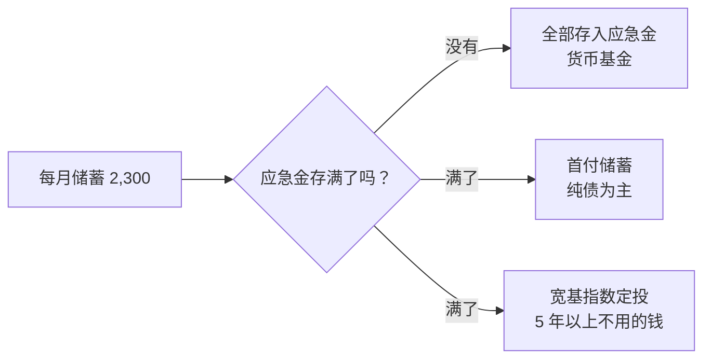
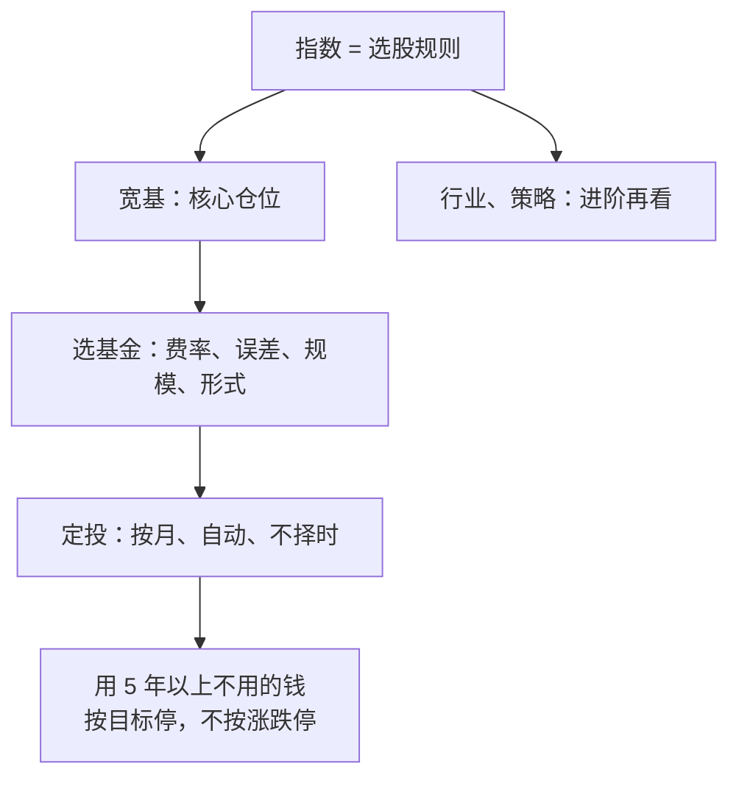

# 第 11 章 指数基金与定投：普通人的最优解之一

> **本章导读**
>
> - 建议用时：50 分钟（含动手 10 分钟）
> - 前置知识：第 9 章（股票长期回报）、第 10 章（基金费用、主动与被动）
> - 读完你能回答：
>   1. 指数是怎么编出来的？宽基、行业、策略指数有什么区别？
>   2. 沪深 300、中证 500、中证 A500 分别代表什么？
>   3. 选指数基金看哪几个指标？场内 ETF 和场外基金怎么选？
>   4. 定投到底解决什么问题？它能降低风险吗？
>   5. 小林的 10,500 元和每月的钱，具体怎么投？

---

## 【积木 11-1】指数是一套「选股规则」

指数不是一只股票，而是**一套公开的规则**：按什么标准选哪些股票、每只占多少权重、多久调整一次。指数公司（如中证指数公司）每天按这套规则计算一个点数，反映这一篮子股票的整体涨跌。

指数基金做的事情很简单：**照着规则买，规则变了就跟着调**，不需要基金经理判断哪只股票好。

这带来三个好处：

| 好处 | 原因 |
|---|---|
| 便宜 | 不需要研究团队选股，管理费低 |
| 透明 | 规则公开，成分股公开，你知道自己买了什么 |
| 不依赖某个人 | 基金经理换人不影响投资方向 |

---

## 【积木 11-2】三类指数：宽基、行业、策略

| 类型 | 选股方式 | 例子 | 特点 |
|---|---|---|---|
| 宽基指数 | 按市值、流动性等从全市场选，覆盖多个行业 | 沪深 300、中证 500、中证 A500 | 分散，代表「市场整体」 |
| 行业 / 主题指数 | 只选某个行业或主题 | 某行业指数、某主题指数 | 集中，波动大，像第 10 章小林那只基金 |
| 策略指数 | 按某种因子筛选或加权 | 红利、低波动等 | 有特定风格，适合有一定基础后再研究 |

**新手的核心仓位放宽基**。行业指数本质上和「重仓一个行业的主动基金」风险相似，只是更便宜。

### 三个常见宽基指数

| 指数 | 怎么选 | 风格 |
|---|---|---|
| 沪深 300 | 沪深两市规模大、流动性好的 300 只股票 | 大盘 |
| 中证 500 | 排除沪深 300 成分股和总市值前 300 名后，按市值再选 500 只 | 中盘 |
| 中证 A500 | 从各行业选取市值较大、流动性较好的 500 只，使一级行业市值分布与全市场尽可能一致；2024 年 9 月 23 日发布 | 大中盘、行业均衡 |

来源：中证指数公司指数编制方案与官网（2026-10-22 检索）；中国证券报对中证 A500 与沪深 300、中证 500 的对比解读。

**中证 500 和中证 A500 只差一个字母，内容差别很大**：前者是「掐头取中间」的中盘股，后者是「各行业挑代表」的大中盘股。买之前看清名称。

### 一个高频误解：「指数基金不会亏」

指数基金分散了个股风险，但**分散不了整个市场的风险**。整个 A 股下跌时，宽基指数一样会跌，而且可能跌很深。以中证 A500 为例，它的回测数据显示历史最大回撤约 71%（指数发布前的数据是按规则回测出来的，新浪财经 2024 年转引，非一手来源，需核实原文）。**宽基指数基金依然是高波动资产**，第 6 章的期限与承受力原则一样适用。

---

## 【积木 11-3】选指数基金：四个指标

同一个指数往往有几十只基金在跟踪。挑选时看：

| 指标 | 含义 | 怎么看 |
|---|---|---|
| 费率 | 管理费 + 托管费 | 越低越好。大型宽基 ETF 常见 0.15% + 0.05%，例如首批中证 A500 ETF（新浪财经 2024 年报道） |
| 跟踪误差 | 基金表现和指数的偏离程度 | 越小越好，说明「抄得准」 |
| 规模 | 基金资产总额 | 太小（如几千万）有清盘风险，流动性也差 |
| 产品形式 | 场内 ETF、场外联接基金、普通指数基金 | 见下表 |

### 场内 ETF 还是场外基金？

| | 场内 ETF | 场外指数基金 / ETF 联接基金 |
|---|---|---|
| 在哪买 | 证券账户，像股票一样交易 | 银行、基金 App、基金公司 |
| 价格 | 盘中实时成交价 | 按当日收盘后的净值成交 |
| 成本 | 交易佣金（第 9 章），无申赎费 | 申购费或销售服务费（第 10 章） |
| 自动定投 | 多数券商支持，但不如场外普遍 | 几乎都支持 |
| 适合 | 有证券账户、愿意自己下单 | 想要设定好自动扣款、不用盯盘 |

**对新手最重要的不是哪种更省一点钱，而是哪种你能坚持**。如果自动扣款能让你不去看盘、不去手动操作，多付一点成本也值得。

指增基金（指数增强）在指数基础上追求超额收益，费用通常更高，属于「半主动」，新手可以先不考虑。

---

## 【积木 11-4】定投：解决的是「什么时候买」的焦虑

**定投**：每隔固定时间（如每月）投入固定金额，不管市场涨跌。

它的机制是：价格低时，同样的钱买到更多份额；价格高时，买到更少份额。所以平均成本会低于这段时间的平均价格。

但定投到底比一次性投入好不好？用工具看五种**假设**的价格形状，每月投 1,000 元、共 36 个月，对比第 0 个月一次性投入 36,000 元：

```bash
python3 tools/dca_sim.py
```

```text
共投入 36,000：一次性在第 0 月投入，或每月 1,000 连投 36 个月
  价格路径                一次性收益     定投收益     定投平均成本     期末价格
  一路上涨 1→2            +100.0%     +40.0%        1.428       2.00
  一路下跌 1→0.5           -50.0%     -31.4%        0.729       0.50
  先跌后回 1→0.5→1          +0.0%     +38.7%        0.721       1.00
  先涨后回 1→1.5→1          +0.0%     -18.9%        1.233       1.00
  原地震荡 ±20%             -0.0%      +2.1%        0.980       1.00
```

（价格路径是人为构造的形状，不是任何指数的真实走势。）

逐行读：

1. **一路上涨**：一次性投入完胜。定投因为后面的钱买在了更高的价格，收益少了一大截。
2. **一路下跌**：两种都亏，定投亏得少，因为钱是分批进去的。
3. **先跌后回**：这就是常说的「**微笑曲线**」，定投大幅领先。
4. **先涨后回**：定投反而亏钱，一次性投入不赚不亏。定投在高位买了太多。
5. **原地震荡**：差别不大。

### 结论

- **定投不是提高收益的魔法**。长期向上的市场里，一次性投入从数学上常常更优，因为钱更早进场。
- **定投真正的价值是心理和纪律**：不用判断时机，不会因为怕买在高点而迟迟不动，也不会因为一次性投入后立刻大跌而崩溃卖出。
- **普通人的收入本来就是按月来的**，每月发工资后投入一部分，天然就是定投。这时候讨论「一次性还是定投」意义不大。

> 说明：表中定投收益按「总投入」计算，没有考虑定投期间尚未投入的钱可以放在货币基金里赚一点利息；考虑之后，结论方向不变。

### 一个高频误解：「定投能降低风险，跌了也不怕」

定投降低的是**择时风险**（一次买在最高点），不能消除市场下跌的风险。定投几年后，账户里已经积累了很多钱，这时市场大跌，你的亏损金额一样很大。第 4 行「先涨后回」就说明：定投一样会亏。

### 「微笑曲线」的前提

定投在下跌时最显威力，但前提是：**下跌之后市场会涨回来，而且你在下跌时没有停止定投**。现实中很多人在下跌时看到账户越来越亏，就停止扣款甚至卖出，正好错过了微笑曲线的右半边。第 14 章会讲怎么对抗这种冲动。

---

## 【积木 11-5】定投的几个实操问题

| 问题 | 建议 |
|---|---|
| 多久投一次？ | 每月一次，跟发薪日对齐就够了。每周、每日在长期结果上差别很小 |
| 投多少？ | 先保证第 3 章的储蓄、第 4 章的应急金；定投的钱应该是 5 年以上不用的钱（第 6 章） |
| 什么时候停？ | 不按涨跌停，按目标停：钱快要用的时候，提前一两年逐步转到低风险资产（第 8 章首付储蓄的做法） |
| 要不要「越跌越买」？ | 估值定投、智能定投等方法存在，但需要判断估值，第 18 章之后再考虑；新手先做好最简单的定额定投 |
| 要不要止盈？ | 第 13 章讲再平衡，用规则代替「感觉涨够了」 |

---

## 【积木 11-6】小林的方案

**第一步：10,500 元的转换。** 第 10 章决定卖掉那只行业集中的基金。这笔钱本来就在股票市场里，所以小林把它**一次性**转入宽基指数基金，没有分批：他不是新入场，只是从「一个行业」换成「一篮子行业」。

他选择了一只跟踪行业均衡型宽基指数的场外联接基金，理由：

| 考虑 | 选择 |
|---|---|
| 指数 | 宽基，行业分散，不押某个方向 |
| 费率 | 管理费 0.15% + 托管费 0.05% 量级 |
| 形式 | 场外联接基金，方便后面设自动定投 |
| 规模 | 选规模较大的，避免清盘风险 |

（本课不推荐具体产品；以上是选择逻辑。）

用第 10 章的工具对比一下：同样 10,500 元、假设扣费前年化 7%、持有 10 年，年费 0.2% 的基金约被费用吃掉 383 元，而原来那只主动基金约 2,694 元。

**第二步：每月定投。** 小林的应急金还在补（第 4 章，约 6.8 个月后存满）。他的安排：



应急金存满之前，不新增定投；存满之后，每月储蓄在「首付储蓄」和「长期定投」之间怎么分，**由第 12 章的资产配置决定**。他已经在 App 里找好了自动定投的入口，日期设在发薪日后一天。

---

## 【积木 11-7】动手

1. 打开基金 App，搜索沪深 300、中证 500、中证 A500，各挑一只规模较大的基金，对比费率、规模、近几年最大回撤。
2. 打开中证指数公司官网，找一个指数的「编制方案」读一遍，看它的选股规则和调整频率。
3. 用自己的定投金额跑一次模拟：

```bash
python3 tools/dca_sim.py --monthly 你每月能投的钱 --months 36
```

4. 想清楚：你的定投是哪个目标的钱？这个目标什么时候要用？

---

## 【本章小结】

三句话：

1. **指数是一套公开的选股规则**，指数基金便宜、透明、不依赖某个人；新手的核心仓位放宽基，但宽基一样会大跌。
2. **选指数基金看费率、跟踪误差、规模和产品形式**；场内场外差别不大，选你能坚持的那种。
3. **定投解决的是择时焦虑和纪律问题，不是收益魔法**；长期上涨时一次性投入往往更优，定投也会亏；坚持不停，才拿得到微笑曲线的右半边。



### 自测题

1. 指数基金为什么比主动基金便宜？（积木 11-1）
2. 宽基指数和行业指数的主要区别是什么？为什么新手核心仓位放宽基？（积木 11-2）
3. 中证 500 和中证 A500 的选股逻辑有什么不同？（积木 11-2）
4. 宽基指数基金会大幅下跌吗？（积木 11-2）
5. 选指数基金看哪四个指标？（积木 11-3）
6. 在「一路上涨」的市场里，定投和一次性投入哪个更好？为什么？（积木 11-4）
7. 定投降低的是什么风险？不能降低什么风险？（积木 11-4）
8. 小林为什么把 10,500 元一次性转入，而不是分批定投？（积木 11-6）

---

## 【下一章预告】

第二阶段「认识工具」到这里结束：现金、债券、股票、基金、指数都认识了。小林手里现在有好几种钱、好几种工具，接下来的问题是：**怎么搭配**？第 12 章进入第三阶段，讲**资产配置**：

- 为什么说资产配置决定了长期结果的大部分？
- 股债比例怎么定？「100 减年龄」靠不靠谱？
- 股票和债券为什么能互相「减震」？
- 小林的每月 2,300 元，该怎么在首付储蓄和长期定投之间分？

*学完本章，回到对话里说一句「继续」，我就开讲第 12 章。*
