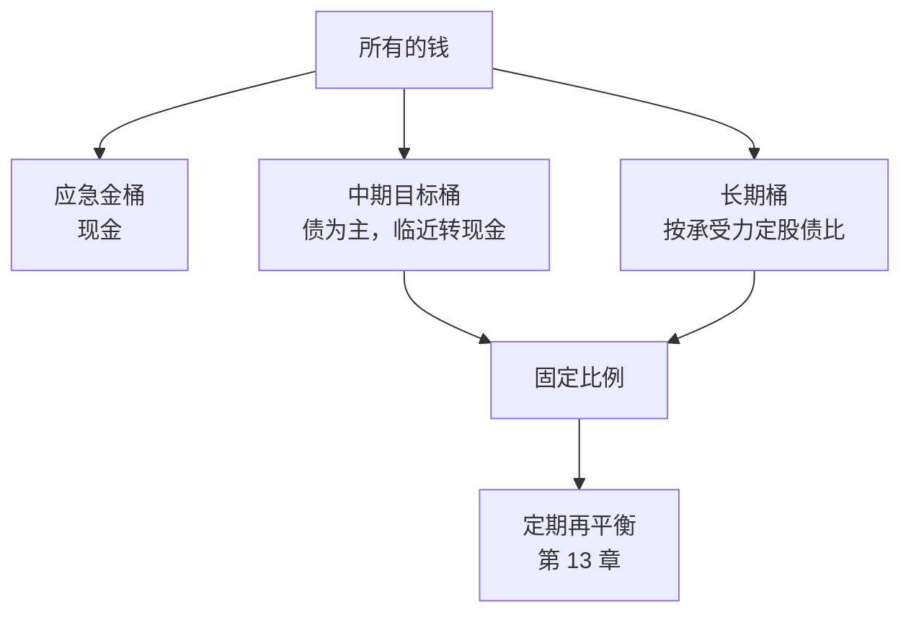

# 第 12 章 资产配置：决定长期结果的那件事

> **本章导读**
>
> - 建议用时：50 分钟（含动手 15 分钟）
> - 前置知识：第 6 章（期限与承受力）、第 8 章（债券）、第 11 章（宽基指数）
> - 读完你能回答：
>   1. 资产配置是什么？「资产配置决定 90% 收益」这句话对吗？
>   2. 股票和债券为什么搭在一起更好？
>   3. 股债比例怎么定？「100 减年龄」靠不靠谱？
>   4. 有多个目标时，钱怎么分？
>   5. 小林每月的钱，到底怎么分？

---

## 【积木 12-1】资产配置：先定比例，再挑产品

前面 11 章，我们认识了现金、债券、股票、基金这些工具。**资产配置就是决定每种工具各放多少比例**。

大多数新手的顺序是反的：先到处找「好产品」，买了一堆之后，才发现自己 90% 的钱都在股票里，或者全在货币基金里。正确的顺序是：


### 一个高频误解：「资产配置决定了 90% 以上的收益」

这句话常被引用，出处是 Brinson、Hood 和 Beebower 1986 年发表在《Financial Analysts Journal》上的论文《Determinants of Portfolio Performance》。他们研究了美国 91 个大型养老金计划，发现**资产配置政策解释了组合季度收益随时间波动的约 93.6%**。

注意，它说的是「**收益的波动有多少能被解释**」，不是「收益的 90% 来自资产配置」，更不是「选什么产品不重要」。后来的研究对这个结论有很多讨论和修正。

但它背后的道理是成立的：**你在股票里放 20% 还是 80%，对结果的影响，远大于你在股票里选 A 基金还是 B 基金**。

---

## 【积木 12-2】为什么股票和债券要搭在一起

第 8 章讲过，债券波动小、收益低；第 9 章讲过，股票波动大、长期收益高。把它们按比例搭配，会发生一件有意思的事：

```bash
python3 tools/portfolio_mix.py
```

```text
假设：股票类 收益 8% 波动 20%；债券类 收益 3% 波动 4%；相关系数 0.0；持有 5 年，每月再平衡
    股票比例     年化波动     到期亏钱概率     最差5%期末     平均最大回撤    最差5%的一年
        0%       4.0%          5.1%        1.00 倍         5.5%         -7.9%
       10%       4.1%          3.2%        1.02 倍         5.4%         -7.8%
       20%       5.1%          4.1%        1.01 倍         6.9%        -10.0%
       30%       6.6%          7.2%        0.98 倍         9.5%        -13.2%
       40%       8.4%         10.5%        0.93 倍        12.4%        -17.0%
       50%      10.2%         14.0%        0.89 倍        15.5%        -20.5%
       60%      12.1%         18.0%        0.82 倍        19.2%        -25.6%
       70%      14.1%         17.8%        0.78 倍        22.1%        -29.3%
       80%      16.0%         20.5%        0.74 倍        25.0%        -32.2%
       90%      18.0%         23.6%        0.69 倍        28.4%        -36.7%
      100%      20.0%         26.1%        0.63 倍        31.7%        -40.7%
```

（所有参数都是假设量级；按月模拟 3,000 次、每月再平衡。）

三个观察：

1. **从 100% 债券加入 10% 股票，波动几乎没变（4.0% 到 4.1%），到期亏钱的概率反而下降了**（5.1% 到 3.2%）。这就是分散的威力：两种走势不完全同步的资产放在一起，彼此会抵消一部分波动。
2. **股票比例越高，回撤越深**：每多 10% 股票，最坏一年大约多跌 3 到 4 个百分点。
3. **这张表就是一张「菜单」**：你用第 6 章的承受力，在这里找到对应的那一行。

### 相关性：搭配有效的前提

分散效果取决于两种资产是不是「同涨同跌」，用**相关系数**衡量（-1 到 1）。上表假设股债相关性为 0。如果把相关性提高到 0.5：

```bash
python3 tools/portfolio_mix.py --corr 0.5
```

50% 股票的组合，年化波动从 10.2% 升到 11.1%，平均最大回撤从 15.5% 升到 17.3%。

**股债相关性不是固定的**。很多时候它很低甚至为负，股市大跌时债券反而上涨。但也有例外：利率快速上升时，股票和债券可能同时下跌，比如 2022 年美股和美债就出现过同跌。所以资产配置能降低风险，但不能保证每次都起作用。

---

## 【积木 12-3】股债比例怎么定：三个经验法则

| 法则 | 说法 | 问题 |
|---|---|---|
| 100 减年龄 | 股票比例 = 100 − 年龄。28 岁就是 72% 股票 | 只看年龄，不看目标期限和承受力 |
| 生命周期 | 年轻时多股票，越接近目标越少 | 方向对，但要落到具体目标上 |
| 按回撤倒推 | 先定能接受的最大跌幅，再找对应比例 | 最贴近真实感受，推荐 |

**按回撤倒推**的做法：第 6 章的自测题问过「10 万变 7 万你会怎么做」。如果答案是「睡不着」，说明你能接受的回撤明显低于 30%。在上表里找到平均最大回撤和最坏一年都在你能承受范围内的那一行。

```bash
python3 tools/portfolio_mix.py --max-dd 15
# 平均最大回撤不超过 15.0% 的最高股票比例：40%
```

### 一个高频误解：「我年轻，所以应该多买股票」

年轻意味着你的**长期钱**有更长的时间扛波动，这是对的。但年轻人往往还有**3 到 5 年内要用的钱**（结婚、买房），这部分不能因为「我年轻」就放进股票。**比例是按每一笔钱的期限定的，不是按人的年龄定的。**

---

## 【积木 12-4】多个目标：分桶管理

大多数人不只有一个目标。与其算一个「总股债比例」，不如**按目标把钱分成几个桶**，每个桶有自己的期限和配置：

| 桶 | 期限 | 配置思路 | 对应章节 |
|---|---|---|---|
| 应急金 | 随时 | 100% 现金类，不参与配置 | 第 4、7 章 |
| 短期目标（1 到 3 年） | 短 | 现金类 + 短债 | 第 7、8 章 |
| 中期目标（3 到 5 年） | 中 | 债为主，少量股票，越临近越保守 | 第 8 章 |
| 长期目标（5 年以上） | 长 | 按承受力定股债比例 | 第 11、12 章 |

分桶有两个好处：

1. **心理上更容易坚持**。长期桶跌了 20%，你知道首付桶和应急金没受影响，就不容易恐慌卖出。
2. **每个桶独立决策**。首付桶临近目标可以逐步转现金，长期桶不受影响。

---

## 【积木 12-5】更多配置方法：了解即可

| 方法 | 核心思路 | 适合谁 |
|---|---|---|
| 固定比例（如股债 40/60） | 定一个比例，定期调回去 | 新手，本课推荐 |
| 目标日期（下滑轨道） | 越接近目标日期，股票比例越低 | 养老、教育等有明确日期的目标 |
| 风险平价 | 按每类资产贡献的风险分配，而不是按金额 | 进阶，需要估计波动和相关性 |
| 全天候 | 把风险均匀分布在经济增长和通胀的不同组合下 | 进阶，第 19 章讲宏观后再看 |

后三种都有现成的基金产品（如目标日期基金、养老 FOF），第 15 章讲个人养老金时会提到。

**对新手来说，简单的固定比例 + 定期再平衡已经足够好**。复杂的方法需要更多估计，估计错了反而有害。

---

## 【积木 12-6】小林的资产配置方案

小林的情况：应急金正在补（约 6.8 个月后存满 4.6 万）；首付目标约 5 年后；10,500 元已在宽基指数基金里；承受力低（「10 万变 7 万睡不着」）。

**第一步：分桶**

| 桶 | 金额来源 | 期限 | 配置 |
|---|---|---|---|
| 应急金 | 现有 3 万 + 每月储蓄补足 | 随时 | 活期 + 货币基金（第 7 章） |
| 首付桶 | 应急金满后每月投入 | 约 5 年 | 股 20% / 债 80%，最后 2 年降到 0 股票 |
| 长期桶 | 10,500 + 应急金满后每月投入 | 10 年以上 | 股 40% / 债 60% |

**第二步：用工具验证比例**

首付桶，5 年期、20% 股票（见积木 12-2 的表）：到期亏钱概率约 4.1%，平均最大回撤约 6.9%。小林觉得可以接受。

长期桶，10 年期：

```bash
python3 tools/portfolio_mix.py --years 10 --max-dd 20
```

```text
       40%       8.4%          3.5%        1.04 倍        15.9%        -19.3%
       50%      10.2%          6.6%        0.96 倍        20.0%        -23.4%
```

40% 股票时，平均最大回撤约 16%、最坏一年约 -19%，在他能接受的范围内；50% 时最坏一年接近 -23%，已经接近他「睡不着」的边缘。所以选 40%。

**第三步：每月的钱怎么分**

应急金存满后，每月 2,300 元：

| 去向 | 金额 | 其中股票类 | 其中债券类 |
|---|---|---|---|
| 首付桶 | 1,800 | 360（宽基指数） | 1,440（短债 + 纯债） |
| 长期桶 | 500 | 200（宽基指数） | 300（纯债） |

约 11 个月后分期还清，每月储蓄升到 4,100，多出的 1,800 元按同样逻辑分配（首付金额的具体目标第 21 章再定，届时可能调整两个桶的分配比例）。

**一个现成的问题**：长期桶现在只有那 10,500 元，而且是 100% 股票，远超 40% 的目标。怎么办？卖掉一部分股票买债？还是让以后每月的新钱全部买债，慢慢把比例拉回来？这正是第 13 章「再平衡」要回答的。

---

## 【积木 12-7】动手

1. 把你所有的钱按积木 12-4 分桶，写下每个桶的期限。
2. 对每个桶，回答第 6 章的承受力问题，用工具找到合适的比例：

```bash
python3 tools/portfolio_mix.py --years 桶的期限 --max-dd 你能接受的回撤
```

3. 换一组更悲观的假设再跑一次，比如股票收益 6%、相关性 0.3，看看比例结论是否依然成立：

```bash
python3 tools/portfolio_mix.py --stock-mu 6 --corr 0.3 --years 10
```

4. 统计你现在每个桶的**实际**股债比例，和目标比一比。

---

## 【本章小结】

三句话：

1. **先定比例，再挑产品**；股票放多少，对结果的影响远大于选哪只基金。「资产配置决定 90% 收益」是对原始研究的误读，原意是解释收益波动的大部分。
2. **股债搭配能降低波动**，前提是两者不完全同涨同跌；相关性会变，配置能降风险但不能保证每次有效。
3. **按目标分桶、按期限和承受力定比例**；「100 减年龄」只看年龄，不如按能接受的回撤倒推。



### 自测题

1. 资产配置和挑产品，哪个应该先做？为什么？（积木 12-1）
2. Brinson 等人 1986 年的研究，结论到底是什么？（积木 12-1）
3. 为什么在 100% 债券里加入 10% 股票，亏钱概率反而可能下降？（积木 12-2）
4. 股债相关性升高时，组合的波动会怎样？股债会同时下跌吗？（积木 12-2）
5. 「100 减年龄」法则的主要问题是什么？（积木 12-3）
6. 一个 25 岁的人，2 年后要用的结婚基金，适合放多少股票？（积木 12-3、12-4）
7. 分桶管理有哪两个好处？（积木 12-4）
8. 小林的长期桶为什么选 40% 股票而不是 50%？（积木 12-6）

---

## 【下一章预告】

比例定好了，市场一动，比例就会跑偏：股市大涨后股票变成 60%，大跌后变成 25%。第 13 章讲**再平衡与投资纪律**：

- 再平衡是什么？为什么它是「自动高抛低吸」？
- 多久再平衡一次？按时间还是按偏离幅度？
- 用新增资金再平衡，和卖出再平衡，有什么区别？
- 小林那个 100% 股票的长期桶，该怎么调回 40%？

*学完本章，回到对话里说一句「继续」，我就开讲第 13 章。*
