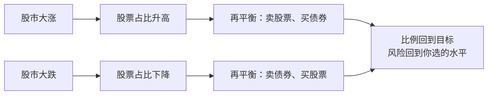
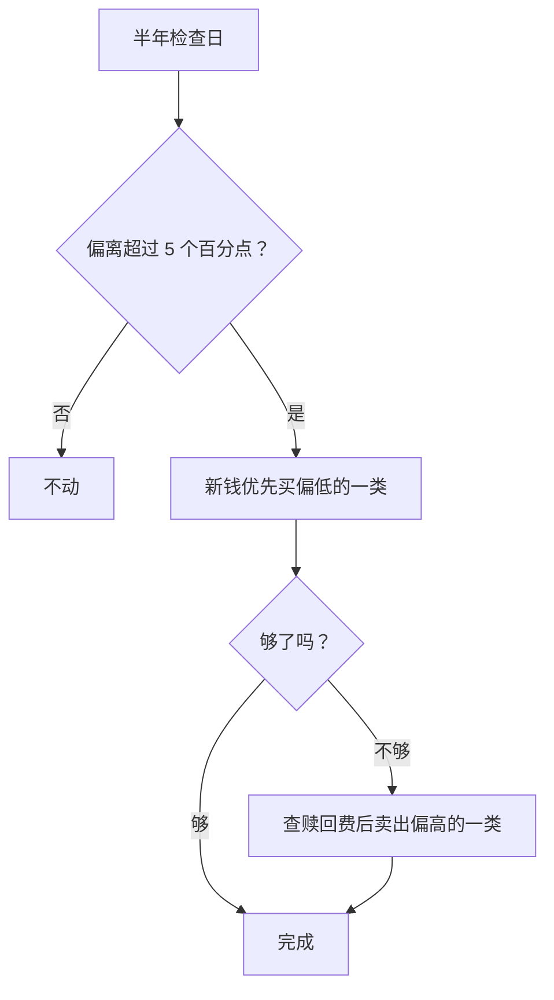

# 第 13 章 再平衡与投资纪律

> **本章导读**
>
> - 建议用时：45 分钟（含动手 15 分钟）
> - 前置知识：第 10 章（赎回费）、第 12 章（目标比例、分桶）
> - 读完你能回答：
>   1. 比例为什么会「跑偏」？跑偏了有什么问题？
>   2. 再平衡是什么？它能提高收益吗？
>   3. 按时间、按阈值、用新钱，三种再平衡怎么选？
>   4. 投资纪律怎么落到纸面上？
>   5. 小林那个 100% 股票的长期桶，怎么调回 40%？

---

## 【积木 13-1】比例会自己跑偏

第 12 章，小林的长期桶定了股 40 / 债 60。假设一开始正好是 4 万股票、6 万债券。

一年后股票涨了 50%，债券涨了 3%：

| | 年初 | 年末 | 年末占比 |
|---|---|---|---|
| 股票 | 40,000 | 60,000 | 49.2% |
| 债券 | 60,000 | 61,800 | 50.8% |

**你什么都没做，股票比例就从 40% 变成了约 49%**。如果股市继续涨，它会一路升到 60%、70%。

这有什么问题？第 12 章的表告诉你：股票占比越高，回撤越深。你按「能承受的回撤」选了 40%，现在实际风险却是 50% 甚至更高的水平。**涨的时候风险在悄悄变大，等到下跌时，你承受的是自己没有选过的风险。**

---

## 【积木 13-2】再平衡：把比例拉回来

**再平衡**：定期或在偏离过大时，卖出占比过高的资产、买入占比过低的资产，把比例恢复到目标。

上面的例子里，再平衡就是卖出约 11,280 元股票、买入债券，回到 40/60。

注意这个动作的方向：**卖出的是涨多了的，买入的是涨少了或跌了的**。所以再平衡常被称作「自动的高抛低吸」，它靠规则执行，不需要你判断市场。



下跌时的再平衡最难：股票刚跌了 30%，规则却要你卖债券去买股票。这正是它有价值的地方，也是它最考验纪律的地方。

---

## 【积木 13-3】再平衡能提高收益吗？

用工具模拟股 40 / 债 60 持有 10 年，比较三种做法（假设参数与第 12 章相同，每种策略用同一组随机路径）：

```bash
python3 tools/rebalance.py sim --stock 40 --years 10 --band 5
```

```text
目标 股 40.0% / 债 60.0%，10 年，模拟 2000 次（每种策略用同一组随机路径）
  策略             平均终值     最差5%终值     平均最大回撤     期末股票占比       途中最高股票占比     平均操作次数
  不再平衡             1.71        1.05         17.8%         47.9%            55.8%          0.0
  每年再平衡            1.66        1.05         15.7%         40.0%            49.2%         10.0
  阈值±5             1.65        1.06         15.7%         40.2%            46.5%          6.8
```

坦白地说，结果是：

- **不再平衡的平均终值最高**。原因很简单：长期看股票收益更高，不再平衡就让股票比例一路往上漂（期末平均约 48%，途中最高平均约 56%），收益自然更高。
- **但它的回撤也更深**（17.8% vs 15.7%），因为你实际承担的已经不是 40% 股票的风险了。

所以，**再平衡的主要作用是控制风险，让组合一直保持在你选定的风险水平上，而不是提高收益**。在某些市场环境下（比如反复震荡），再平衡确实可能带来一点额外收益，但不要把它当成赚钱的手段。

如果你发现「不再平衡收益更高，我也能接受更深的回撤」，那说明你的目标比例定低了，应该回到第 12 章调高目标，而不是放任比例乱漂。

### 一个高频误解：「再平衡就是止盈」

止盈通常是「涨够了就卖掉，落袋为安」，卖掉之后钱去哪、什么时候再买，往往靠感觉。再平衡只是**按规则把比例调回去**：股票并没有全部卖掉，卖出的钱也有明确去处。一个靠判断，一个靠规则。

---

## 【积木 13-4】三种再平衡方式

| 方式 | 做法 | 优点 | 缺点 |
|---|---|---|---|
| 定期再平衡 | 每年或每半年固定日期调整 | 简单，不用盯 | 可能在偏离很小时也操作，增加成本 |
| 阈值再平衡 | 偏离目标超过某个幅度（如 5 个百分点）才调整 | 操作次数少（上表平均 6.8 次 vs 10 次） | 需要定期检查是否触发 |
| 用新钱再平衡 | 新增资金优先买入占比偏低的资产 | 不用卖出，不产生赎回费 | 偏离大、新钱少时，要很久才能调回来 |

推荐的组合做法：**定期检查 + 阈值触发 + 优先用新钱**。

1. 每半年固定一天检查比例（定期）；
2. 偏离超过 5 个百分点才动手（阈值）；
3. 动手时先让当月新钱只买偏低的那一类，不够再卖出偏高的（新钱优先）。

### 再平衡的成本

| 成本 | 说明 |
|---|---|
| 赎回费 | 场外基金持有时间短可能有赎回费，第 10 章讲过：多数基金持有不满 7 日至少 1.5%；指数基金和债券基金对个人持有满 7 日可另行约定 |
| 申购费 | 买入时的费用，第 10 章 |
| 场内交易费 | ETF 卖出无印花税，但有佣金（第 9 章） |

阈值不要设得太小（比如 1%），否则会频繁操作，把成本和精力都浪费掉。5 个百分点是一个常见的经验值。

---

## 【积木 13-5】投资纪律：写一份投资说明书

再平衡最大的敌人不是规则复杂，而是**到时候你不想执行**：股市大涨时舍不得卖，大跌时不敢买。

机构投资者用一份叫**投资政策说明书**（Investment Policy Statement，IPS）的文件来约束自己。个人也可以写一份简化版，一页纸就够，回答六个问题：

1. 我的目标是什么？每个目标的期限多长？
2. 每个桶的目标比例是多少？
3. 我用哪些工具？不用哪些？
4. 每月怎么投？
5. 什么时候检查、偏离多少再平衡、怎么执行？
6. 什么情况下可以修改这份说明书？什么情况下不能？

第 6 条最关键：**「市场涨得好 / 跌得惨」不是修改理由**。人生阶段变化、目标变化才是。

### 一个高频误解：「规则太死板，市场变了就该灵活调整」

灵活调整听起来很合理，但实际上，大多数「灵活调整」发生在两个时刻：大涨后想加仓，大跌后想清仓。这恰好是最容易出错的时刻。规则的价值就在于**把决策放在冷静的时候做，执行放在情绪激动的时候做**。第 14 章会解释为什么人在那些时刻特别容易犯错。

---

## 【积木 13-6】小林的长期桶：怎么从 100% 调回 40%

第 12 章留下的问题：长期桶只有 10,500 元，全部是股票，目标 40%。

```bash
python3 tools/rebalance.py plan --stock-value 10500 --bond-value 0 --target 40 --monthly 500
```

```text
当前：股 10,500 / 债 0，股票占比 100.0%，目标 40%
  方案 A 卖出调整：卖出股票 6,300，买入债券，立即达到目标
  方案 B 只用新钱：每月 500 全部买债，需要再投入债券 15,750，约 31.5 个月
```

（计算假设期间价格不变。）

方案 B 要两年半以上，而且长期桶的每月投入要等应急金存满（约 6.8 个月后）才开始，实际会更久。这么长时间里，这笔钱一直承担着远超他承受力的风险。所以小林选择**方案 A**。

执行前他做了两件事：

1. **查赎回费**。他是在第 11 章刚把钱转进这只指数基金的。查基金合同后确认，个人持有满 7 日后的赎回费很低，于是等满 7 天再操作，避开了至少 1.5% 的短期赎回费。
2. **复盘**。第 11 章他把 10,500 元一次性全部买成了股票基金，第 12 章才定比例，顺序反了，这正是第 12 章积木 12-1 说的「先挑产品，后定比例」。好在金额不大，发现得也早。

调整后：长期桶股票 4,200 元、债券 6,300 元。之后按投资说明书的规则管理。

他把这些规则写成了一页纸：[cases/xiaolin/investment-policy.md](../cases/xiaolin/investment-policy.md)，贴在了手机备忘录的第一条。

---

## 【积木 13-7】动手

1. 按积木 13-5 的六个问题，给自己写一份一页纸的投资说明书（可以直接复制小林的那份改）。
2. 统计每个桶现在的实际比例，用工具算一下要调回目标需要多少钱、多久：

```bash
python3 tools/rebalance.py plan --stock-value 你的股票类金额 --bond-value 你的债券类金额 --target 目标股票比例 --monthly 每月新增
```

3. 在日历里设两个提醒：每年 6 月和 12 月的某个周末，标题写「再平衡检查，先读投资说明书」。
4. 用不同的目标比例和阈值跑一次模拟，看看操作次数和回撤的变化：

```bash
python3 tools/rebalance.py sim --stock 60 --band 10
```

---

## 【本章小结】

三句话：

1. **比例会随涨跌自己跑偏**，涨得越多，你实际承担的风险越超出原计划；再平衡把比例拉回目标，是靠规则执行的高抛低吸。
2. **再平衡主要控制风险，不保证提高收益**；推荐定期检查 + 阈值触发（如 5 个百分点）+ 新钱优先，注意赎回费。
3. **把规则写成一页纸的投资说明书**，决策在冷静时做，执行在激动时做；市场涨跌不是修改理由。



### 自测题

1. 股 40 / 债 60 的组合，股票一年涨 50%、债券涨 3%，年末股票占比大约是多少？（积木 13-1）
2. 为什么说比例跑偏会让你「承受自己没有选过的风险」？（积木 13-1）
3. 再平衡在股市大跌后要求你做什么？为什么这最难？（积木 13-2）
4. 根据模拟，不再平衡的平均终值更高，为什么还要再平衡？（积木 13-3）
5. 再平衡和止盈的区别是什么？（积木 13-3）
6. 阈值为什么不宜设得太小？（积木 13-4）
7. 投资说明书里，哪些情况可以修改规则？哪些不行？（积木 13-5）
8. 小林为什么选择卖出调整而不是只用新钱？执行前为什么要等满 7 天？（积木 13-6）

---

## 【下一章预告】

规则写好了，但小林心里没底：「真到大跌的时候，我会不会照样慌了全卖掉？」第 14 章讲**投资心理学**：

- 为什么亏 1 万的痛苦，远大于赚 1 万的快乐？
- 「回本再卖」为什么是一个坑？（终于可以把第 6、10 章埋下的「沉没成本」讲透）
- 追涨杀跌、过度自信、从众，这些偏差是怎么让人亏钱的？
- 有哪些具体的办法，能让你在情绪最激动的时候不做蠢事？

*学完本章，回到对话里说一句「继续」，我就开讲第 14 章。*
