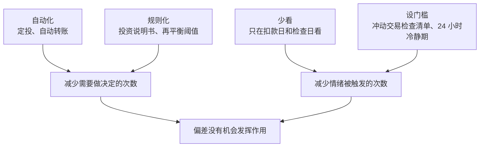
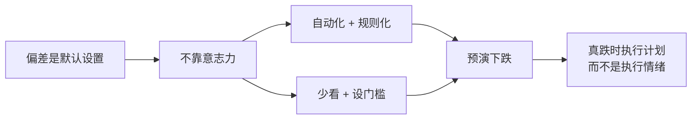

# 第 14 章 投资心理学：你最大的敌人是自己

> **本章导读**
>
> - 建议用时：45 分钟（含动手 10 分钟）
> - 前置知识：第 10 章（明星基金为什么让人亏钱）、第 13 章（投资说明书）
> - 读完你能回答：
>   1. 为什么「基金赚钱，基民不赚钱」？差距有多大？
>   2. 为什么亏 1 万的痛苦远大于赚 1 万的快乐？
>   3. 「回本再卖」为什么是一个坑？
>   4. 追涨、从众、过度自信等偏差，是怎么让人亏钱的？
>   5. 有哪些具体办法，能让你在情绪最激动时不做蠢事？

---

## 【积木 14-1】基金赚钱，基民不赚钱：有数据了

第 10 章说过，大多数人在基金业绩最好的时候买入。现在有了更直接的证据。

**晨星（中国）的研究**：2025 年 5 月 22 日，晨星基金研究中心发布《中国公募基金投资者回报差研究报告》，比较「基金本身的回报」和「考虑了资金进出时点的投资者回报」。截至 2024 年末的五年期年化数据：

| 基金类型 | 投资者回报差（年化） |
|---|---|
| 偏股型积极配置 | -2.17% |
| 主动股票（非行业） | -2.65% |
| 行业基金 | -3.59% |
| 偏债型保守混合 | -0.86% |
| 固收型 | -0.62% |

其中医药类行业基金的投资者回报差达到约 -7% 每年。来源：新华财经 2025-05-22 报道（非一手来源，需核实报告原文）。

**规律很清楚：波动越大、越热门的产品，投资者自己「亏掉」的部分越多**。

**新的披露指标**：从 2026 年基金半年报开始，成立满一年的主动股票型和混合型基金要披露「**盈利投资者数量占比**」，即过去一年里赚了钱的持有人占多少。首批数据中，有一只基金一年净值增长 68.57%，盈利投资者占比却只有 15.51%：基金涨了近七成，八成多的持有人是亏的。来源：《证券日报》，央视网 2026-08-29 转载。

基金本身没有问题，问题出在投资者买卖的时机。这一章讲的就是：**为什么人会系统性地在错误的时候买卖**。

---

## 【积木 14-2】模拟：同一只基金，两种投资者

用工具模拟一只假想基金：净值先从 1.0 加速涨到 1.8，再跌回 1.0，最后涨到 1.5。两位投资者都从第一个月开始每月投 1,000 元：

- **纪律型**：每月固定投，从不卖。
- **追涨杀跌型**：近 3 个月涨幅超过 15% 就额外多投 3,000；浮亏超过 15% 就全部卖出，等再次大涨才敢回来。

```bash
python3 tools/behavior_gap.py
```

```text
基金净值 1.00 → 最高 1.80 → 最低 1.00 → 期末 1.50；买入并持有的年化收益 10.7%
  投资者          累计投入       期末资产(含已卖出)     资金加权年化
  纪律型          48,000             59,004        +10.3%
  追涨杀跌型        37,000             30,531        -15.9%
      第 28 月 净值 1.13 浮亏 17%，全部卖出 30,531
```

（价格路径是人为构造的形状，不是任何真实基金。）

同一只基金，期末净值比起点高 50%：

- 纪律型投资者年化约 10.3%，接近基金本身。
- 追涨杀跌型投资者**亏了约 6,500 元**。他在涨得最猛时加大了投入，成本被抬得很高；在接近底部时受不了割肉离场；之后的反弹没有达到他「再次大涨」的标准，他一直没敢回来。

这不是夸张的漫画，而是积木 14-1 那组真实数据背后的典型过程。

---

## 【积木 14-3】损失厌恶：亏 1 万比赚 1 万的感受强得多

心理学家 Daniel Kahneman 和 Amos Tversky 在 1979 年提出了**前景理论**（Prospect Theory，发表于《Econometrica》），Kahneman 因相关研究获得 2002 年诺贝尔经济学奖。其中最著名的发现是**损失厌恶**：

> 同样金额的损失带来的痛苦，比同样金额的收益带来的快乐大得多。

Tversky 和 Kahneman 1992 年的研究估计，这个倍数大约是 2 倍多（他们估计的损失厌恶系数约为 2.25）。

在投资里，损失厌恶会导致：

| 表现 | 后果 |
|---|---|
| 不敢看亏损的账户 | 小林那只基金亏 30%，他「不敢看」，问题拖着不处理 |
| 下跌时恐慌卖出 | 只想让痛苦停下来，于是在低点割肉 |
| 过度保守 | 因为怕亏，长期钱也全放存款，被通胀慢慢侵蚀（第 1 章） |

### 看得越勤，越痛苦

股票类资产短期内涨跌各半是常态。如果你每天看账户，就会频繁看到「亏了」，而每次亏损的痛苦都是赚钱快乐的两倍多。**查看频率越高，你主观感受到的风险就越大**，越容易做出冲动决定。这也是第 13 章投资说明书里写「只在扣款日和检查日看」的原因。

---

## 【积木 14-4】沉没成本与「回本再卖」

第 6 章和第 10 章都埋了一个问题：小林那只基金亏了 30%，他的第一反应是「等回本再卖」。

**沉没成本**：已经发生、无论怎么做都收不回来的成本。理性的决策只应该看未来，不应该被沉没成本影响。

「回本再卖」的问题在于：**市场根本不知道你的买入价**。你的成本价是 1.5 元还是 1.0 元，对这只基金明天涨还是跌没有任何影响。用自己的成本价来决定卖不卖，等于把决策交给了一个和未来毫无关系的数字。

和它相关的是**处置效应**（Shefrin 和 Statman 1985 年提出）：投资者倾向于**过早卖出赚钱的资产、过久持有亏钱的资产**。赚了就想「落袋为安」，亏了就想「再等等」。结果是好的拿不住、差的砍不掉。

### 判断该不该卖，只问一个问题

第 10 章已经用过：

> **如果今天手里是同样金额的现金，我还会买它吗？**

会，就继续持有（不管亏没亏）；不会，就卖掉换成你会买的东西（不管亏没亏）。这个问题把成本价从决策里拿掉了。

### 一个高频误解：「不卖就不算亏」

第 2 章讲过：资产负债表按市价记账，浮亏已经是真实的损失。「不卖」并没有让亏损消失，只是让你暂时不用面对它，同时也让这笔钱继续承担着你可能并不想承担的风险。

---

## 【积木 14-5】其他常见偏差

| 偏差 | 表现 | 小林踩过吗 |
|---|---|---|
| 从众 | 同事都在买、群里都在讨论，于是跟着买 | 是：跟同事买了明星基金 |
| 近因效应 | 把最近的表现当成未来的样子：涨了一年就以为会一直涨 | 是：看近一年排名买入 |
| 过度自信 | 高估自己判断市场的能力，于是频繁交易 | 是：一年操作二十多次（第 9 章） |
| 锚定 | 被某个无关的数字绑住，比如买入价、历史最高价 | 是：「等回到 1.5 元」 |
| 心理账户 | 把钱分成不同性质区别对待：年终奖「随便花」、炒股赚的钱「随便亏」 | 部分：觉得「这是闲钱，亏了也无所谓」 |
| 鸵鸟效应 | 坏消息出现时选择不看 | 是：亏了不敢打开 App |

关于过度自信，Barber 和 Odean 2000 年发表在《Journal of Finance》的研究《Trading Is Hazardous to Your Wealth》，分析了美国一家券商 6 万多个家庭账户，发现交易最频繁的那一组，扣除成本后的收益明显低于交易少的家庭和市场整体。**交易越多，往往赚得越少。**

### 一个高频误解：「知道了这些偏差，就不会再犯」

不会。这些偏差是人脑的默认设置，研究它们的心理学家自己也会犯。知道它们的价值不在于「从此免疫」，而在于**提前设计好环境和规则，让偏差没有机会发挥作用**。下一节讲怎么做。

---

## 【积木 14-6】对抗偏差：靠设计，不靠意志



具体做法：

1. **自动化**：定投、发薪日转账全部设成自动的，不需要每个月重新下决心（第 3、11 章）。
2. **规则化**：比例、再平衡、什么情况可以改规则，都写在投资说明书里（第 13 章）。
3. **少看**：删掉手机桌面上的基金 App 图标，关掉涨跌推送通知。
4. **设门槛**：任何**计划外**的买卖，先等 24 小时，再过一遍检查清单：

| 冲动交易检查清单 | |
|---|---|
| 1. 这笔交易在投资说明书里吗？ | 不在，就停 |
| 2. 我为什么想做？是因为最近涨了 / 跌了 / 有人推荐吗？ | 是，就停 |
| 3. 如果今天是现金，我还会买它吗？ | 用来判断卖出 |
| 4. 如果做错了，最坏会亏多少？我能接受吗？ | 不能，就停 |
| 5. 我能用一句话向朋友解释这笔交易的理由吗？ | 不能，就停 |

5. **预演下跌**：提前想好「如果股票类资产跌 30%，我做什么」，并写下来。真跌的时候，执行的是冷静时写下的计划，而不是当时的情绪。

---

## 【积木 14-7】小林的复盘与预演

小林把自己过去一年的操作对照积木 14-5 复盘了一遍，几乎每一条都踩过。他做了三件事：

**1. 删 App、关通知。** 基金 App 和券商 App 都移到手机的第二屏文件夹里，关闭所有涨跌推送。

**2. 把检查清单加进投资说明书。** 在 [cases/xiaolin/investment-policy.md](../cases/xiaolin/investment-policy.md) 里新增「冲动交易检查清单」和 24 小时冷静期。

**3. 写下跌预演。** 以长期桶为例（第 13 章调整后：股票 4,200、债券 6,300）：

| 情景 | 长期桶会怎样 | 我要做什么 |
|---|---|---|
| 股票类跌 30% | 股票约 2,940，桶内股票占比约 32%，偏离目标 8 个百分点 | 到检查日触发再平衡：新钱优先买股票，不够再卖一部分债券补股票 |
| 股票类跌 50% | 股票约 2,100，占比约 25% | 同上；同时提醒自己：首付桶和应急金不受影响 |
| 我很想全部卖掉 | | 先读投资说明书，等 24 小时，过检查清单 |

（跌幅是假设情景，用来预演，不是预测。）

预演完他发现，一个桶里 40% 股票跌 30%，整个桶只跌约 12%，和「10 万变 7 万」的恐惧相比小得多。**分桶和配置，本身就是对抗恐慌的工具。**

---

## 【积木 14-8】动手

1. 用你的真实交易记录复盘：过去一年你在什么时候买、什么时候卖？对照积木 14-5，你踩过哪几个？
2. 跑一次模拟，换不同的「清仓线」看看结果：

```bash
python3 tools/behavior_gap.py --stop 10 --chase 20
```

3. 去看你持有的主动基金最新半年报或年报，找「盈利投资者数量占比」和「加权平均净值利润率」，和净值增长率对比。
4. 写下你的跌 30% 预演，加进自己的投资说明书。
5. 关掉基金和券商 App 的涨跌推送。

---

## 【本章小结】

三句话：

1. **基金赚钱、基民不赚钱是有数据的**：越热门、波动越大的产品，投资者因追涨杀跌损失得越多；2026 年起基金定期报告开始披露盈利投资者占比。
2. **损失厌恶、沉没成本、处置效应、从众、近因、过度自信**是人脑的默认设置；判断卖不卖只问「今天是现金还买不买」，不看成本价。
3. **对抗偏差靠设计不靠意志**：自动化、规则化、少看、设门槛、提前预演下跌。



### 自测题

1. 晨星的研究显示，哪类基金的投资者回报差最大？为什么？（积木 14-1）
2. 一只基金一年涨了近七成，为什么大多数持有人却亏钱？（积木 14-1、14-2）
3. 损失厌恶是什么？为什么查看账户越频繁越容易做错决定？（积木 14-3）
4. 为什么说「回本再卖」是把决策交给了一个和未来无关的数字？（积木 14-4）
5. 处置效应的表现是什么？（积木 14-4）
6. 「跟同事一起买」「看近一年排名买」分别对应哪种偏差？（积木 14-5）
7. 知道了这些偏差，为什么还是会犯？应该怎么应对？（积木 14-5、14-6）
8. 小林的长期桶股票类跌 30%，整个桶大约跌多少？这说明了什么？（积木 14-7）

---

## 【下一章预告】

管好了心态，接下来管一个常被忽视、却每年都在发生的东西：**税和账户**。第 15 章讲：

- 个人所得税怎么算？专项附加扣除你都申报了吗？
- 住房公积金除了买房还能怎么用？
- 个人养老金账户值不值得开？每年能省多少税？
- 不同投资品的税费有什么区别？

*学完本章，回到对话里说一句「继续」，我就开讲第 15 章。*
