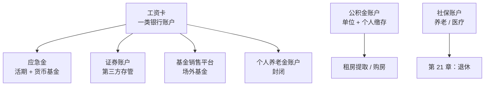

# 第 15 章 税费与账户：个税、公积金、个人养老金、交易成本

> **本章导读**
>
> - 建议用时：50 分钟（含动手 20 分钟）
> - 前置知识：第 2 章（受限资产）、第 9、10 章（交易费用）
> - 读完你能回答：
>   1. 个人所得税是怎么算出来的？为什么同样的工资，有人每年多退几千？
>   2. 专项附加扣除有哪几项？各多少？
>   3. 年终奖为什么有「多发 1 元，少拿 2,000 多」的情况？
>   4. 住房公积金除了买房，还能怎么用？
>   5. 个人养老金账户值不值得开？对谁值得？
>   6. 存款、基金、股票、债券的收益，分别要不要交税？

---

## 【积木 15-1】税是确定的成本，省税是确定的收益

投资收益不确定，但税是确定的。合法地少交 1,000 元税，等于确定地多赚 1,000 元。所以第 1 章把「税务规划」列为理财的五件事之一。

本章所有政策数字都是**2026 年 10 月检索到的现行规定**，税收政策会调整，每年申报前请以「个人所得税」App 和国家税务总局的最新说明为准。

---

## 【积木 15-2】个人所得税：一条公式

工资薪金、劳务报酬、稿酬、特许权使用费合称**综合所得**，按年计税：

```text
应纳税所得额 = 年收入 − 60,000（基本减除费用）− 专项扣除 − 专项附加扣除 − 其他扣除
个税 = 应纳税所得额 × 税率 − 速算扣除数
```

| 年应纳税所得额 | 税率 | 速算扣除数 |
|---|---|---|
| 不超过 36,000 | 3% | 0 |
| 36,000 到 144,000 | 10% | 2,520 |
| 144,000 到 300,000 | 20% | 16,920 |
| 300,000 到 420,000 | 25% | 31,920 |
| 420,000 到 660,000 | 30% | 52,920 |
| 660,000 到 960,000 | 35% | 85,920 |
| 超过 960,000 | 45% | 181,920 |

几个名词：

- **专项扣除**：个人缴纳的基本养老保险、基本医疗保险、失业保险和住房公积金，俗称「三险一金」个人部分。
- **专项附加扣除**：国家规定的七项，下一节讲。
- **其他扣除**：如个人养老金、符合条件的商业健康险等。

**累进税率是超额累进**，不是「收入一过线，全部收入都按高税率交」。只有超出的那部分适用更高税率，所以「涨薪反而到手变少」在工资部分不会发生（年终奖单独计税是例外，见积木 15-4）。

每月发工资时单位先按累计方式**预扣预缴**，次年 3 月 1 日至 6 月 30 日做**年度汇算**，多退少补。

---

## 【积木 15-3】专项附加扣除：最容易漏掉的钱

| 项目 | 标准 | 要点 |
|---|---|---|
| 3 岁以下婴幼儿照护 | 每孩每月 2,000 元 | 父母一方全额或双方各 50% |
| 子女教育 | 每孩每月 2,000 元 | 同上 |
| 赡养老人 | 每月 3,000 元 | 父母至少一方年满 60 岁；非独生子女分摊，每人每月不超过 1,500 元 |
| 住房贷款利息 | 每月 1,000 元 | 首套房贷；与住房租金二选一 |
| 住房租金 | 每月 1,500 / 1,100 / 800 元 | 按工作城市规模分档；在工作城市无自有住房 |
| 继续教育 | 学历教育每月 400 元；职业资格取证当年 3,600 元 | 证书须在国家职业资格目录内 |
| 大病医疗 | 医保目录内个人自付累计超过 15,000 元的部分，最高 80,000 元 | 年度汇算时扣除 |

来源：国家税务总局通过央视新闻发布的 2026 年度专项附加扣除确认提示（2025-12-31）、人民网（2025-12-01）。

怎么申报：打开**「个人所得税」App**，首页「专项附加扣除填报」，选择年度后按提示填写。每年 12 月要确认下一年度的信息，已填且无变化的可以「一键带入」。**当年漏报的，可以在次年 3 到 6 月年度汇算时补上。**

---

## 【积木 15-4】年终奖：两种计税方式与「临界点」

**全年一次性奖金单独计税**的优惠政策延续至 **2027 年 12 月 31 日**（南方新闻网 2026 年个税汇算报道）。在此之前，年终奖可以二选一：

- **单独计税**：奖金 ÷ 12，用得数在**月度税率表**里找税率，再用整笔奖金 × 税率 − 速算扣除数。
- **并入综合所得**：和工资加在一起按年度税率表算。

哪个更省，取决于你的工资水平：

```bash
python3 tools/tax_calc.py --salary 15000 --insurance 3075 --special 4500 --bonus 30000
#   方式一 年终奖单独计税：合计个税 1,773.00
#   方式二 并入综合所得：  合计个税 3,390.00（最高税率 10%）
#   选单独计税更省 1,617.00

python3 tools/tax_calc.py --salary 8000 --insurance 1600 --special 1500 --bonus 30000
#   方式一 年终奖单独计税：合计个税 900.00
#   方式二 并入综合所得：  合计个税 864.00（最高税率 3%）
#   选并入综合所得更省 36.00
```

经验：**工资部分扣完还有不少应纳税所得额的，单独计税往往更省；工资本身很低或扣除很多的，并入可能更省**。年度汇算时，个税 App 一般会帮你比较，但最好自己确认一下。

### 单独计税的「临界点」

单独计税时，整笔奖金只用一个税率，不是超额累进。所以奖金 ÷ 12 刚跨过一档时，**整笔奖金**都按更高税率算：

```bash
python3 tools/tax_calc.py --bonus-edge
```

```text
  奖金   36,000.00  税   1,080.00  到手   34,920.00
  奖金   36,001.00  税   3,390.10  到手   32,610.90
  奖金   38,566.67  税   3,646.67  到手   34,920.00
  奖金  144,000.00  税  14,190.00  到手  129,810.00
  奖金  144,001.00  税  27,390.20  到手  116,610.80
  奖金  160,500.00  税  30,690.00  到手  129,810.00
```

奖金从 36,000 多发 1 元，到手少了 2,309 元；要发到约 38,567 元，到手才和 36,000 时一样。**36,000 到约 38,567、144,000 到 160,500 这些区间都是「多发不如少发」的区间**（后面几档也有）。如果你的奖金刚好落在这些区间，可以和单位沟通发放方式，或者选择并入综合所得计算一下。

---

## 【积木 15-5】住房公积金：被忽视的一大笔钱

第 2 章把公积金列为「受限资产」：它是你的钱，但不能随便取。

- **怎么来的**：单位和个人按相同比例缴存（各地比例一般在 5% 到 12% 之间），两份都进你的个人账户。所以公积金的一半是单位额外给你的钱。
- **常见用途**：购房、偿还房贷、**租房提取**、使用公积金贷款（利率通常低于商业贷款），部分城市还允许用于装修、大病等。
- **各地规则差别很大**：租房提取额度、提取频率、贷款额度都由当地公积金中心规定，去当地公积金官网或「手机公积金」小程序查。

对租房的年轻人来说，**租房提取**是最容易忽视的一项。很多城市允许按月或按季度提取用于付房租，把「受限资产」变成可用的现金流。第 21 章讲买房时，会算公积金贷款能省多少利息。

---

## 【积木 15-6】个人养老金：对谁值得？

**个人养老金**是国家支持、个人自愿参加的养老储蓄制度。根据财政部、税务总局公告 2024 年第 21 号，已在全国范围实施：

| 环节 | 规则 |
|---|---|
| 缴费 | 每年最多 12,000 元，在综合所得中据实扣除 |
| 投资 | 账户内可买储蓄存款、理财、商业养老保险、公募基金、国债等，收益暂不征税 |
| 领取 | 达到领取条件（一般为法定退休年龄）后领取，**单独按 3% 缴税** |
| 流动性 | 封闭管理，原则上不能提前支取 |

来源：国家税务总局广西壮族自治区税务局 12366 答复（2026-07-01）。

它的节税效果**完全取决于你的边际税率**：

```bash
python3 tools/tax_calc.py --salary 15000 --insurance 3075 --special 4500 --pension 12000
#   个人养老金当年少交个税 360.00；将来领取时按 3% 缴税 360.00；净节税约 0.00

python3 tools/tax_calc.py --salary 30000 --insurance 5000 --special 1500 --pension 12000
#   个人养老金当年少交个税 2,400.00；将来领取时按 3% 缴税 360.00；净节税约 2,040.00
```

| 你的边际税率 | 每存 12,000 元当年省 | 领取时交 3% | 净效果 |
|---|---|---|---|
| 3% | 360 | 360 | 基本没有节税，还锁定到退休 |
| 10% | 1,200 | 360 | 约 840 |
| 20% | 2,400 | 360 | 约 2,040 |
| 45% | 5,400 | 360 | 约 5,040 |

（简化计算，未计入投资收益与资金的时间价值。）

**结论**：边际税率 10% 及以上的人，个人养老金值得认真考虑；边际税率 3% 的人，节税几乎为零，而钱要锁几十年，**不值得为了节税去存**。如果你本来就要为养老做长期投资，而且不介意锁定，可以考虑；否则先不急。

### 一个高频误解：「个人养老金是稳赚的理财产品」

个人养老金是一个**账户**，不是一种产品。账户里买什么由你选：买存款就是存款的收益，买股票基金就有股票基金的波动。节税是确定的，投资收益不是。

---

## 【积木 15-7】投资收益的税费

| 投资 | 个人所得税（现行规定） | 其他主要费用 |
|---|---|---|
| 银行存款利息 | 暂免征收 | 无 |
| 国债利息 | 免征 | 无 |
| 企业债、公司债利息 | 按 20% 征收 | 无 |
| 公募基金：买卖价差、分红 | 个人投资者暂不征收 | 申购费、赎回费、管理费等（第 10 章） |
| A 股：买卖价差 | 个人转让上市公司股票暂免征收 | 卖出印花税 0.05%、佣金、过户费（第 9 章） |
| A 股：现金分红 | 持股超过 1 年免征；1 个月以上至 1 年 10%；1 个月以内 20% | 同上 |

（政策可能调整，以税务部门最新规定为准。）

对普通投资者来说，**税不是最大的成本，费用和频繁交易才是**。第 9、10 章算过：频繁交易的佣金和印花税、高费率基金的管理费，长期吃掉的远比税多。另外，A 股分红税「持有越久越少」，也是在鼓励长期持有。

---

## 【积木 15-8】你的账户地图

一个人的金融账户越来越多，最好画一张地图：



建议：

- 每个账户记下：开户机构、用途、对应第 12 章的哪个桶。
- **工资卡、应急金、投资账户分开**，避免日常消费不知不觉花掉投资的钱。
- 不用的账户和 App 及时清理，减少被盗刷和诈骗的入口（第 22 章）。

---

## 【积木 15-9】小林的税务体检

小林的情况（本章补充设定）：税前月薪 15,000 元，三险一金个人部分每月约 3,075 元，在省会城市租房，独生子女、父亲刚满 60 岁。他从来没填过专项附加扣除。（这组设定下，税后月收入约 1.14 万元，补填扣除后约 1.19 万元，与前面章节「约 1.2 万」的近似相符。）

```bash
python3 tools/tax_calc.py --salary 15000 --insurance 3075 --special 0
#   工资部分应纳税所得额 83,100，适用最高税率 10%
#   全年个税 5,790.00

python3 tools/tax_calc.py --salary 15000 --insurance 3075 --special 4500
#   工资部分应纳税所得额 29,100，适用最高税率 3%
#   全年个税 873.00
```

住房租金（省会城市）1,500 + 赡养老人 3,000 = 每月 4,500 元。**补填之后，每年个税从 5,790 元降到 873 元，多出约 4,900 元**，相当于他两个多月的储蓄。

他的行动：

| 事项 | 行动 |
|---|---|
| 专项附加扣除 | 在个税 App 填报住房租金和赡养老人；今年已预扣的部分，在明年 3 到 6 月年度汇算时退回 |
| 年终奖 | 发放后用工具比较两种计税方式 |
| 个人养老金 | 填报扣除后边际税率是 3%，节税几乎为零，**暂不开立**；收入上升到 10% 档以上再考虑 |
| 公积金 | 查询所在城市的租房提取政策，按规定提取用于付房租，提取的钱进入首付桶 |
| 账户地图 | 列出 6 个金融账户，注销了 2 个不再使用的理财 App |

多出来的约 4,900 元退税和公积金租房提取，**按投资说明书全部进入首付桶**，不进消费。

---

## 【积木 15-10】实操：一份可以照做的退税清单

以「税前月薪 15,000、在省会城市租房、非本地户籍、独生子女、父亲 60 岁、母亲 58 岁、父母均已退休」这个典型情况为例，逐项过一遍：

| 项目 | 能不能扣 | 每月金额 | 关键条件 |
|---|---|---|---|
| 住房租金 | 能 | 1,500 | 本人及配偶在**主要工作城市**范围内无自有住房；由签租赁合同的承租人扣除；留存租赁合同 5 年 |
| 赡养老人 | 能 | 3,000 | 父母中**任一位**年满 60 岁即可全额享受，母亲 58 岁不影响；独生子女按 3,000 全额，无需分摊协议 |
| 子女教育 / 婴幼儿照护 | 不适用 | — | 无子女 |
| 继续教育 | 看情况 | 400 或 3,600 | 在读学历教育每月 400（同一学历最长 48 个月）；取得《国家职业资格目录》内证书的当年扣 3,600 |
| 住房贷款利息 | 不适用 | 1,000 | 与住房租金二选一；在工作城市买了首套房后才适用 |
| 大病医疗 | 通常不适用 | 据实 | **只能扣本人、配偶、未成年子女的**，父母的不行（常见误区） |

来源：《个人所得税专项附加扣除暂行办法》（国税总局官网全文）、国家税务总局 12366 纳税服务平台问答（2026-10-23 检索）。

### 五个容易搞错的细节

1. **「非本地户籍」不影响扣除**。判断标准是「主要工作城市有没有自有住房」，和户籍无关。老家的房子不算，因为那不是主要工作城市。
2. **父母名下的房子，不算你的自有住房**。条文写的是「纳税人及配偶」有自有住房，所以即使父母在你工作的城市买了房、你住进去，只要产权不在你和配偶名下，仍可按租房扣（前提是你确实在付租金、签了合同）。
3. **母亲 58 岁不影响赡养老人扣除**。只要父母中有一位满 60 岁，独生子女就能按每月 3,000 全额扣。
4. **合租也能扣**。只要你和出租方签了规范的租赁合同，各自按标准扣除；但同住的夫妻，主要工作城市相同的只能一方扣。
5. **租金和房贷利息不能同时享受**。同一纳税年度里只能选一个。

### 操作路径与时间点


- **以前年度漏报的**，可以在次年 3 月 1 日至 6 月 30 日的年度汇算中补填，多退少补。更早年度能否更正申报，各地执行口径不同，建议打 12366 或问主管税务机关。
- **每年 12 月**要在 App 里确认下一年度的扣除信息，无变化可「一键带入」，忘记确认可能影响次年按月享受。
- **资料留存 5 年**：租赁合同、职业资格证书、医药票据等。税务与住建、公安、民政、医保等部门数据是互通的，**不要虚报**。

### 还能再省一点的两个地方

- **年终奖**：发放后一定要比较「单独计税」和「并入综合所得」。以上述工资结构为例，2 万元年终奖单独计税比并入省约 917 元。
- **个人养老金**：先算出自己的边际税率。填完扣除后只剩 3% 档的，存 12,000 元当年省 360 元、领取时再交 360 元，**净节税接近 0，不值得为节税去存**；收入进入 10% 档以上才明显划算。

## 【本章小结】

三句话：

1. **个税按年计算、超额累进**：基本减除 6 万，再减三险一金和七项专项附加扣除；漏报的专项附加扣除可以在年度汇算时补上，往往能退几千元。
2. **年终奖两种计税方式要比较**，单独计税存在「多发不如少发」的临界区间；个人养老金的价值取决于边际税率，3% 档几乎不节税。
3. **公积金可以租房提取**，别让它一直躺着；投资收益的税对普通人影响不大，费用和频繁交易才是大头。


### 自测题

1. 综合所得的个税公式是什么？基本减除费用每年多少？（积木 15-2）
2. 超额累进是什么意思？涨工资会不会让到手的工资变少？（积木 15-2）
3. 你在一个省会城市租房、父母都已超过 60 岁、有一个兄弟，你能扣哪些项目、每月多少？（积木 15-3）
4. 年终奖 36,001 元单独计税，为什么比 36,000 元到手少？（积木 15-4）
5. 住房公积金的钱从哪来？租房的人可以怎么用它？（积木 15-5）
6. 边际税率 3% 的人存 12,000 元个人养老金，净节税多少？为什么？（积木 15-6）
7. 个人投资者买卖公募基金赚的钱要交个税吗？A 股分红税和持有时间有什么关系？（积木 15-7）
8. 小林补填专项附加扣除后，每年少交多少个税？他为什么暂不开个人养老金？（积木 15-9）

---

## 【下一章预告】

小林的钱现在都在 A 股和国内债券里。万一 A 股长期表现不好呢？第 16 章讲**更多资产**：

- 黄金：它不产生现金流，为什么还能作为配置的一部分？
- REITs：普通人怎么间接「当房东」？
- 海外资产：QDII 基金是什么？额度、汇率、溢价有哪些坑？
- 这些资产要不要放进小林的组合？放多少？

*学完本章，回到对话里说一句「继续」，我就开讲第 16 章。*
