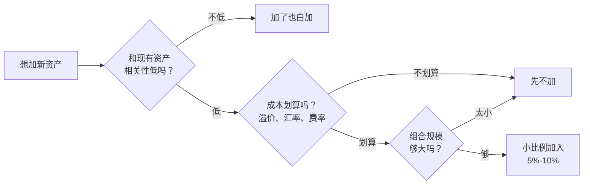

# 第 16 章 更多资产：黄金、REITs、海外资产

> **本章导读**
>
> - 建议用时：45 分钟
> - 前置知识：第 12 章（资产配置、相关性）
> - 读完你能回答：
>   1. 黄金不产生现金流，为什么还能作为配置的一部分？
>   2. 买黄金有哪几种方式？各自成本多少？
>   3. 公募 REITs 是什么？「分派率高」是不是就等于好？
>   4. QDII 基金是什么？为什么会出现「场内溢价」？
>   5. 这些资产该不该加进你的组合？加多少？

---

## 【积木 16-1】为什么要考虑更多资产

第 12 章讲过：分散的效果来自**低相关**。如果两个资产同涨同跌，放在一起也降不了风险。

小林现在的组合只有 A 股和国内债券。这两类资产都受同一个东西影响：**中国的经济和政策**。如果 A 股长期表现不好（比如像日本股市那样经历漫长的低迷期），他的长期桶会很吃力。

加入一些和 A 股相关性低的资产，理论上能改善这一点。但**加不加、加多少，取决于它能不能真的降低风险、以及成本划不划算**，不能因为「听起来高级」就加。

---

## 【积木 16-2】黄金：不生息，但能和股票不同步

黄金有个很特别的地方：**它不产生任何现金流**。不像股票有分红、债券有利息、房子有租金。你持有一块黄金，一百年后还是那块黄金。

那为什么它还能作为配置的一部分？

1. **它和股票、债券的走势常常不同步**。股市大跌、地缘冲突、货币信用受质疑时，资金会流向黄金。
2. **它是「另一种货币」**。当人们对纸币的购买力产生怀疑时，黄金是传统的价值储藏手段。
3. **它对抗的是「极端情况」**，不是日常的通胀。关于黄金长期能否跑赢通胀，研究结论并不一致。

**所以黄金的作用是「降低组合波动、应对极端情形」，不是「赚钱」。** 它的长期收益预期不应设得太高。

### 买黄金的几种方式

| 方式 | 是什么 | 成本与注意 |
|---|---|---|
| 实物金条、金币 | 直接持有实物 | 买卖有点差、有保管和变现成本，回购价通常低于买入价 |
| 银行积存金 | 银行记账式黄金，可定投、可提实物 | 关注买卖点差和手续费 |
| 黄金 ETF / 联接基金 | 跟踪金价的基金，证券账户或基金平台买 | 费率低、流动性好，**大多数人的首选** |
| 黄金首饰 | 消费品 | **不适合投资**：加工费高，回购折价大 |

### 一个高频误解：「买金饰既好看又能保值」

金饰的价格里包含加工费和品牌溢价，回购时按原料金价打折。它的保值功能远不如投资型金条或黄金 ETF。**金饰是消费，不是投资。**

---

## 【积木 16-3】公募 REITs：间接「当房东」

**REITs**（Real Estate Investment Trusts，不动产投资信托基金）把一栋能收租的资产（高速公路、产业园、仓储物流、购物中心、保障房等）打包成基金份额，在交易所上市交易。

中国的公募 REITs 从 2021 年开始试点，最初是基础设施类，2025 年末商业不动产 REITs 试点落地，2026 年 5 月首批商业不动产 REITs 上市。截至 2026 年 6 月底，已上市 82 只，发行规模约 2,243 亿元，总市值约 2,141 亿元。来源：戴德梁行《2025-2026 亚洲 REITs 研究报告》（2026-07-24 发布），属非一手来源，需核实原文。

### 它的核心特点：强制分红

按规定，公募 REITs 每年要将**不低于 90% 的可分配金额**分配给投资者。市场平均分派收益率约 5% 到 6%（戴德梁行报告：2026 年 3 月末全市场平均约 5.6%）。

### 分派率高，不等于收益高

这是最容易踩的坑。REITs 分两种，性质完全不同：

| 类型 | 底层资产 | 特点 |
|---|---|---|
| **产权类** | 产业园、仓储物流、消费基础设施、商业不动产 | 资产长期存在，理论上会增值，分派率较低（约 4% 到 6%） |
| **经营权类** | 高速公路、能源等有特许经营期的资产 | 特许经营权到期后**资产归零**，所以分派率高（有的年化可达 8% 到 12%） |

经营权类的高分派率，本质上是**在把本金一点点还给你**，类似债券的还本付息，不是「多出来的收益」。看到 10% 的分派率先别激动，先看清底层资产是什么、还剩多少年。

（数据来源：腾讯新闻《年分红最高超 10%，公募 REITs 的"黄金坑"来了吗》2026-07-12，非一手来源。）

### 怎么参与

- **场内**：证券账户像买股票一样买卖，需要判断价格，会面临折溢价。
- **场外**：部分产品有场外份额，也可以通过基金认购参与。
- **风险**：REITs 在二级市场会涨跌，2026 年 3 月末全市场市值较发行价平均涨约 3%，但分化明显（不动产权类平均涨约 15%，收费收益权类平均跌约 11%）。**它不是「稳赚的收租」**。

---

## 【积木 16-4】海外资产：QDII、港股通与汇率

投资海外市场有两个直接目的：**分散**（海外股市和 A 股相关性没那么高）和**参与**（比如全球科技巨头）。

### 主要渠道

| 渠道 | 说明 | 门槛 |
|---|---|---|
| QDII 基金 | 用人民币申购、由基金公司换汇投资海外 | 无特殊门槛，但受**外汇额度**限制 |
| 港股通 | 通过沪港通、深港通买港股 | 需证券账户并满足资产要求，以券商说明为准 |
| 跨境 ETF | 在 A 股上市的、跟踪海外指数的 ETF | 需证券账户 |

### 三个必须知道的坑

**1. 额度与限购**

QDII 基金有外汇额度。额度紧张时，基金公司会暂停申购或限制单日申购金额。你会看到「暂停大额申购」的公告，这是正常的额度管理，不是产品出问题。

**2. 场内溢价**

跨境 ETF 在交易所交易，价格由买卖双方决定，可能明显高于它的实际净值（溢价）。当额度受限、买的人多时，溢价会很高。

```bash
python3 tools/alt_asset.py premium --nav 1.20 --price 1.32
```

```text
净值 1.200，场内价 1.320，溢价 10.00%
  此刻买入，如果溢价回到 0，价格要跌 9.09%，等于白亏这么多
```

**溢价 10% 买入，意味着即使指数不涨不跌，只要溢价回落，你就亏 9%**。历史上跨境 ETF 出现过远高于 10% 的溢价。**买之前一定看溢价率，超过 3% 到 5% 就别追。**

**3. 汇率**

你买的是美元（或其他外币）资产。人民币升值时，海外资产换算成人民币会缩水；人民币贬值时则相反。汇率可能放大也可能抵消收益。

另外，QDII 基金的费率通常高于境内基金，还要承担海外市场的波动。

---

## 【积木 16-5】加进去，到底有没有用？

用工具模拟：在「股 40 / 债 60」的组合里，加入不同比例的黄金（假设长期收益 3%、波动 15%、与股票和债券相关性都只有 0.1）：

```bash
python3 tools/alt_asset.py mix --stock 40 --alt-mu 3 --alt-sigma 15 --stock-corr 0.1 --bond-corr 0.1
```

```text
  它的比例  股票比例   组合波动   平均最大回撤   平均年化   最差5%期末
        0%    40.0%       8.4%        15.9%      5.09%        1.02
        5%    38.0%       8.1%        14.9%      4.99%        1.03
       10%    36.0%       7.8%        14.0%      4.89%        1.05
       20%    32.0%       7.7%        12.0%      4.68%        1.08
       30%    28.0%       7.8%        10.1%      4.48%        1.12
```

（全部为假设参数，实际相关性会随时间变化。）

读法：

- 加入 10%，组合波动从 8.4% 降到 7.8%，平均最大回撤从 15.9% 降到 14.0%，**风险确实降低了**。
- 代价是平均年化从 5.09% 降到 4.89%，**收益也降低了**。
- 但**最差 5% 情形的期末值反而上升**（1.02 到 1.05）。这正是黄金的价值：糟糕的年景里它更抗跌。

再换一组参数：假设某资产与股票相关性 0.7（很高）：

```bash
python3 tools/alt_asset.py mix --stock 40 --alt-mu 7 --alt-sigma 18 --stock-corr 0.7 --bond-corr 0.3
#   10% 时组合波动 9.0%，比不加（8.4%）还高
```

**结论：分散的效果来自「低相关」，不来自资产的名字。** 一个和 A 股高度同步的「海外资产」，加了也白加。

---

## 【积木 16-6】小林的决定：暂时都不加

小林动心了几分钟，然后算了一笔账：

| 资产 | 他的判断 |
|---|---|
| 黄金 | 长期桶总共约 10,500 元，加 5% 只有 500 多元，一年波动带来的差别可能就几十元。**规模太小，加了没有意义，反而增加复杂度**。等长期桶到 5 万以上再说 |
| REITs | 分派率看起来很高，但经营权类「高分红」其实是还本；二级市场价格也会波动。**先观察一年，读几份年报再说** |
| 海外资产 | 有额度、溢价、汇率三个坑；他现在的资产规模还撑不起额外的复杂度。**等到长期桶有一定规模、且境内宽基已经执行到位之后，再考虑用一只低费率的全球宽基做 10% 左右的配置** |

他的原则写进了投资说明书：**先把简单的事做好（低费率宽基 + 债券 + 应急金 + 定投纪律），再考虑复杂化。** 复杂的工具不会让一个 1 万元的组合变成 10 万元，但会显著增加犯错的概率。

### 一个高频误解：「资产种类越多，越分散越安全」

分散的关键是**低相关**，不是数量。买 10 只跟踪同一个指数的基金，叫做分散了基金公司，不叫分散了风险。同理，加一堆相关性很高的资产，只会让组合更复杂、成本更高。

---

## 【积木 16-7】动手

1. 打开你的证券账户，搜索任意一只跨境 ETF，找到它的「溢价率」（IOPV 对比），记下当天的数值。
2. 挑一只公募 REITs，看它的招募说明书：底层资产是什么？属于产权类还是经营权类？剩余期限多少年？
3. 用工具模拟一下加入黄金对你组合的影响（把 `--stock` 改成你自己的股票比例）。
4. 在你的投资说明书里写一句：什么条件下我会考虑加入新资产类别？（小林写的是「长期桶超过 5 万元」）

---

## 【本章小结】

三句话：

1. **黄金不生息，作用是降波动、应对极端情形**，不是赚钱；用黄金 ETF 或联接基金参与，金饰不是投资。
2. **REITs 强制分红不低于 90%**，但经营权类的高分派率本质是还本；REITs 二级市场价格同样会波动。
3. **QDII 有额度、溢价、汇率三重坑**，溢价高时坚决不追；分散的价值来自低相关，不来自资产数量。



### 自测题

1. 黄金为什么不产生现金流，却仍可能降低组合波动？（积木 16-2）
2. 为什么黄金首饰不适合作为投资？（积木 16-2）
3. 公募 REITs 的强制分红比例是多少？（积木 16-3）
4. 经营权类 REITs 分派率很高，为什么不能等同于高收益？（积木 16-3）
5. QDII 基金的「场内溢价」是怎么形成的？溢价 10% 买入有什么风险？（积木 16-4）
6. 人民币升值时，你持有的海外资产换算成人民币会怎样？（积木 16-4）
7. 加入与股票相关性 0.7 的资产，能降低组合波动吗？（积木 16-5）
8. 小林为什么暂时都不加？他的原则是什么？（积木 16-6）

---

## 【下一章预告】

到这里，「把工具组合成体系」这一阶段结束了。下一章进入最后一个阶段，回到公司本身：第 17 章讲**读懂财报**。

- 利润表、资产负债表、现金流量表，各自回答什么问题？
- 为什么有的公司利润很高，账上却没有钱？
- 三个表之间怎么勾稽？用你熟悉的数据分析思维看财报，会顺畅得多。
- 有哪些一眼就能看出的财务危险信号？

*学完本章，回到对话里说一句「继续」，我就开讲第 17 章。*
