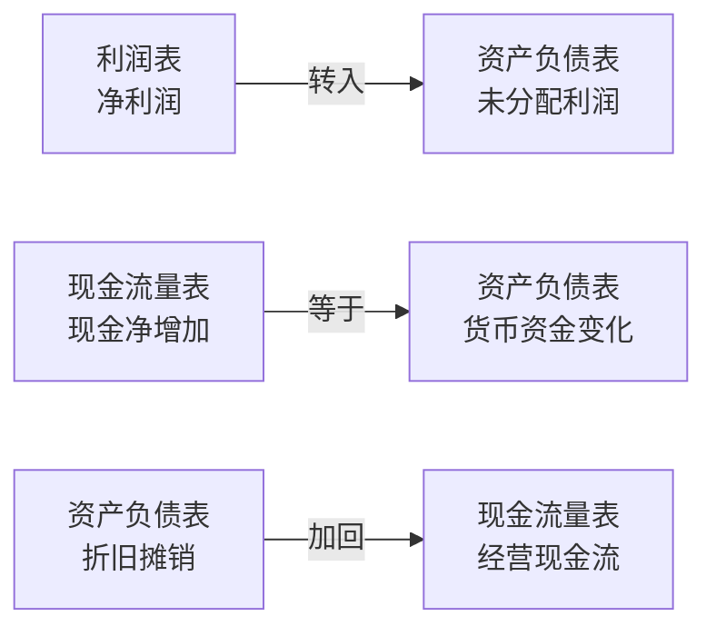
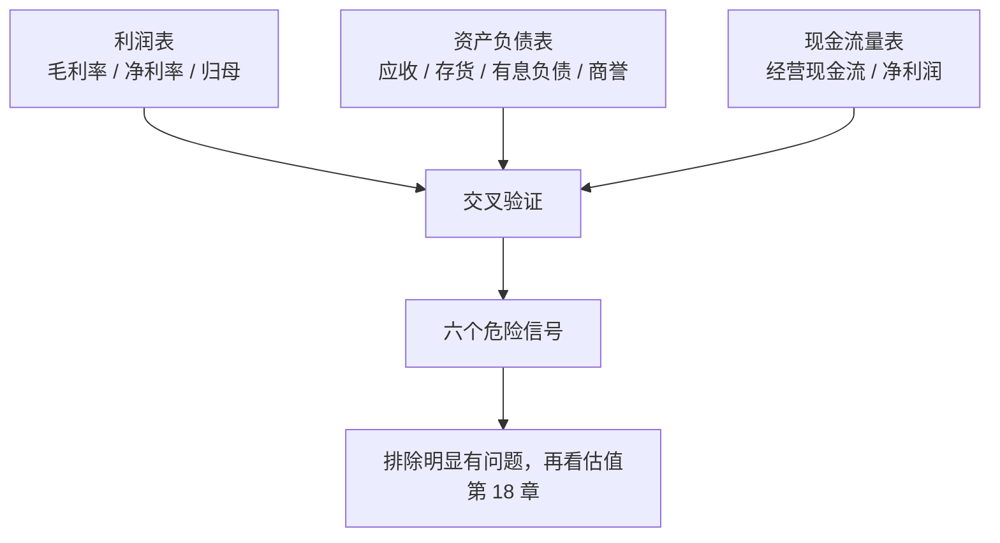

# 第 17 章 读懂财报：利润表、资产负债表、现金流量表

> **本章导读**
>
> - 建议用时：60 分钟（含动手 15 分钟）
> - 前置知识：第 2 章（你自己的两张表）、第 9 章（股价 = 盈利 × 估值）
> - 读完你能回答：
>   1. 三张报表各自回答什么问题？它们之间怎么勾稽？
>   2. 为什么有些公司利润很高，账上却没钱？
>   3. 毛利率、净利率、ROE 分别说明什么？
>   4. 有哪几个一眼就能看出的危险信号？
>   5. 不做研究个股的人，为什么也要懂一点财报？

---

## 【积木 17-1】第 2 章那两张表，放大到公司身上

第 2 章你给自己做过资产负债表和现金流量表。公司也一样，只是多了第三张：**利润表**。

| 报表 | 回答的问题 | 类比 | 你的版本 |
|---|---|---|---|
| 资产负债表 | 此刻有多少家当、欠多少 | 照片 | 第 2 章的表 |
| 利润表 | 这段时间赚了多少 | 一段录像的「成绩」 | 你的月结余（第 2 章） |
| 现金流量表 | 这段时间现金怎么进出 | 录像的「银行流水」 | 第 3 章的流水 |

公司的三张表也不是孤立的。核心勾稽只有几条：



**做数据分析的你应该很熟悉这种感觉**：一份报表内部对不上，就说明口径有问题，或者有人动了手脚。第 2 章你用小林的现金对账抓出了每月 3,000 元的漏洞，读财报用的是同一套思路。

---

## 【积木 17-2】利润表：一层层剥下来

利润表是从收入开始，一层层扣减，最后剩下净利润：

```text
营业收入
 − 营业成本            → 毛利（毛利率 = 毛利 ÷ 收入）
 − 销售费用、管理费用、研发费用、财务费用   → 营业利润
 + 营业外收支          → 利润总额
 − 所得税              → 净利润
 − 少数股东损益        → 归母净利润
```

几个关键指标：

| 指标 | 公式 | 看什么 |
|---|---|---|
| 毛利率 | 毛利 ÷ 营业收入 | 产品的定价能力和护城河。同行之间差异大 |
| 净利率 | 净利润 ÷ 营业收入 | 最终赚钱效率 |
| 期间费用率 | （销售+管理+研发+财务）÷ 收入 | 管理效率，是否靠烧钱换收入 |
| ROE | 净利润 ÷ 所有者权益 | 股东每投入 1 元，一年赚多少 |

### 三个必须注意的口径问题

1. **净利润 ≠ 归母净利润**。公司有子公司、且不是 100% 持股时，子公司利润里属于其他股东的部分叫「少数股东损益」，要从净利润里扣掉才是你的。**看上市公司，一律看归母净利润。**
2. **同比 vs 环比**。收入同比增长 20% 是好事，但如果环比在往下掉，可能意味着增长在减速。两个都要看。
3. **非经常性损益**。卖了一栋楼、拿到政府补助、处置了子公司，这些一次性收入会美化净利润，但明年不会再有。**看「扣非净利润」**，才是主营业务的真实盈利能力。

### 一个高频误解：「净利润年年增长，公司就一定好」

不一定。利润可以靠三种方式「做出来」：放宽信用把货赊出去（收入涨了，钱没收到）、把成本资本化（今年少计费用）、靠一次性收益。**利润是观点，现金是事实**，所以下一张表更重要。

---

## 【积木 17-3】资产负债表：家当与欠条

核心等式和你的个人报表一模一样：

```text
资产 = 负债 + 所有者权益
```

看公司时，重点看三个东西：

| 项目 | 看什么 |
|---|---|
| 货币资金 | 账上有多少钱，够不够还短期债务 |
| 应收账款 | 卖了货还没收到的钱。**增速持续高于收入增速，说明在靠赊账做收入** |
| 存货 | 卖不出去的货。**增速远超收入，说明可能滞销** |
| 有息负债 | 短期借款 + 长期借款 + 应付债券。要付利息的才叫压力 |
| 商誉 | 收购时多付的钱。**一旦被收购的公司业绩不达预期，就要计提减值，直接冲击利润** |

一个常用的安全指标：**资产负债率 = 总负债 ÷ 总资产**。不同行业差别很大（银行、地产天然高），要同行比。

---

## 【积木 17-4】现金流量表：利润到底有没有变成钱

现金流量表把现金进出分成三类：

| 类型 | 内容 | 关注点 |
|---|---|---|
| 经营活动 | 卖货收的钱、付给供应商和员工的钱 | **最重要**，正数且持续增长才健康 |
| 投资活动 | 买设备、买理财、收购 | 扩张期通常为负，正常 |
| 筹资活动 | 借款、还款、分红、增发 | 长期靠借钱维持经营是危险信号 |

**为什么利润高但没钱？** 三个常见原因：

1. **应收账款**：货卖了，钱还在客户那里（收入确认了，现金没到）。
2. **存货**：钱变成了堆在仓库里的货。
3. **资本开支**：赚的钱拿去买设备、建厂房了（这在扩张期是合理的）。

判断标准很简单，看一个比率：

```text
经营现金流 ÷ 净利润
```

长期大于 1，说明利润基本都能变成现金；长期明显小于 1，就要去查应收账款和存货。

---

## 【积木 17-5】用工具跑一份「财报体检」

`tools/financial_health.py` 用一组关键数字做规则式初筛。先看一个虚构的健康样本：

```bash
python3 tools/financial_health.py examples/financial-health-healthy.json
```

```text
甲（虚构·健康型） 财报体检

一、盈利能力
  毛利率        42.0%
  净利率        12.0%
  净资产收益率  16.0%
  收入增速      13.6%

二、利润的质量
  经营现金流 / 净利润  1.12
    正常

三、异常信号
  未触发常见异常规则
```

再看一个虚构的风险样本（收入增长很快，但处处异常）：

```bash
python3 tools/financial_health.py examples/financial-health-risky.json
```

```text
三、异常信号
  - 应收账款增速 180.0% 明显高于收入增速 42.9%（可能放宽信用换收入）
  - 存货增速 216.7% 远高于收入增速（可能滞销积压）
  - 资产负债率 78.7% 偏高（超过 70%）
  - 有息负债 70,000 高于货币资金 45,000（偿债压力）
  - 存贷双高：账上钱不少却大量借款，需要解释
  - 商誉占净资产 118.8%（超过 30%，减值风险）
  - 净利润为正但经营现金流为负（最需要警惕的组合）
```

（两家公司都是虚构的，数字用来演示规则。）

注意「乙」的 ROE 高达 28%，比「甲」的 16% 还高，收入增速 43% 也很漂亮。**如果只看这两个数字，它比「甲」更吸引人**。但它的利润没有变成现金、靠赊账和囤货做收入、靠大量借钱维持、商誉比净资产还多。这正是只看利润表最容易踩的坑。

---

## 【积木 17-6】六个危险信号

| 信号 | 为什么危险 |
|---|---|
| 净利润为正，经营现金流长期为负 | 利润是账面的，钱没进来 |
| 应收账款增速持续远高于收入增速 | 可能靠放宽信用甚至虚构交易做收入 |
| 存货增速远超收入增速 | 产品卖不动，未来要计提跌价 |
| 商誉占净资产比例过高 | 一次减值就能吃掉多年利润 |
| 存贷双高：账上现金多，却大量借高息债 | 现金可能是受限的，或者根本不存在 |
| 大股东高比例质押、频繁减持 | 内部人可能比你先跑 |

这些不是「一票否决」，而是**提示你去看细节**。财务造假的手法一直在进化，规则式筛查只能过滤掉最粗糙的那一类。

---

## 【积木 17-7】不做个股，为什么也要懂财报

你可能会问：本课一直建议新手买指数基金，那学财报干什么？

三个理由：

1. **判断你买的基金在说什么**。基金经理的季报、年报里会讲「我们重仓了高 ROE、现金流优秀的公司」。懂财报，你才能判断这句话是真的，还是话术。
2. **排雷**。行业指数基金、主动基金都可能重仓某几只暴雷股。看到「某基金重仓股财务造假、连续跌停」的新闻，你能判断这对你的基金影响多大。
3. **看懂经济新闻**。第 19 章讲宏观时会用到：企业盈利、库存周期这些概念，都建立在财报数据上。

对小林来说，结论很明确：**他不需要成为分析师，但需要具备「一眼看出不对劲」的能力**。这项能力的成本很低，收益是避开大坑。

---

## 【积木 17-8】用你熟悉的方法看财报

作为数据分析师，你有天然优势。把财报当成一份数据集：

| 数据分析的做法 | 用在财报上 |
|---|---|
| 先确认口径 | 归母还是合并？同比还是环比？扣非还是未扣非？ |
| 看趋势不看单点 | 至少拉 5 年，看毛利率、应收周转、经营现金流的走向 |
| 结构占比分析 | 应收账款占总资产多少？商誉占净资产多少？ |
| 异常检测 | 哪一年的数据明显偏离自身历史规律？那一年发生了什么？ |
| 横向对比 | 和同行比。毛利率比同行高很多，要么真有护城河，要么有问题 |
| 交叉验证 | 收入涨了，但员工数、用电量、运费没涨？这就不对劲 |

**财报分析的核心不是算得多复杂，而是交叉验证**：多个口径的数据必须能互相解释。第 2 章你给自己做的现金对账，本质就是这个。

---

## 【本章小结】

三句话：

1. **三张表各有分工且互相勾稽**：利润表看赚了多少，资产负债表看家当和欠条，现金流量表看钱有没有真的进来。
2. **利润是观点，现金是事实**；看归母净利润和扣非净利润，用「经营现金流 ÷ 净利润」检验利润质量。
3. **六个危险信号**（现金流为负、应收和存货异常、商誉过高、存贷双高、大股东质押减持）能过滤掉最粗糙的坑；核心方法是交叉验证。



### 自测题

1. 三张报表分别回答什么问题？利润表的净利润最终进了资产负债表的哪个科目？（积木 17-1）
2. 净利润和归母净利润有什么区别？为什么要看扣非净利润？（积木 17-2）
3. 一家公司毛利率 40%、净利率 5%，说明什么？（积木 17-2）
4. 为什么利润高但账上没钱？举三个原因。（积木 17-4）
5. 「经营现金流 ÷ 净利润」长期只有 0.3，你会去查什么？（积木 17-4）
6. 风险样本「乙」的 ROE 和收入增速都比健康样本高，为什么反而更危险？（积木 17-5）
7. 「存贷双高」为什么可疑？（积木 17-6）
8. 不做个股的人，为什么也要懂财报？（积木 17-7）

---

## 【下一章预告】

排完雷，下一个问题是：**这家公司值多少钱？** 第 18 章讲估值：

- 市盈率（PE）到底在说什么？为什么同一家公司在不同年份 PE 能差一倍？
- 市净率（PB）、股息率、PEG 分别适合什么公司？
- DCF（现金流折现）是什么？为什么它是理论最优、实操最难？
- 怎么判断现在的估值是贵还是便宜？

*学完本章，回到对话里说一句「继续」，我就开讲第 18 章。*
